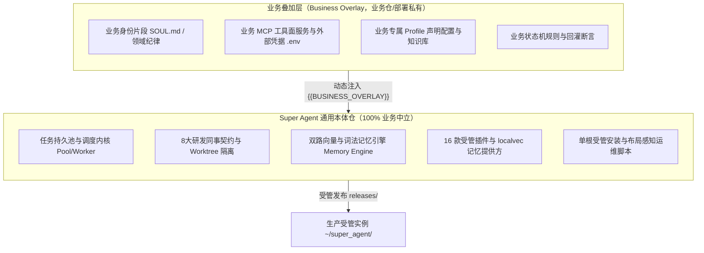
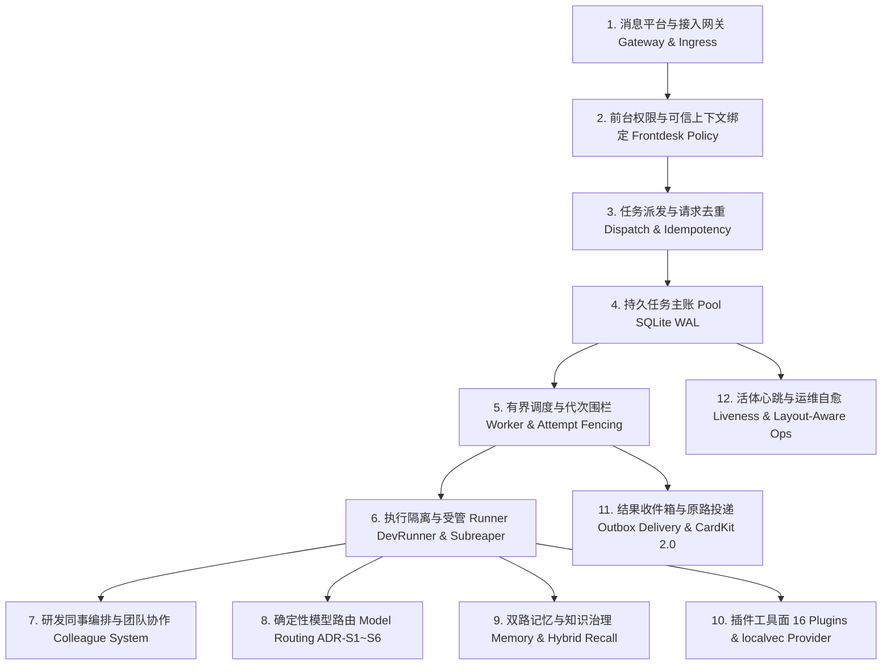

# Super Agent v2.0 架构全景深潜（System Architecture）

本文档为 Super Agent v2.0 的核心架构全景指南，阐述系统设计哲学、分层拓扑、持久运行时、多智能体协同机制、长期记忆工程与安全确定性保障。

---

## 1. 核心设计哲学与中立性定理

Super Agent 的根本定位是：**把一个具备企业级可靠性的常驻智能体拆分为可 Clone、可幂等安装的通用技术底座**。

### 1.1 知白守黑：通用底座与业务叠加层解耦



1. **零业务污染（Zero Business Pollution）**：
   - 仓级业务中立性棘轮门禁（`tests/test_repo_neutrality.py`）对所有纳入版本控制的文本实施机械式扫描，严禁企业私有领域词、私有平台名与内部网段泄漏进通用代码。
2. **声明式业务规格（BusinessProfileSpec）**：
   - 通用骨架通过 `BusinessProfileSpec` 声明目标角色、拓扑依赖与队列需求；所有业务特化内容通过 `{{BUSINESS_OVERLAY}}` 占位符在部署时合成生效。

---

## 2. 系统十二层逻辑分层



| 层级 | 核心模块 | 核心职责与确定性保障 |
| :--- | :--- | :--- |
| **1. 接入网关** | `patches/`、`runtime/` | 捕获平台会话标识、消息类型与上下文，注入可信主体属性。 |
| **2. 前台边界** | `runtime/hermes_frontdesk_policy.py` | 校验工具调用权限、拦截未授权写操作、阻断越界目录访问。 |
| **3. 派发去重** | `agentcore/pool.py:submit` | 基于业务请求键（Request Key）与契约哈希实现严格事务内去重。 |
| **4. 任务主账** | `agentcore/pool.py` | SQLite WAL 模式，记录任务状态、依赖链、Attempt 代次与租约。 |
| **5. 有界调度** | `agentcore/worker.py`、`scheduler.py` | 跨进程并发控制，`begin_execution` 代次硬校验，防旧 Worker 迟到覆写。 |
| **6. 执行隔离** | `agentcore/dev_runner.py`、`attempt_supervisor.py` | Linux Subreaper 递归收割后代进程，`fcntl.flock` 锁定工作区。 |
| **7. 同事协作** | `agentcore/colleague_dev.py` | 8 大标准研发同事角色契约，独立 Worktree 编码与验收断言。 |
| **8. 模型路由** | `agentcore/model_routing.py` | 纯函数三级路由（`pro`/`main`/`flash`），受 ADR-S1 ~ ADR-S6 强约束。 |
| **9. 长期记忆** | `agentcore/memory/`、`plugins/localvec/` | 代际分桶（`workspace_id`）、向量 + 词法混合召回、突触塑料账本。 |
| **10. 插件工具面** | `plugins/`（16 款 + localvec） | 标准化工具集暴露，两道启用门禁，自动级联装配同事工作区。 |
| **11. 证据投递** | `agentcore/completion_delivery.py`、CardKit | 绑定原始 Origin 原路回投，流式更新合并与屏障排空（`drain()`）。 |
| **12. 运维自愈** | `scripts/ops/_layout.sh`、`tools/superagent.py` | 布局感知对账、遗留配置平滑纠偏、`recall-diagnostics` 持续体检。 |

---

## 3. v2.0 单根受管拓扑（Single-Root Topology）

Super Agent 生产部署统一收敛至 `<managed_root>/<profile>`（默认 `~/super_agent/<profile>`），实现自包含与原子切换：

```
~/super_agent/<profile>/
├── current -> releases/20261108-025453-98354f0/   # 原子软链：指向当前生效发布
├── hermes-current -> /path/to/hermes/runtime      # 宿主运行时软链（安装器动态推断）
├── install-manifest.json                          # 安装元数据账本与完整性记录
├── releases/                                      # 不可变发布版本池
│   └── 20261108-025453-98354f0/
│       ├── agentcore/                             # 内核源码树
│       ├── identity/                              # 受管身份暂存（SOUL.generic.md, agents/）
│       ├── plugins/                               # 16 款受管插件源码与 localvec
│       ├── skills/                                # 通用技能库
│       ├── patches/                               # 平台补丁
│       ├── tools/                                 # 诊断与运维工具
│       └── release.json                           # 目录完整性与 SHA256 指纹
├── config/                                        # 实例私有配置目录
│   ├── config.yaml                                # 运行时总配置文件
│   └── colleagues.yaml                            # 同事角色拓扑定义
├── identity/                                      # 实例生效身份
│   ├── SOUL.generic.md                            # 暂存的通用骨架
│   └── SOUL.md                                    # 挂载业务叠加层后的最终生效身份
├── state/                                         # 持久化状态与数据库
│   ├── pool.db                                    # 持久任务池数据库（WAL 模式）
│   ├── liveness.db                                # 长任务活体心跳与状态账本
│   ├── recall-diagnostics/                        # 召回诊断报告目录
│   │   └── <profile>.json                         # 本实例与同事的召回观测账本
│   ├── markdown-outbox/                           # 文档直发待投递收件箱
│   └── colleague-team/                            # 同事名册登记库
└── workspaces/                                    # 隔离工作区
    ├── main/                                      # 主智能体工作区
    ├── analyst/                                   # 分析师同事工作区
    └── reviewer/                                  # 评审员同事工作区
```

---

## 4. 多智能体同事制与确定性调度

### 4.1 8 大官方研发岗位契约
`agentcore.colleague_dev` 严格定义了 8 大研发岗位角色职责与边界：
1. **需求架构师（Requirement Architect）**：需求澄清与规格文档化。
2. **用例开发大师（Case Developer）**：测试用例编写与正反例设计。
3. **红队评审员（Red Team Reviewer）**：挑刺、反模式防御与断言漏洞审查。
4. **仿真测试专家（Simulation Expert）**：回灌执行、时序对账与环境回溯。
5. **归因分析专家（Attribution Analyst）**：根因分析与机理级排查。
6. **后端开发工程师（Backend Developer）**：业务逻辑与服务实现。
7. **前端交互专家（Frontend Specialist）**：流式交互卡片与视图呈现。
8. **运维巡检哨兵（Ops Sentinel）**：常驻运行巡检、配置漂移纠偏与健康看护。

### 4.2 Git Worktree + fcntl.flock 写者隔离
每个研发同事在领单执行时，独占独立的 Git Worktree。DevRunner 在执行前对工作区根目录施加 `fcntl.flock(fcntl.LOCK_EX | fcntl.LOCK_NB)` 排他锁，**确保同一时刻单一写者**，杜绝并发覆写。

### 4.3 确定性模型路由与 ADR-S1 ~ ADR-S6 守卫
`agentcore.model_routing` 提供纯函数三级模型路由：
- `pro`：高阶推理档（仅限白名单角色，设有单任务上限配额）。
- `main`：日常主力工作档。
- `flash`：高并发轻量快筛档。
- **守卫底线**：严禁将长上下文压缩（`compression`）或关键记忆提炼（`memory`）降级至 `flash`；任何模型降级必须输出显式降级回执。

---

## 5. 长期记忆工程与召回诊断观测器

### 5.1 代际硬隔离与混合召回
- **`workspace_id` 代际分桶**：不同会话、项目或生命周期的事实严格分桶，物理阻断跨代事实串扰。
- **双路召回（Hybrid Recall）**：结合向量语义相似度（`localvec`）与词法倒排索引（BM25），通过倒数排名融合（RRF）合成最终召回列表。
- **突触塑料账本（Plasticity Feedback）**：依据任务终态（成功强化/失败抑制）动态微调事实权重。

### 5.2 召回诊断观测器（Recall Diagnostics Observation）
- 记忆提供方配置 `memory.localvec.diagnostic_path` 指向 `<managed_root>/state/recall-diagnostics/<profile>.json`。
- 观测器持续统计召回时延、Top-K 相似度分布、命中率及缓存有效性。
- `tools/superagent.py doctor` 自动化巡检各 Profile 的磁盘绑定（`disk_bindings`）与最新观测报告。

---

## 6. 宿主解释器推断与布局感知运维

1. **自动推断链（hermes_root Inference）**：
   受管安装器解析宿主环境时按确定性优先级推断：
   `显式参数` > `managed_root/hermes-current` > `install-manifest.json` > `默认回退`。
2. **多布局感知运维（Layout-Aware Ops）**：
   `scripts/ops/_layout.sh` 统一判定当前实例拓扑，使 `uninstall-legacy.sh` 与 `purge_and_rebuild_host.sh` 既能治理单根受管环境，也能纠偏单一写者环境中的 systemd 单元与 `PYTHONPATH` 漂移，所有历史修改前置备份至 `drift-backups/`。
