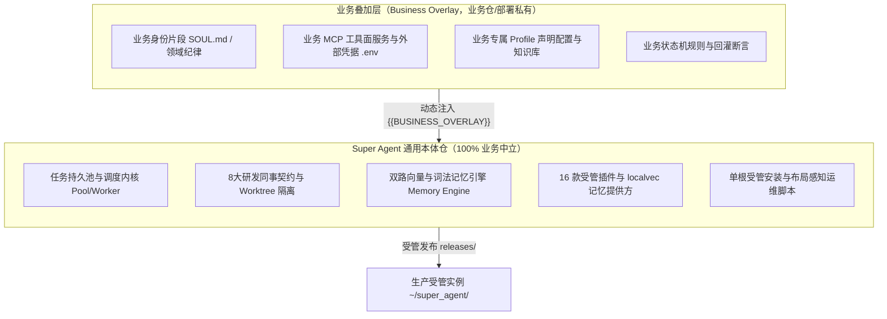
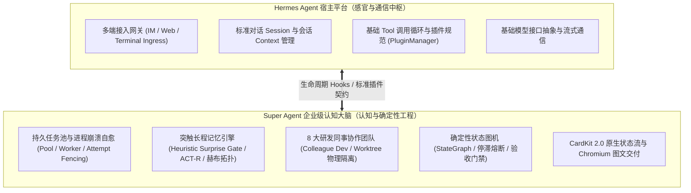
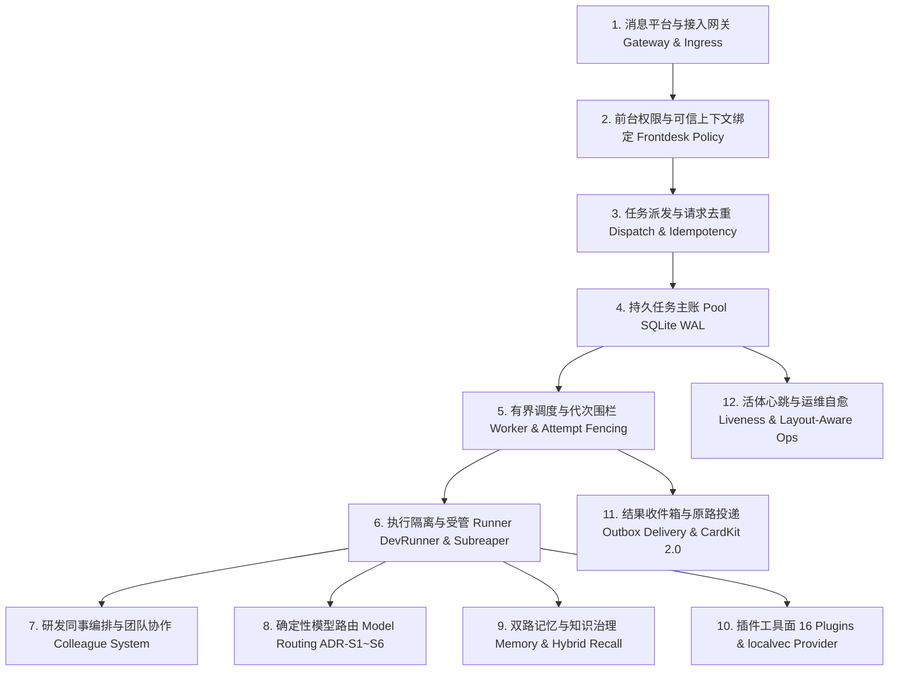

# Super Agent v2.0 架构全景深潜（System Architecture）

本文档为 Super Agent v2.0 的核心架构全景指南，阐述系统设计哲学、分层拓扑、持久运行时、多智能体协同机制、长期记忆工程与安全确定性保障。

---

## 1. 核心设计哲学与中立性定理

Super Agent 的根本定位是：**把一个具备企业级可靠性的常驻智能体拆分为可 Clone、可幂等安装的通用技术底座**。

### 1.1 知白守黑：通用底座与业务叠加层解耦

1. **零业务污染（Zero Business Pollution）**：
   - 仓级业务中立性棘轮门禁（`tests/test_repo_neutrality.py`）对所有纳入版本控制的文本实施机械式扫描，严禁企业私有领域词、私有平台名与内部网段泄漏进通用代码。
2. **声明式业务规格（BusinessProfileSpec）**：
   - 通用骨架通过 `BusinessProfileSpec` 声明目标角色、拓扑依赖与队列需求；所有业务特化内容通过 `{{BUSINESS_OVERLAY}}` 占位符在部署时合成生效。

### 1.2 宿主基石与协同共生：Hermes Agent 平台

Super Agent 深度依托并服务于 **Hermes Agent** 开源宿主平台，双方在职责上形成明确的分工与能力协同：

- **严守插件边界，绝不侵入修改宿主代码**：Super Agent 所有的增强能力均通过 Hermes 标准的插件机制（`plugins/`）、配置项（`config.yaml`）与钩子（`pre_llm_call`, `post_llm_call`, `on_session_end`）挂载，完全尊重 Hermes 官方的设计原则；
- **双模并存**：日常短对话由 Hermes 原生快速响应；重型长任务自动交由 Super Agent 持久任务池与同事制团队异步稳健执行。

---

## 2. 系统十二层逻辑分层

| 层级 | 核心模块 | 核心职责与确定性保障 |
| :--- | :--- | :--- |
| **1. 接入网关** | `patches/`、`runtime/` | 捕获平台会话标识、消息类型与上下文，注入可信主体属性。 |
| **2. 前台边界** | `runtime/hermes_frontdesk_policy.py` | 校验工具调用权限、拦截未授权写操作、阻断越界目录访问。 |
| **3. 派发去重** | `agentcore/pool.py:submit` | 基于业务请求键（Request Key）与契约哈希实现严格事务内去重。 |
| **4. 任务主账** | `agentcore/pool.py` | SQLite WAL 模式，记录任务状态、依赖链、Attempt 代次与租约。 |
| **5. 有界调度** | `agentcore/worker.py`、`scheduler.py` | 跨进程并发控制，`begin_execution` 代次硬校验，防旧 Worker 迟到覆写。 |
| **6. 执行隔离** | `agentcore/dev_runner.py`、`attempt_supervisor.py` | Linux Subreaper 递归收割后代进程，`fcntl.flock` 锁定工作区，SkillForge 先例自动注入。 |
| **7. 同事协作** | `agentcore/colleague_dev.py` | 8 大标准研发同事角色契约，独立 Worktree 编码，Raven 式路径所有权矩阵（`owns`/`appends`/`never`）硬门禁。 |
| **8. 模型路由** | `agentcore/model_routing.py` | 纯函数三级路由（`pro`/`main`/`flash`），受 ADR-S1 ~ ADR-S6 强约束。 |
| **9. 双轨记忆与技能** | `agentcore/memory/`、`agentcore/skill_forge.py` | EverOS 双轨模型：用户事实/实体/前瞻 + 智能体程序化技能（`SkillForge` Markdown 原生存储、成熟度评分与混合召回）。 |
| **10. 插件工具面** | `plugins/`（16 款 + localvec） | 标准化工具集暴露，两道启用门禁，自动级联装配同事工作区。 |
| **11. 证据投递** | `agentcore/completion_delivery.py`、CardKit | 绑定原始 Origin 原路回投，流式更新合并与屏障排空（`drain()`）。 |
| **12. 根因自愈与运维** | `agentcore/failure_mender.py`、`tools/superagent.py` | Raven 结构化 `WHY` 分类学（`STOPPED_BEFORE_VERIFY`、`PATH_OWNERSHIP_VIOLATION` 等）、布局感知对账、`recall-diagnostics` 持续体检。 |

---

## 3. v2.0 单根受管拓扑（Single-Root Topology）

Super Agent 生产部署统一收敛至 `<managed_root>/<profile>`（默认 `~/super_agent/<profile>`），实现自包含与原子切换。关键运行时路径包括：
- `current -> releases/<version>/`：原子软链，指向当前激活的不可变版本（由 Git describe / short SHA 派生，绝非时间戳）；
- `state/`：持久化数据中心，包含任务队列（`analysis-queue/pool.db`、`dev-queue/pool.db`）、长任务活体心跳（`liveness.db`）与召回诊断账本（`recall-diagnostics/<profile>.json`）；
- `config/`：实例私有配置目录（`config.yaml`、角色拓扑）；
- `hermes-current`：宿主运行时软链（安装器动态推断）。

> 完整标准单根受管目录树与各组件落位规范，请参阅全仓唯一权威定义 [DEPLOY.md §1.1 单根标准受管拓扑](DEPLOY.md#11-单根标准受管拓扑全仓唯一权威定义)。

---

## 4. 多智能体同事制与确定性调度

### 4.1 8 大官方研发岗位契约
`agentcore.colleague_dev` 严格定义了 8 大研发岗位角色职责与边界：
1. **需求架构师（Requirement Architect）**：需求澄清与规格文档化。
2. **用例开发大师（Case Developer）**：测试用例编写与正反例设计。
3. **红队评审员（Red Team Reviewer）**：挑刺、反模式防御与断言漏洞审查。
4. **仿真测试专家（Simulation Expert）**：隔离沙箱测试执行、时序对账与环境回溯。
5. **归因分析专家（Attribution Analyst）**：根因分析与机理级排查。
6. **后端开发工程师（Backend Developer）**：业务逻辑与服务实现。
7. **前端交互专家（Frontend Specialist）**：流式交互卡片与视图呈现。
8. **运维巡检哨兵（Ops Sentinel）**：常驻运行巡检、配置漂移纠偏与健康看护。

### 4.2 Git Worktree + fcntl.flock 写者隔离
每个研发同事在领单执行时，独占独立的 Git Worktree。DevRunner 在执行前对工作区根目录施加 `fcntl.flock(fcntl.LOCK_EX | fcntl.LOCK_NB)` 排他锁，**确保同一时刻单一写者**，杜绝并发覆写。

### 4.3 确定性模型路由与 ADR-S1 ~ ADR-S6 守卫
`agentcore.model_routing` 提供纯函数三级模型路由：
- `pro`：高阶推理档（仅限白名单角色，设有单任务上限配额）。
- `main`：日常主力工作档。
- `flash`：高并发轻量快筛档。
- **守卫底线**：严禁将长上下文压缩（`compression`）或关键记忆提炼（`memory`）降级至 `flash`；任何模型降级必须输出显式降级回执。

---

## 5. 长期记忆工程与召回诊断观测器

### 5.1 代际硬隔离与混合召回
- **`workspace_id` 代际分桶**：不同会话、项目或生命周期的事实严格分桶，分桶隔离跨代事实串扰。
- **双路召回（Hybrid Recall）**：结合向量语义相似度（`localvec`）与词法倒排索引（BM25），通过倒数排名融合（RRF）合成最终召回列表。
- **突触塑料账本（Plasticity Feedback）**：依据任务终态（成功强化/失败抑制）动态微调事实权重。

### 5.2 召回诊断观测器（Recall Diagnostics Observation）
- 记忆提供方配置 `memory.localvec.diagnostic_path` 指向 `<managed_root>/state/recall-diagnostics/<profile>.json`。
- 观测器持续统计召回时延、Top-K 相似度分布、命中率及缓存有效性。
- `tools/superagent.py doctor` 自动化巡检各 Profile 的磁盘绑定（`disk_bindings`）与最新观测报告。

### 5.3 多维启发式惊奇度打分门禁与三频段连续体记忆（Heuristic Surprise Gate & Continuum Memory）
理论借鉴自 Google Research 的 **Titans**（*Learning to Memorize at Test Time*, arXiv:2501.00663，惊奇度驱动记忆门控与动量衰减）及其演进架构 **HOPE**（*Nested Learning / Continuum Memory System*，多频谱连续体记忆与自指更新）。由于生产智能体运行在冻结权重的黑盒大模型之上（不直接对神经网络权重做梯度更新），Super Agent 在 Agent 工程层（SQLite FTS5 + `vec0` + Markdown 技能库）将其转化为确定性的三频段连续体记忆系统：
1. **高频层（Turn 级，多维启发式惊奇度准入门禁 Heuristic Surprise Gate）**：
   `memory_surprise.py` 与 `memory_gate.py` 结合向量余弦新颖度（Embedding Cosine Novelty）、大模型语义纠错判定（LLM Semantic Judge）、实体锚定与一致性校验执行准入门禁，拒绝平庸流水账污染记忆库。
2. **中频层（Task 终态级，自指突触可塑性 Synaptic Plasticity）**：
   `memory_plasticity.py` 与 `synapse.py` 在任务终态依据真实执行反馈（成功或失败）自动对本轮召回引用的事实与 1-Hop 共激活边施行正向强化（Potentiation）或负向抑制（Depression）。
3. **低频层（Consolidation 级，SkillForge 过程技能蒸馏固化）**：
   `memory_consolidate.py` 与 `skill_forge.py` 将多轮验证通过的高分案例（`AgentCase`）自动蒸馏固化为结构化 `ProceduralSkill` Markdown 规程，并在新任务派发时自动挂载注入。

---

## 6. 宿主解释器推断与布局感知运维

1. **自动推断链（hermes_root Inference）**：
   受管安装器解析宿主环境时按确定性优先级推断：
   `显式参数` > `managed_root/hermes-current` > `install-manifest.json` > `默认回退`。
2. **多布局感知运维（Layout-Aware Ops）**：
   `scripts/ops/_layout.sh` 统一判定当前实例拓扑，使 `uninstall-legacy.sh` 与 `purge_and_rebuild_host.sh` 既能治理单根受管环境，也能纠偏单一写者环境中的 systemd 单元与 `PYTHONPATH` 漂移，所有历史修改前置备份至 `drift-backups/`。

---

## 7. 架构级状态机重塑与 LangGraph 思想吸收

### 7.1 LangGraph 核心架构价值评估与纯 Python 引擎（`agentcore.state_graph`）
在复杂长任务与多智能体研发中，传统的黑盒命令式循环（Imperative Tool Loop）极易发生**工具停滞死循环**（如无指引地连续触发数百次文件检索却不进入实现与验证）。LangGraph 的核心优势在于将智能体协作重塑为显式、有状态、可回退的图机：
1. **显式 StateGraph 与强类型 Reducers**：
   任务状态由类型化字典承载，节点更新经由显式 Reducer 进行纯函数合并，消除隐式局部变量污染。
2. **确定性条件边（Gate-Driven Routing）**：
   支持 `add_conditional_edges`，严格执行 `research -> implement -> verify -> [harvest / retry]` 状态跃迁；仅当验证门禁失败且重试次数未耗尽时方可触发回退，杜绝无限制盲目打转。
3. **节点边界持久化快照（Durable Checkpointing）**：
   提供 `SqliteCheckpointer`（WAL 模式）、`JsonCheckpointer` 与 `MemoryCheckpointer`。在长耗时任务或外部进程中断后，能精确在最近一次验证通过的节点断点续跑，无需从头重算。
4. **停滞检测守卫（Tool-Loop Stagnation Guard）**：
   计算相邻节点间的状态指纹（State Fingerprint）。当检测到任务在连续 `N` 步内未产生任何实质性状态增量（Zero Delta）时，主动抛出 `StagnationDetectedError`，强制熔断并触发人工干预或降级路由。
5. **工作区收获门禁（Mandatory Worktree Harvest Gate）**：
   智能体在独立 Git Worktree 完成验证并生成 Commit 后，图终态严格执行 `worktree_harvest` 校验，未合并或未提取的临时分支会触发 `WorktreeStrandedError`，杜绝已验证的代码资产静默遗失。

### 7.2 任务卡片桥接状态机（`TaskCardBridge`）彻底解耦
此前 `TaskCardBridge` 将**瞬态运行心跳（Running Heartbeat）**与**终态交付回执（Terminal Patch）**混在单一状态字段中，导致中间心跳超时（`unknown`）会永久阻塞终态卡片变绿（`finalized=1` 锁死）。
- **正交化状态解耦**：将 `progress_patch_state`（过程心跳状态）与 `patch_state`（终态卡片状态）物理分拆。中间心跳的任何网络抖动或超时绝不拦截终态回执。
- **真终态确认与有界重试**：只有在终端补丁明确成功送达平台时才落盘 `finalized=1, patch_state='idle'`；若遭遇超时，保留在重试队列中（最多 3 次指数退避重试），超限后降级至 `patch_state='degraded'` 并通过私聊/群聊直投文字底线兜底，杜绝卡片永久挂死。

### 7.3 进程收敛状态机（`AttemptSupervisor`）与文件配额
- **确定性收敛状态机**：`AttemptSupervisor` 规范为 `RUNNING -> STOPPING（5秒有界收敛 Deadline）-> EVIDENCE_EMITTED`。
- **跨权限子进程防崩溃**：子进程衍生 `sudo` 或不同 UID 进程时，捕获 `PermissionError`/`ProcessLookupError`，记录 `unquiesced_pids`；当 5 秒超期时，确定性退出并输出带有 `quiescent=False` 的 `stop.json` / `evidence_fd`，驱动任务池状态机安全流转至终态。
- **配额扩展**：默认 `--max-file`（`RLIMIT_FSIZE`）由 64MB 升级至 512MB，消除大型环境部署与大产物输出时的 `SIGXFSZ` 崩溃。

### 7.4 前台双通道交付与概念咨询直答
- **前台解释文字 + 派单回执双通道并存**：前台大模型在同一轮次中输出专业分析文字并调用 `durable_submit` 时，网关层完整保留引导说明文本并与任务承兑回执拼接交付，拒绝截断覆盖。
- **纯概念与架构意图直答（类别六）**：对于架构概念、设计哲学与方法论咨询，前台作为资深技术参谋直接在首轮深度专业作答，严禁无脑向后台反射性派发重型分析单。

---

## 8. 工程目录职责边界与核心包拓扑（Directory Boundaries & Package Map）

### 8.1 仓库四大运行面目录边界契约

为保持跨宿主部署、日常运维与验证测试的职责边界严格正交，仓库运行面划分为四大核心目录：

| 目录 | 定位 | 核心文件与职责 | 目标场景与读者 |
| :--- | :--- | :--- | :--- |
| `install/` | **引导器与外层 Shell 包装器** (Bootstrap & Shell Wrappers) | `superagent.sh`（一键安装交互入口）、`install.sh`（底层幂等安装器）、`bootstrap_dependencies.py`（依赖预取器）、`setup_profile.py` / `setup_worker.py` / `setup_memory.py`、`runtime/*.service` 与 `identity/SOUL.generic.md`。 | 新机器/新环境从零初始化、无人值守拉起通用智能体底座。 |
| `tools/` | **操作员 CLI 与开发者工具** (Operator CLIs & Tools) | `superagent.py`（统一受管生命周期 CLI：支持 `plan` / `install` / `update` / `rollback` / `doctor` 等；发布打包由 `package_superagent.py` 完成）、`redeploy_check.py`、`inspect_recall_diagnostics.py` 等。 | 工程师日常开发交互、发布打包与故障排查。 |
| `checks/` | **就地环境验收探针与轻量冒烟** (Verification Probes & Smoke Tests) | `prefer_d7_smoke.py`、`feature_check.sh`、`deployment_layered_audit.py`、`model_context_check.sh`、`systemd_containment_probe.py`、`verify_memory_source.py`。 | 部署后验收验证、CI 自动化门禁、无副作用现场只读探针。 |
| `scripts/ops/` | **宿主生命周期与集群运维脚本** (Host Lifecycle Shell Scripts) | `_layout.sh`（多拓扑感知推断器）、`deploy_production.sh`（自动化构建与分发流水线）、`backup_and_rollback.py`（物理备份与回滚引擎）、`uninstall-legacy.sh`（遗留服务平滑清理）、`purge_and_rebuild_host.sh`。 | SRE 集群运维编排、多机器批量交付与灾备重建。 |

### 8.2 `agentcore/` 七大逻辑领域架构与向后兼容契约

`agentcore/` 包承担全系统核心执行引擎，为保证 `tests/` 下两百余个测试模块、三千余项自动化用例、第三方插件系统与外部脚本的 100% 向后兼容性，所有模块在 Python 导入层面统一维持顶层扁平入口（`from agentcore.<module> import ...`），在架构逻辑上收敛为七大领域：

1. **同事制与多智能体组织学 (Colleagues & Multi-Agent Orchestration)**：`colleague_*`, `dev_runner.py`
2. **卡片交互与流式前端 (Cards & Stream Interaction)**：`card_*`, `cardkit2_renderer.py`, `task_card*.py`, `stalled_card_bridge.py`
3. **交付、事实回投与安全证据 (Delivery, Receipts & Traceability)**：`completion_*`, `delivery_*`, `direct_completion.py`, `markdown_delivery.py`
4. **持久任务池与进程监督 (Execution Engine & Supervision)**：`pool.py`, `worker.py`, `scheduler.py`, `attempt_supervisor.py`, `analysis_runner.py`, `barge_in_control.py`
5. **长期记忆与可塑性治理 (Long-Term Memory Subsystem)**：`memory/`（子包）, `memory_*`, `colleague_memory_cli.py`
6. **状态图引擎与系统韧性 (State Graph, Liveness & SRE Observability)**：`state_graph.py`, `liveness*.py`, `structured_logging.py`, `ops_alerts*.py`
7. **配置、治理与模型拓扑 (Governance, Profiles & Routing)**：`model_routing.py`, `model_context.py`, `profile_spec.py`, `baseline_config.py`, `safety_envelope.py`

详细的 103 个模块归属与职责映射表请参阅：
- [`agentcore/PACKAGE_MAP.md`](../agentcore/PACKAGE_MAP.md) —— 模块职责完整映射表
- [`agentcore/README.md`](../agentcore/README.md) —— 核心引擎开发与使用规范

---

## 9. 核心代码硬核故障防御机制与代价权衡（五大技术防线）

为摆脱空洞的宣传修饰词，本系统在工程实现中依据严密的因果链与操作系统级底层契约构建了五大具体技术防线，并明确定义了其物理限制与设计代价：

### 9.1 Linux Subreaper 孤儿子进程逃逸与 PID 复用碰撞防御
- **所在源码**：`agentcore/attempt_supervisor.py:22-66, 96`
- **故障场景**：受管任务子进程恶意或异常执行 `double fork()`、`setsid()` 脱离父进程组，逃逸为孤儿守护进程；或在超时强杀时，子进程退出后 PID 迅速被内核回收并分配给无关系统进程，导致后续 `SIGKILL` 误杀系统关键服务。
- **代码防线**：
  1. 通过 `prctl(PR_SET_CHILD_SUBREAPER)` 将 supervisor 声明为 Linux 内核级 subreaper，所有孤儿子孙进程终止孤儿化后强制挂载到 supervisor 下；
  2. 终止清理时通过读取 `/proc/self/task/{pid}/children` 精确枚举内核挂载的真实子孙 PID，逐个发送 `SIGKILL`；
  3. `process_start(pid)` 组合校验 `/proc/{pid}/stat` 第 20 字段（进程启动时钟节拍 `starttime`）与 `/proc/sys/kernel/random/boot_id`。若 PID 对应的启动指纹不匹配，拒绝操作，彻底杜绝 PID 复用串扰；
  4. 遇到 `PermissionError`（如特权子进程无法杀死）时将 PID 记入 `unquiesced_pids`，生成不可变 `evidence.json` 并以退出码 125 退出。
- **代价与物理限制**：仅支持 Linux 平台；非 root 权限无法强制清理不同 UID 的特权子进程；退出时的 5 秒等待窗口（`REAPING_DEADLINE_SECONDS = 5.0`）会增加异常终止时的同步等待延迟。

### 9.2 记忆提炼静默降级熔断与 Pro 算力配额守卫（ADR-S1 ~ ADR-S6）
- **所在源码**：`agentcore/model_routing.py:53-87, 376-405, 455-465`
- **故障场景**：当高算力模型配额不足或网络超时触发容灾降级时，若系统将长上下文压缩（`compression`）或长程记忆提炼（`memory`）静默回退至廉价轻量模型（`flash`），会导致模型生成虚假幻觉或吞噬关键事实，污染长期记忆库。
- **代码防线**：
  1. **`ADR-S1`**：所有 Runner 统一经由 `agentcore.model_routing` 单一真相源解析模型，严禁硬编码；
  2. **`ADR-S2`**：任何合法降级强制打上 `degraded=True` 并产出显式 `degradation_reason`，透传至交付回执；
  3. **`ADR-S3`**：对 `COMPRESSION_PROTECTED_ROLES` 设立刚性底线，任何试图降级至 `flash` 的行为一律截断并抛出 `ValueError("Protected role cannot be degraded to 'flash'")`，宁可中断拒绝，绝不降级提炼；
  4. **`ADR-S4`**：`agentcore` 与 `toolsets.pi_executor` 保持无环单向依赖，禁止反向导入；
  5. **`ADR-S5`**：仅 `PRO_ALLOWED_ROLES` 允许使用最高算力模型，且单任务硬限制 `DEFAULT_MAX_PRO_CALLS_PER_TASK = 2`；
  6. **`ADR-S6`**：终态卡片生产互斥，杜绝单 Profile 多卡冲突。
- **代价与物理限制**：当主力模型遭遇全局限流时，记忆提炼任务会直接报障失败，无法利用轻量模型进行降级自愈；调用方必须编写明确的退避重试或人工介入逻辑。

### 9.3 状态图停滞空转熔断与 Worktree 脏改动遗留拦截
- **所在源码**：`agentcore/state_graph.py:240-250, 442-455, 570-580`
- **故障场景**：自主智能体在执行循环工作流时陷入局部最优死循环，持续调用无用工具消耗 Token；或任务终态在 Git 临时 Worktree 分支内残留未提交、未打包的代码改动，导致成果丢失或分支污染。
- **代码防线**：
  1. `_state_hash(state)` 对状态字典排除内部键后计算规范化 JSON MD5 签名；`CompiledGraph` 在节点跳转时比对哈希。若连续 `stagnation_limit`（默认 5）步状态无实质变化，主动抛出 `StagnationDetectedError` 熔断退出；
  2. 启用 `worktree_harvest_check=True` 时，在流转至终点节点前，自动针对 `worktree_path` 触发 `git status --porcelain` 物理检查。一旦发现脏文件或未跟踪变动，立即阻断并抛出 `WorktreeStrandedError`。
- **代价与物理限制**：要求业务状态中所有 Value 具备确定性 JSON 序列化能力；大状态树每次跳转计算 MD5 带来 CPU 开销；终态检查增加了同步调用 Git 子进程的文件系统 I/O 开销。

### 9.4 任务租赁看门狗防裂脑接管与 Attempt 围栏校验
- **所在源码**：`agentcore/pool.py:635-715`
- **故障场景**：Worker 假死或心跳丢失超过租约时限，看门狗扫除超时任务准备重试。若盲目强杀并置终态，而原 Worker 突然恢复并写入工作区，将造成双重写入与状态裂脑；或看门狗误杀正在由新 Worker 抢占的重试任务。
- **代码防线**：
  1. `reconcile_watchdog()` 开启 `BEGIN IMMEDIATE` 独占事务，执行因果链对账；
  2. 仅当 `(now - heartbeat) > lease` 且满足物理消亡证据（`/proc/{pid}/stat` + `boot_id` 确认旧进程已死、已绑定受管停止回执、成功获取文件级排他锁 `flock`）时才允许接管；
  3. 执行终态转换或重新入队时强制携带 Attempt 围栏条件：`UPDATE ... WHERE id=? AND attempt=? AND status='running'`。过期看门狗写入直接失效，杜绝踩踏新 claim 实例。
- **代价与物理限制**：若假死进程陷入内核态死锁仍持有文件锁或 PID，看门狗出于安全策略拒绝强行收割，任务会保持在 running 异常状态等待管理员手动介入；所有 Worker 必须常驻心跳刷新线程。

### 9.5 LLM Token 截断静默清空防御与反向 Hook 回读验真
- **所在源码**：`plugins/write_guard/__init__.py:1-53, 100-240`
- **故障场景**：智能体生成长文档或代码内联至 `write_file(content=...)` 时，触碰输出 Token 限制导致 JSON 尾部被硬性截断。工具执行框架无法修复不完整 JSON，降级替换为空对象 `{}`，直接把目标文件覆写为 0 字节，而智能体误以为写入成功。此外，执行框架中 `transform_tool_result` 优先于 `post_tool_call` 执行，传统 post hook 报错会被静默丢弃。
- **代码防线**：
  1. `pre_tool_call` 双重拦截：① 内容超过 8000 字符（`WRITE_GUARD_MAX_CHARS`）直接阻断并要求分块写入；② 检测到 `content` 缺失（空字典 `{}` 截断签名）直接抛错阻断，告知模型输出已被截断，严禁原样重试；
  2. 钩子倒序自适应：针对框架先执行 `transform_tool_result`、后执行 `post_tool_call` 的真实时序，改由 `transform_tool_result` 主动通过 `resolved_path` 真实回读文件系统（校验文件存在、为普通文件、大小符合预期）；若不符则就地重写返回给模型的 Tool Result 文本；
  3. 宁窄勿宽与一键熔断：无法解析绝对路径时不判失败防止误判，支持 `WRITE_GUARD_OFF=1` 环境变量热拔插。
- **代价与物理限制**：单次文件写入增加了至少一次 `stat` 与读取的 I/O 开销；8000 字符硬约束迫使大文件生成必须被拆分成多轮对话分段追加；对字符计数的阈值在多字节字符（如中文）场景下偏保守。

