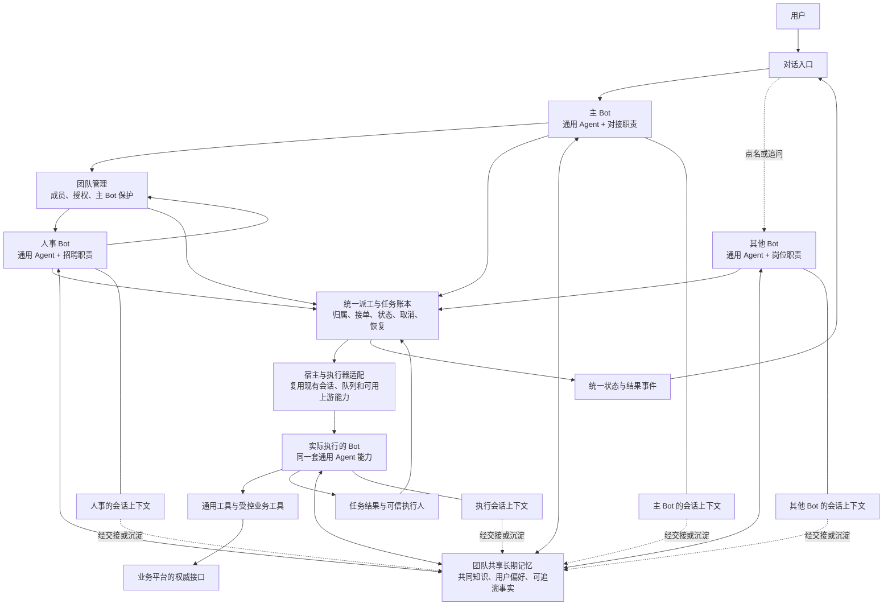

# 同事制度收拢：架构与执行指导

## 目标

让多个 Bot 像一个团队一样工作：每个 Bot 使用同一套通用 Agent 能力，通过名字、岗位和当前任务区分职责；团队成员共享长期记忆，各自保留独立会话。主 Bot 可以管理团队，也可以授权人事招聘；主 Bot 自身不能被团队管理操作移除。

通用的身份、派工、执行适配、状态、署名和回传由本仓统一管理。业务仓提供业务工具、源码和岗位知识；物理资源任务仍由业务平台原有的唯一调度入口处理。按用户后续明确的方向，新的同事链路直接复用现有宿主和本仓能力，**不依赖 DS-Bot**；现场已有的外部适配仅作盘点和兼容参考，不擅自关闭或删除。

第一版验收一条真实工作链：**主 Bot 授权人事 → 人事招聘同事 → 派任务 → 同事执行 → 用户看到可信署名和结果 → 再追问该同事**。先小范围跑通，不把名单登记成功说成同事已经能工作。

## 目标架构



图里“状态与结果事件”是长任务进度展示的**输入契约**，不是另写一个卡片系统。对话入口是否能让用户直接和每位 Bot 私聊，要看接入平台和上游能力；没有独立平台账号时，主 Bot 可以转交，但必须标清是谁执行、谁转交。

## 三个需要讲清的概念

### 1. 每个 Bot 是同一类 Agent

- 主 Bot、人事、开发和其他同事使用相同的通用能力底座：模型调用、对话、工具、记忆、任务、状态与交付。岗位描述决定平时负责什么，不应把“人事只能聊天”“开发只能读文件”硬编码为不同物种。
- 能力接口相同，不代表所有部署都必须使用同一模型、拥有同一个操作系统身份或自动拥有所有资源权限。实际可用的模型、工具和工作区由宿主配置；能力暂不可用时明确报告，不能因为岗位名伪装成功。
- 受托的人事可在宿主管理授权范围内招聘与管理成员。主 Bot 的不可移除由宿主和管理接口强制执行，不只依赖提示词；同系统账号下任意终端是否能绕开保护，必须单独验证。
- 岗位不是任务的唯一身份：同一岗位可以有多位同事，同一同事也可以承担不同职责。使用稳定成员 ID 与实例代次，姓名和岗位用于展示。

### 2. 长期记忆共享，会话上下文不实时共享

- 团队有共同的长期记忆：用户偏好、共同规则、项目事实、经确认的结论和可复用经验。团队成员在各自回合中通过同一记忆接口读取；**不要默认按岗位把团队长期记忆切成彼此看不到的孤岛**。
- 同一团队内，已确认写入的共享内容应能被其他成员在后续读取或召回；具体一致性和索引延迟要可观察。记忆来源、版本、时间和冲突状态要可追溯；并发写入、重复与矛盾必须能处理或留待审阅。
- 每个 Bot 的当前对话、未完成推理、工具输出和临时草稿属于各自会话。不要把它们实时广播到所有 Bot 的上下文，也不能假定别人已经看过。
- 任务交接时明确传递所需材料、结论和产物；需要长期共享的事实通过已有记忆写入/审阅机制沉淀。一个 Bot 刚想到的内容，不等于已经成为共享事实。
- 共享不意味着模型自动知道全部历史：上下文有预算，召回要按任务相关性执行。记忆质量、召回命中与错误命中要单独评测；不同团队或不同用户的数据范围由宿主确定，团队内也不能因为共享机制泄露凭据。

### 3. 一个任务有一个权威归属和一个最终发送方

宿主持久绑定 `task_id`、发起人/原会话、被派成员 ID 与代次、执行会话/执行器、状态、产物和回传路由。角色名和模型自报的姓名不能证明是谁完成任务。同一任务的状态事件由任务账本产生，最终消息由一个明确的发送方负责；网络结果不明时先核对，不能靠多套回填同时补发。

## 当前现场与冲突边界

本指导编写于 2026-10-29；WSL 主开发仓当时是 `super-agent`，`master` 为 `2b35e5d`，相对本地远端跟踪分支领先 1 个提交。开工前重新核对，避免覆盖其他人正在做的工作。

现有可复用基础包括 `agentcore/colleague_registry.py`、`colleague_provisioner.py`、`colleague_catalog.py`、`pool.py`、`worker.py`、`session_execution.py`、`colleague_dialogue.py`、`colleague_conversation.py`、`colleague_dialogue_history.py` 及 `plugins/durable_dispatch/`。这些文件中有已实现组件，也有依赖宿主注入的接口：**逐一核对实际接线和测试，不要把模块存在说成已经上线。**

现场还存在外部同事适配服务和业务 MCP 入口。通用的角色匹配、接单、任务归属与结果回传应收拢到本仓；业务接口可以先保留兼容转发。**迁移期间不能让新旧入口各自创建一份任务或同时发送同一份结果。** 具体平台与业务地址由部署配置提供，不写死在通用仓。

已有独立的长任务进度展示工作，见 `docs/LONG_TASK_INTERACTION_GUIDE.md` 与相应进度模块。**本任务不修改那条线的文件、卡片布局或展示状态机**。本任务负责提供可信的成员、任务、状态和结果事件；展示线通过稳定接口消费。若确需修改共享接口，先确认对方工作状态，约定输入输出并合并验证，不并行改同一文件。

## 先处理四个已发现的风险

以下是代码路径审查发现的风险，是否在当前生产中发生需要验证；先复现和写测试，再修：

1. **角色找不到时误派人**：既有外部同事适配可能在无法匹配角色时选择列表中的第一位 Bot。改为找不到或同名不明确时返回清楚的错误，不猜。
2. **按文字停顿判断完成**：既有适配可能在输出短暂不变后认为任务完成。应优先使用上游真实回合终态与任务绑定；拿不到明确终态时标记等待或结果不明，不凭停顿声称完成。
3. **超时后重复派工**：既有业务入口在外部适配调用异常时会尝试另一条路径。网络超时不证明原请求未接收；先按稳定请求 ID 查询。只有确定未接单且符合重试策略才可切换执行器。
4. **工作树与分支保护**：检查 `agentcore/colleague_dev.py` 中基于 `git worktree add -B` 和强制移除的路径。不得重置已有分支或在失败时丢弃未提交工作；失败要保留可恢复现场并报告路径。未经核验，不把工作树称作安全沙箱。

## 分阶段执行

### 第 0 阶段：取证与责任划分

1. 盘点现有主 Bot、成员、任务入口、队列、执行器、记忆读写、展示和回传的实际接线；按 profile 和运行进程区分配置、代码与真实生效状态。
2. 分别记录已有 `durable-dispatch`、外部 Bot 适配、一次性子 Agent 和研发执行路径的职责与真实调用证据。检查是否存在多队列、多发送方和不可靠降级；不因此直接删除任何历史数据。
3. 核对上游可用能力、版本和许可。不同开源 Bot 项目是独立实现，不能因为名称相似就假定接口或行为一致。优先整套复用已验证的身份、会话和聊天能力；本仓保留受控适配和兼容边界。
4. 写出一张当前链路和一张目标链路，标注每份状态的权威来源、宿主线程/进程、失败恢复和展示消费者。记录正在并行的长任务工作与不能同时修改的文件。

**出口：** 能指出一条真实或隔离测试任务从用户到实际执行者再到原会话的每一步；尚无证据的部分明确写“未验证”。

### 第 1 阶段：身份与管理能力统一

1. 建立宿主认证的团队、成员、岗位和代次关系，允许一岗多人、一个人承担多种职责。重新启用或替换实例时，旧任务仍绑定旧代次，不得冒充新成员执行。
2. 复用现有登记与生命周期组件，接入真正可执行的宿主实例。创建分为已登记、准备中、可接单和失败；没有宿主证据前不得宣称入职成功。
3. 主 Bot 的身份受保护；授权人事可招聘和管理其他成员。按用户授权接入上游支持的授权机制；上游不提供委托时做有边界的适配，不绕过主 Bot 保护，也不把上游审批或能力猜成已经满足需求。
4. 停用先阻止新任务、排空或明确取消现有任务，再停放实例；保留任务、产物和历史。所有接单入口使用同一代次与排空栅栏，无法确认外部空闲时不能宣称停用完成。

**出口：** 同一底座能创建并运行主 Bot、人事和开发同事；人事招聘与主 Bot 保护都有宿主层面测试，而不是只验证提示词和名册。

### 第 2 阶段：派工和调度收拢

默认先由一个 Agent 完成任务；只有子任务能独立推进、并行收益足以覆盖沟通和汇总成本时才派给其他同事。交接传任务目标、必要约束、相关证据或文件引用和预期结果，不复制整段对话，也不要求同事频繁互相同步。对同类任务记录效果、耗时和 token 用量，对比单 Agent 与多同事结果；没有数据时不要假定多同事更快或更好。

复用现有 `AgentScheduler` / `Worker` 的 FlowCoro 后端与 SQLite 队列；不要为同事系统另建一套不受约束的调度器。有副作用的工作默认不可自动重放。当前 Python 绑定在执行 Python 回调时仍受 GIL 约束；若性能测量证实调度或计算是瓶颈，再把相关热点下沉到 FlowCoro/C++ 或独立进程，不能仅靠更换线程池就声称纯 Python 代码并行加速。2026-10-29 在 caixuf 本机临时编译上游 FlowCoro `aaac885e673e01b6f21037a47930ef744668d26b` 后，调度器和 worker 的 25 项测试通过；本机旧构建缺少取消接口，不能直接用作该后端。这是兼容性验证，未证明业务性能，也未启用生产。

1. 本仓提供统一的派工、状态、取消与恢复契约；新的工作路径直接使用宿主任务会话和现有 worker，不依赖 DS-Bot。现有外部适配仅在确需兼容时保留，不把它设为新路径的前置条件。避免强迫所有执行器改成相同进程实现。
2. 请求绑定发起人、会话、成员 ID/代次、目标、权限范围和稳定请求 ID。接单、重复请求、权限撤销、超时不明和结果回传的边界均由宿主执行，不由模型文本决定。
3. 当前阶段先打通一种真实执行路径，不同时启用多个独立调度器或发送器。业务平台的物理资源任务仍使用其原有唯一队列；通用队列负责同事工作，不直接另起物理任务。
4. 按任务性质决定并发、隔离、超时与重放；不把现有只读任务的可重放策略直接用于写文件、外部发送或其他有副作用的工作。多个队列/多个 worker 的总容量与公平性需要实测。
5. 一个回合可能派生出脱离进程组的后台进程（`setsid`、worker、`systemd-run`）。仅靠 `killpg` 或「进程列表为空」不能证明工作已停止：认领任务时生成随机尝试令牌并随环境传入，清理后按令牌复查 `/proc`，只有证明无残留才允许结算并输出成功回执。证据必须来自宿主侧实测，不能由模型文本或空列表代替。

   **已验证的实现与部署契约（2026-10-29）：** 令牌机制在 `agentcore/colleague_containment.py`，环境变量固定为 `AGENTCORE_ATTEMPT_TOKEN`（32 位小写十六进制），扫描方式是读 `/proc/<pid>/environ` 找该 `NAME=value` 字节串，因此 `exec` 后仍能命中，跨 `fork` 自然继承。`sweep()` 先 `SIGTERM`、宽限后 `SIGKILL`，返回 `{"quiescent": bool, "survivors": [...]}`；`evidence_id()` 把它压成稳定摘要。
   `agentcore/colleague_worker.py` 在三处使用：启动时 `_require_attempt_containment()` 要求**所有** runner 自报 `attempt_containment`，只有 `runner_and_descendants` 放行，其它一律在**建立预留之前**拒绝（`colleague_turn_containment_unprovable;<kind>`）；「没有该属性」也算拒绝（`unreported`），因为只按已知类做 `isinstance` 检查会让其它启动器直接绕过。执行后 `_attempt_evidence()` 用队列给的同一个令牌再扫一次，不静默就整体判失败（`attempt_not_quiescent`），不输出 `ok: True`；成功回执新增 `quiescence_evidence_id`，它是宿主可核对的凭证，不是装饰字段。失败路径同样扫：`_discard_attempt()` 在任何异常后清理遗留进程，但不声称已清理（回执仍是统一失败），否则一次崩溃就能把逃逸进程留到下次重启。
   内置 launcher 跑 `hermes chat` 时只会依次回放 gateway 事件，工具进程是 gateway 的子进程、不继承本回合环境，所以它自报 `gateway_delegated` 并在 `run()` 入口直接拒绝；宿主注入的 launcher 自报 `host_owned`，同样不能在本 worker 结算。只有把回合真正跑在本进程里的 runner 才能回答“这个 attempt 的后代都停了”。
   **部署要求：** 队列在派发时把令牌写进 worker 的环境。没有令牌时 `_attempt_evidence()` 返回 `None`，回执里 `quiescence_evidence_id` 为 `null` —— 这不阻止执行，但等于没有证据，生产不应依赖这种配置。
   **已知边界：** 清空自身环境的后代、以及属于其它用户（`/proc/<pid>/environ` 不可读）的后代扫不到。这两种情况必须让预留保持打开、交人工核对，不能当成已停止。该机制是证据，不是沙箱。
6. 原业务 MCP 名称可以保留作兼容外壳，逐步转发到统一契约；切换前后核对旧调用方、任务归属与回执，保留回滚路径。不要同时保留两个能执行的默认分支。

**出口：** 单任务、重复提交、超时不明、取消、重启、两个用户和两个成员并发均有证据；不会误派、重复执行或跨会话回传。

**真实渠道（2026-10-29 补）：** 上述适配层的 `transport` 此前只有测试替身，交付环节因此必须等真人验收。现已有可执行适配器 `agentcore/feishu_transport.py`：按任务 `origin.chat` 发文本消息，发完立刻从平台回读并比对会话与文本摘要，只有回读一致才返回回执；同一 `delivery_key` 用平台 `uuid` + 本地日志保证至多一次，重复键换了文本或会话直接拒绝而不覆盖；`lookup` 只查不发。凭据来自 `FEISHU_APP_ID` / `FEISHU_APP_SECRET`，只进内存，不进异常、日志或日志库。真实跑法（需要一个 bot 自建、无其他人的测试群）：

```bash
FEISHU_APP_ID=… FEISHU_APP_SECRET=… FEISHU_TEST_CHAT_ID=oc_… \
  bash verify.sh        # ⑥ 真实通道：发→回读→幂等重发→撤回→查无
```

两条交付缝各自接通：只读最终答复走 `ReadOnlyDelivery`（`send_plaintext`/`lookup`）；持久任务完成回执走 `DirectCompletionTransport`，由 `FeishuCompletionSender` 适配——只有回读确认才给 `{'ok': True, 'message_id': …}`，只有尚未触网的拒绝才给 `not_sent`（可安全重试），其余不表态让队列停在 `ack_unknown`；附件未实现时直接报错而非挂起。

对应测试：`tests/test_feishu_transport.py`（替身服务，覆盖回读不符、键冲突、撤回、错误分类、日志权限）、`tests/test_feishu_transport_real.py` 与 `tests/test_feishu_delivery_real.py`（真实平台；缺凭据时 skip，不算通过）。已实测：回执 `om_…`、撤回后 `lookup` 为空、队列 `acknowledged=1`、成员 `tracked_open=0`；另用 `lark-cli im +chat-messages-list` 独立客户端确认消息在群内可见、撤回后变 `deleted: true`。这条通道解决的是“交付不能 mock、但也不必每次等人”，**不**证明真实用户会话里的最终呈现（第 4 阶段仍由用户手动发测试请求）。

### 第 3 阶段：共享记忆与独立会话

1. 盘点现有团队长期记忆与召回入口，优先复用已有服务；不要为新同事另造一份互不相认的平行长期库。
2. 在宿主身份可信的前提下，让团队成员通过同一接口读取共享事实；记录写入者、来源、版本、更新时间以及必要的冲突处理。明确已确认写入后对其他成员的可见时机和索引延迟。
3. 每位 Bot 的会话历史分别保存，保持调用上下文和顺序归属。跨同事交流使用明确消息或任务交接，不自动注入对方整段历史或隐藏推理。
4. 完成后可将有价值的结论通过现有记忆机制沉淀为共享事实。共享读写、撤销、更正和矛盾处理需要可追溯；授权范围改变后不能继续引用无权访问的旧来源。带入过早期历史的摘要，需要核对其依赖的完整来源关系。
5. 建立小型真实评测：写入共享事实后，另一位同事在后续回合能按任务需要召回；不同同事的会话不被串入。测量命中、误命中和延迟，不以测试条数代替质量评测。

**出口：** 实际验证“长期记忆共享、会话不实时共享、交接明确”，并记录权限、并发写入、过期与冲突场景的结果。

现有代码的接线注意事项：`memory_store` 按 `user_id` 限定召回，写入还记录 `agent_id`；因此团队成员需要由宿主绑定同一个团队 `user_id`，并保留各自的写入者标识。这个身份必须来自可信部署配置，不能由模型或用户传入的工具参数选择。`memory_bridge` 的暂存目录应按成员身份分别配置：`TurnSpool.ingest` 会核验目录里每条记录的完整身份，多个不同身份混用一个目录会报身份不匹配。现有 `runtime_service` 也是单身份工作进程，应让每个成员的 worker 使用匹配自身的 profile、user 和 agent 配置，共用相同的记忆库路径及团队 user。常驻 runtime 服务不应由人工随手 `nohup` 拉起：宿主需按 profile 管理启动、就绪（队列出现）与停止，停止后再按尝试令牌复查，避免重启后遗留的 worker 把半处理的回合写进团队队列。常驻召回服务则绑定固定的 user、agent 和数据库指纹；不同成员如何安全复用服务需要宿主提供受控的服务身份映射，不能直接把各成员的 agent 当作可互换的服务身份。

隔离库测试已核对：一位成员写入的事实可在同团队后续召回，其他团队不可见；会话历史现有测试覆盖成员和用户隔离。这只证明现有存储边界，并不证明真实 Bot 的自动写入、身份绑定或线上权限已经接通。写入进入向量索引有延迟，必须在实际部署中验证写入确认、索引可见性和召回质量。

### 第 4 阶段：对话呈现与长任务工作衔接

1. 向现有长任务展示线提供可信的成员身份、任务 ID、状态事件和结果引用；**不另建一套卡片、状态账本或后台发送线程**。
2. 显示“谁接单、谁在执行、谁完成”。主 Bot 转交时注明转交；主 Bot 自己汇总时注明汇总。没有可信执行绑定则显示“执行人未确认”，不能从正文或岗位推断。
3. 用户点名、引用同事消息或说“继续问某位同事”时，验证当前用户、会话、成员及授权，把请求送到正确的独立会话。名字重复要让用户区分；不得从其他用户的对话里猜。
4. 同一任务优先复用现有任务入口展示，完成、失败、取消和附件按进度展示线的协议交付。最终送达与卡片更新分别核对；不可靠路由保留待查。

**出口：** 用户在真实测试对话中能辨认谁做了什么，并能继续追问；不能展示独立平台身份时明确“由主 Bot 转交”。

## 验收矩阵

| 场景 | 必须看到的结果 |
| --- | --- |
| 主 Bot 授权人事，人事招聘开发同事 | 成员实例真正可接单；主 Bot 不能被移除；权限和变更有记录。 |
| 两位同事同名或职责相同 | 需要时能明确选择稳定身份，不能派给第一个或任意一个。 |
| 主 Bot 和同事使用同一套通用能力 | 接口一致；岗位只定义职责。模型或工具未配置时如实显示，不伪造能力。 |
| 一位同事写入确认后的团队事实 | 另一位同事在后续回合按相关性可读取；并发修改、版本和冲突可追溯。 |
| 一位同事的私人会话出现临时想法 | 其他同事不会在实时上下文里自动看到；显式交接或沉淀后才按对应渠道获得。 |
| 两个用户同时找不同同事 | 接单、进度、产物、消息和后续追问不串；共享记忆仍受团队边界约束。 |
| 派工超时、执行器崩溃或发送后回执丢失 | 不盲目派第二次或重复发；可以按任务 ID 核对并恢复。 |
| 成员停用时还有任务 | 新任务被拒；在途任务按策略完成、取消或保留待处理，不能丢失结果。 |
| 工作树中途失败 | 不重置已有分支；未提交内容可恢复，路径与状态明确。 |
| 长任务进度展示同时开发 | 双方通过约定事件接口接入；不覆盖正在开发的文件，不产生两套卡片或两个终态发送者。 |

## 测试与交付要求

- 在隔离环境使用模拟模型和模拟消息通道测试状态机、身份绑定、并发、崩溃与权限；真实模型和真实消息渠道另行验证，不能用模拟通过冒充真人体验通过。
- 用户手动发送真实测试请求；记录发起、接单、执行、回传和追问对应的任务/成员 ID、时间、可见结果与局限。只收集必要证据，不记录凭据或完整私密对话。
- 运行本仓相关单测、`bash verify.sh` 和安装检查；标明跳过及原因。涉及上游版本或补丁时，验证安装、升级后的探针与回滚。
- 交接写明：已部署与未部署的功能、具体版本、可复现命令、失败/不确定项、兼容入口和回滚方式。不要为了通过检查删除历史回执或现场数据。
- 通用适配器、版本钉选、安装配置、第三方许可与测试都进入本仓交付；业务专属配置不进入通用代码。所有任务完成后再做一键部署和 Docker 干净环境逐项验收。
