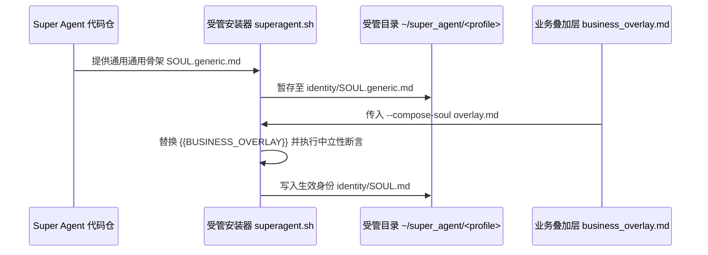

# Super Agent 生产部署与生命周期指南（Deployment & Lifecycle Guide）

本文档为 Super Agent v2.0 单根架构下的生产部署、整包升级、回滚、身份挂载与日常验收全流程操作指南。

---

## 1. 核心部署原则

1. **单根受管（Single-Root Managed）**：
   所有运行时产物、不可变 Release 树、配置、状态数据库与工作区严格收敛于 `<managed_root>/<profile>`（默认 `~/super_agent/<profile>`），杜绝多写者冲突与文件散落。
2. **计划先行（Plan First）**：
   所有安装与更新命令默认先输出变更计划（Plan），只有显式传入 `--apply` 参数才会真正修改系统状态。
3. **业务解耦（Business Overlay Mounting）**：
   通用身份骨架 `identity/SOUL.generic.md` 在部署时随 Release 暂存，业务特化规则通过 `--compose-soul <overlay.md>` 在实例层合成生效。
4. **宿主推断（Hermes Root Inference）**：
   安装器自动探测活跃软链 `hermes-current` 与历史 `install-manifest.json`，无需反复手工指定宿主源码路径。

---

## 2. 统一安装与升级命令（`install/superagent.sh`）

### 2.1 规划与部署（Install）

```bash
# 1. 预览安装计划（只读检查，不修改系统）
./install/superagent.sh plan --profile <profile_name>

# 2. 执行安装（创建单根目录、构建不可变 Release、挂载插件与记忆）
./install/superagent.sh install --profile <profile_name> --apply

# 3. 部署时挂载业务身份叠加层（将 {{BUSINESS_OVERLAY}} 替换为业务私有设定）
./install/superagent.sh install --profile <profile_name> --compose-soul /path/to/business_overlay.md --apply
```

### 2.2 整包升级与原子切换（Update）

```bash
# 1. 预览升级计划（自动核对 Git 提交指纹与待更新插件列表）
./install/superagent.sh update --profile <profile_name>

# 2. 执行原子升级（构建新 releases/<v>，原子切换 current 软链，保留 state/ 与 config/）
./install/superagent.sh update --profile <profile_name> --apply
```

### 2.3 状态体检与诊断观测（Doctor）

```bash
# 巡检当前实例状态、服务存活、插件挂载与召回诊断
./install/superagent.sh doctor --profile <profile_name>
```

Doctor 命令会自动对账：
- **`disk_bindings`**：主 Profile 与所有同事 Profile 的插件及引擎软链一致性（`matched`）。
- **`recall_diagnostics_observation`**：读取 `<managed_root>/state/recall-diagnostics/<profile>.json`，输出最近召回观测指标。
- **`worker_observation`**：验证 Worker 进程状态与 Attempt 围栏。

### 2.4 版本回滚（Rollback）

```bash
# 回滚至上一个备份版本
./install/superagent.sh rollback --profile <profile_name> --apply
```

### 2.5 完整卸载（Uninstall）

```bash
# 按 manifest 严格清理软链与受管目录，保留备份
./install/superagent.sh uninstall --profile <profile_name> --apply
```

---

## 3. 身份暂存与业务叠加层挂载工作流



1. **通用骨架**：`identity/SOUL.generic.md` 定义了严谨的工程纪律、长任务交互规范与工具调用原则，业务定制位保留占位标记 `{{BUSINESS_OVERLAY}}`。
2. **打包暂存**：`tools/superagent.py` 在发布阶段将通用身份骨架纳入受管 Release，确保升级时随时可回溯底本。
3. **合成注入**：在业务现场通过 `--compose-soul <path>` 注入领域规则，安装器校验占位符唯一性并确保无标记残留，生成最终生效的 `SOUL.md`。

---

## 4. 同事 Profile 与工作区自动级联装配

当主实例配置了团队同事网关派工（`colleague-team` 的 `gateway_dispatch.tool_backend.members`）时，受管安装器在执行 `install` 或 `update` 时自动保障：
1. **工作区目录自愈**：为各同事自动创建 `<colleague_home>/workspace` 目录。
2. **插件软链级联对齐**：根据同事各自 `config.yaml` 的 `plugins.enabled` 列表，自动链接当前 Release 下的插件。
3. **向量记忆提供方挂载**：自动挂载 `localvec` 记忆提供方，并将其 `engine_root` 锚定到当前主 Release 的 `current` 软链。
4. **召回诊断自动就绪**：为每个同事自动开辟 `state/recall-diagnostics/<colleague>.json` 记录通道。

---

## 5. 布局感知运维与历史服务平滑纠偏

如果主机曾使用历史旧版或双根路径安装，使用官方布局感知脚本实施平滑对账：

```bash
# 1. 检查遗留 unit 与配置漂移
bash scripts/ops/uninstall-legacy.sh

# 2. 确认无误后执行安全对账纠偏（自动备份受影响配置至 drift-backups/）
bash scripts/ops/uninstall-legacy.sh --apply
```

---

## 6. 容器干净室部署验证（Clean-Room Gate）

在断网无特权的干净容器中，从零 HOME 完整验证安装全流程与 20 项工程断言：

```bash
# 运行官方容器化干净室验证
bash docker/verify.sh
```
断言覆盖：空 HOME 安装、包外隔离导入、私有 Python 解释器、真实 Chromium 截图渲染、配置幂等性、身份合成与离线向量召回。
