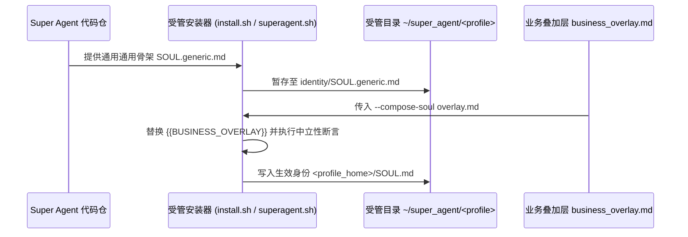

# Super Agent 生产部署与生命周期指南（Deployment & Lifecycle Guide）

本文档为 Super Agent v2.0 单根架构下的生产部署、整包升级、回滚、身份挂载与日常验收全流程操作指南。

---

## 1. 核心部署原则

1. **单根受管（Single-Root Managed）**：
   所有运行时产物、不可变 Release 树、配置、状态数据库与工作区严格收敛于 `<managed_root>/<profile>`（默认 `~/super_agent/<profile>`），杜绝多写者冲突与文件散落。
2. **计划先行（Plan First）**：
   所有安装与更新命令默认先输出变更计划（Plan），只有显式传入 `--apply` 参数才会真正修改系统状态。
3. **业务解耦（Business Overlay Mounting）**：
   通用身份骨架 `identity/SOUL.generic.md` 在部署时随 Release 暂存，业务特化规则通过 `--compose-soul <overlay.md>` 在实例层合成生效至 `<profile_home>/SOUL.md`。
4. **宿主推断（Hermes Root Inference）**：
   安装器自动探测活跃软链 `hermes-current` 与历史 `install-manifest.json`，无需反复手工指定宿主源码路径。

### 1.1 单根标准受管拓扑（全仓唯一权威定义）

生产环境中每个 Profile 严格收敛于 `<managed_root>/<profile>`（默认 `~/super_agent/<profile>`），其物理目录树定义如下：

```
~/super_agent/<profile>/
├── current -> releases/<version>/         # 原子软链，指向当前激活的不可变版本
├── releases/
│   ├── <version>/                         # 不可变发布目录（由 Git describe / short SHA 派生，绝非时间戳）
│   │   ├── agentcore/
│   │   ├── plugins/
│   │   ├── identity/
│   │   └── ...
│   └── ...
├── state/                                 # 实例状态持久化目录（跨版本升级与回滚不丢失）
│   ├── analysis-queue/                    # 分析任务持久队列
│   │   └── pool.db                        # 队列持久化 SQLite 数据库
│   ├── dev-queue/                         # 研发任务持久队列
│   │   └── pool.db                        # 队列持久化 SQLite 数据库
│   ├── memory-spool/                      # 长期记忆事件暂存池（连字符命名前缀）
│   ├── liveness.db                        # 任务活体心跳 SQLite 库（维护 task_liveness 表）
│   ├── cards/                             # 卡片状态与锁根目录
│   ├── colleague-team/                    # 团队协作持久化
│   │   └── registry.sqlite                # 团队成员注册表
│   ├── recall-diagnostics/                # 召回诊断观测数据目录（<profile>.json）
│   ├── markdown-outbox/                   # 离线 Markdown 消息与交付发件箱
│   └── drift-backups/                     # 配置纠偏与备份目录（如 backup_<timestamp>/）
├── config/                                # 运行时配置目录
│   └── config.yaml                        # 实例配置（含 plugins, memory, mcp_servers 等）
├── backups/                               # 实例备份目录
└── install-manifest.json                  # 当前部署元数据与版本历史清单
```

---

## 2. 统一安装与升级命令

### 2.1 规划与部署（Install）

```bash
# 1. 预览安装计划（只读检查，不修改系统）
./install/superagent.sh plan --profile <profile_name>

# 2. 执行安装（创建单根目录、构建不可变 Release、挂载插件与记忆）
./install/superagent.sh install --profile <profile_name> --apply

# 3. 部署时挂载业务身份叠加层（通用骨架由 install/install.sh 合成并写入 <profile_home>/SOUL.md）
bash install/install.sh --profile <profile_name> --compose-soul /path/to/business_overlay.md
# 受管模式下，可通过 agentcore/profile_overlay.py 幂等同步 SOUL.md、AGENTS.md、memories、skills 及 MCP 配置
```

### 2.2 整包升级与原子切换（Update）

```bash
# 1. 预览升级计划（自动核对 Git 提交指纹与待更新插件列表）
./install/superagent.sh update --profile <profile_name>

# 2. 执行原子升级（构建新 releases/<version>，原子切换 current 软链，保留 state/ 与 config/）
./install/superagent.sh update --profile <profile_name> --apply
```

### 2.3 状态体检与诊断观测（Doctor）

```bash
# 巡检当前实例状态、服务存活、插件挂载与召回诊断（只读输出 JSON 结构）
./install/superagent.sh doctor --profile <profile_name>
```

Doctor 命令会自动对账：
- **`disk_bindings`**：主 Profile 与所有同事 Profile 的插件及引擎软链一致性（`matched`）。
- **`recall_diagnostics_observation`**：读取 `<managed_root>/state/recall-diagnostics/<profile>.json`，输出最近召回观测指标。
- **`worker_observation`**：验证 Worker 进程状态与 Attempt 围栏。

### 2.4 版本回滚（Rollback）

回滚属于受管发布维护命令，由底层受管引擎直接执行（不带 `--apply` 参数）：

```bash
# 回滚至 manifest 历史中的上一个版本
python3 tools/superagent.py rollback --profile <profile_name>
```

### 2.5 完整卸载（Uninstall）

```bash
# 外层包装脚本调用（带 --apply 正式执行）
./install/superagent.sh uninstall --profile <profile_name> --apply

# 或直接通过底层引擎执行（底层不带 --apply 参数，支持 --keep-data 保留持久数据）
python3 tools/superagent.py uninstall --profile <profile_name> --keep-data
```

---

## 3. 身份暂存与业务叠加层挂载工作流



1. **通用骨架**：`identity/SOUL.generic.md` 定义了严谨的工程纪律、长任务交互规范与工具调用原则，业务定制位保留占位标记 `{{BUSINESS_OVERLAY}}`。
2. **打包暂存**：`tools/superagent.py` 在发布阶段将通用身份骨架纳入受管 Release，确保升级时随时可回溯底本。
3. **合成注入**：在业务现场通过 `bash install/install.sh --profile <profile> --compose-soul <path>` 注入领域规则，安装器断言 `{{BUSINESS_OVERLAY}}` 占位符恰好出现 1 次并执行替换，生成最终生效身份落盘至 `<profile_home>/SOUL.md`（旧文件自动备份为 `SOUL.md.bak-<timestamp>`），绝不会写入不可变 release 内的 `<release>/identity/SOUL.md`。受管部署时可通过 `agentcore/profile_overlay.py` 进行资产幂等合入。

---

## 4. 同事 Profile 与工作区自动级联装配

当主实例配置了团队同事网关派工（`colleague-team` 的 `gateway_dispatch.tool_backend.members`）时，受管安装器在执行 `install` 或 `update` 时自动保障：
1. **工作区目录自愈**：为各同事自动创建 `<colleague_home>/workspace` 目录。
2. **插件软链级联对齐**：根据同事各自 `config.yaml` 的 `plugins.enabled` 列表，自动链接当前 Release 下的插件。
3. **向量记忆提供方挂载**：自动挂载 `localvec` 记忆提供方，并将其 `engine_root` 锚定到当前主 Release 的 `current` 软链。
4. **召回诊断自动就绪**：为每个同事自动开辟 `state/recall-diagnostics/<colleague>.json` 记录通道。

---

## 5. 布局感知运维与历史服务平滑纠偏

如果主机曾使用历史旧版或双根路径安装，使用官方布局感知脚本实施平滑对账：

```bash
# 1. 检查遗留 unit 与配置漂移
bash scripts/ops/uninstall-legacy.sh

# 2. 确认无误后执行安全对账纠偏（自动备份受影响配置至 drift-backups/）
bash scripts/ops/uninstall-legacy.sh --apply
```

---

## 6. 容器干净室部署验证（Clean-Room Gate）

在断网无特权的干净容器中，从零 HOME 完整验证安装全流程与 8 阶段干净室部署验证（`docker/clean_room_check.sh`）：

```bash
# 运行官方容器化干净室验证脚本（含 8 大验证阶段、32 处 pass() 断言与 22 处 Python assert）
bash docker/clean_room_check.sh
```
断言覆盖：空 HOME 安装、包外隔离导入、私有 Python 解释器、真实 Chromium 截图渲染、配置幂等性、身份合成与离线向量召回。

---

## 7. 部署源锁定与防降级

为避免多工作区并发更新、代码分支落后或脏工作区意外覆盖生产发布，受管安装器（`tools/superagent.py`）内置部署源锁定与防降级门禁机制。

### 7.1 核心防护原则
1. **单一发布源绑定（One Deploy Source per Host）**：每个主机 Profile 首次安装后绑定其源码目录真实路径（`source_repo`），杜绝从不同 clone 或副本交叉发布导致的状态分裂。
2. **提交祖先防降级（Downgrade Prevention）**：升级时新提交必须是当前生效版本的 Git 后代派生（`git merge-base --is-ancestor <prev> <new>`），防止将历史旧版本覆盖发布到环境。
3. **工作区干净度校验（Clean Tree Assertion）**：禁止直接将带有未提交修改的脏工作区打包发布为正式版本。
4. **多版本滚动保留（Release Retention）**：发布后保留当前激活版本及最近 N 个历史版本（默认 N=3），绝不擦除历史发布记录，确保秒级可回滚。

### 7.2 拦截检查项（Blockers）与绕过参数
当命中以下拦截条件时，安装/升级操作将提前终止并返回 `{"status": "blocked", "blockers": [...]}`，不对系统及文件产生任何变更：

| 拦截标识 (Blocker) | 触发条件 | 绕过/覆盖参数 | 说明 |
| :--- | :--- | :--- | :--- |
| `source_dirty` | 当前发布源码树包含未提交的修改 | `--allow-dirty` | 允许发布包含未提交改动的临时版本 |
| `source_repo_mismatch` | 当前执行安装的源码仓库路径与历史清单不一致 | `--adopt-source` | 显式将发布源变更为当前仓库路径 |
| `downgrade_or_divergent` | 新提交不是已安装提交的 Git 后代分支（分支分叉或落后） | `--allow-downgrade` | 允许显式降级或强制覆盖 |
| `previous_commit_unknown_to_source` | 历史安装提交在当前仓库 Git 数据库中不存在 | `--allow-downgrade` | 允许跨非共享历史仓库部署 |
| `unexpected_commit` | 指定了 `--expect-commit <sha>` 但当前仓库 HEAD 提交不符 | 核对后重新指定匹配的 commit SHA | 防止自动化部署发错提交 |

> **注**：对于未记录 `source_commit` 的旧版 manifest，系统会尝试从版本标识回溯解析；若无法解析则放行升级并输出 `legacy_manifest_unpinned` 警告。

### 7.3 指定预期提交部署（`--expect-commit`）
在自动化发布或流水线对接时，可通过 `--expect-commit` 显式校验发布提交，支持完整 SHA-1 或短前缀：
```bash
./install/superagent.sh update --profile <profile> --expect-commit a1b2c3d --apply
```
若工作区 HEAD 与预期提交不一致，操作将被拦截阻断。

### 7.4 历史版本保留与清理
- 默认在 `install` / `update` 时自动保留激活版本及最近 3 个历史 Release（不可变目录和 manifest 历史记录）。
- 使用 `python3 tools/superagent.py prune-releases --profile <profile> --keep N` 可调整保留数量；传入 `--keep 0` 则显式清理全部非活跃版本（注意：无 `--apply` 参数）。
- 回滚命令（`python3 tools/superagent.py rollback --profile <profile>`）不受降级拦截限制，作为受控的标准回滚途径（注意：无 `--apply` 参数）。

### 7.5 版本真实性体检（Doctor Drift）
`./install/superagent.sh doctor` 或 `python3 tools/superagent.py doctor` 在 `deploy_version_observation` 节点对账当前运行态与源码态一致性：
- `installed_commit` / `installed_dirty` / `source_repo` / `source_head`
- `stale_processes`：检查已启动常驻进程的启动时间是否早于当前 Release 安装时间 `installed_at`。
- 若存在版本落后、脏发布或未重启的陈旧进程，`doctor` 状态判定为 `drift`（非 ready，退出码 1），防止带病运行。

