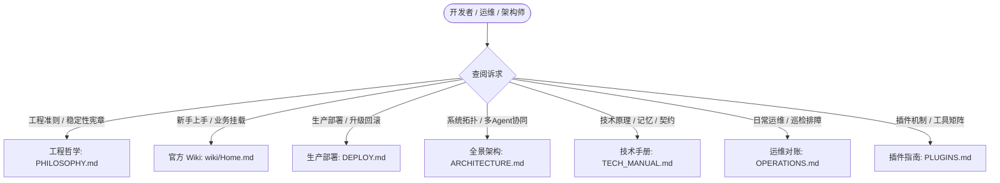

# Super Agent 文档体系与全景导航

本文档是 Super Agent v2.0 的统一文档索引与导航门户。为消除文档冗余、碎片化与版本冲突，仓库历史临时报告与散落草案已彻底清理，全面收敛为 **「1 篇工程哲学宪章 + 5 篇权威技术规范 + 5 篇结构化 Wiki」** 极简架构。

---

## 快速导航路线

---

## 1. 工程哲学与五大权威技术规范（Philosophy & Core Manuals）

这六篇文档为仓库内唯一的生产级权威规范，随代码变更持续演进：

| 文档 | 核心定位与管辖范围 | 适用场景 |
| :--- | :--- | :--- |
| **[`PHILOSOPHY.md`](PHILOSOPHY.md)** | **端到端可靠性工程哲学（最高准则）** • 脊柱优先于器官（Spine Over Subsystems） • 显式暴露退化（Fail-Visible, Never Mask Degradation） • 有界收敛律、可中断可排空设计与分级工具路由 | 任何架构决策、接缝改动、异常处理与健康门禁设计的最高裁决准则 |
| **[`ARCHITECTURE.md`](ARCHITECTURE.md)** | **v2.0 架构全景深潜** • 单根架构拓扑（`~/super_agent/<profile>`） • 十二层分层机制与全仓中立性定理 • 同事制多智能体协作与 8 大研发角色契约 • 前后台权责边界与 StateGraph 状态图 | 深入理解系统顶层设计、智能体通信拓扑与状态机流转 |
| **[`TECH_MANUAL.md`](TECH_MANUAL.md)** | **Super Agent 技术手册** • 任务持久池（Pool/Worker）与 Attempt 围栏契约 • 突触记忆双路召回引擎（BM25 + 向量）与代际分桶隔离 • 突触可塑性反馈与门禁（Plasticity & Memory Gate） • CardKit 2.0 单在途合并与完成态安全投递 | 查询底层技术规范、协议细节、状态转移语义与算法实现 |
| **[`DEPLOY.md`](DEPLOY.md)** | **生产部署与生命周期指南** • 单根受管部署规范（`install/superagent.sh`） • `SOUL.generic.md` 通用身份与业务叠加层（`--compose-soul`） • 不可变 Release 原子发布、秒级平滑回滚与历史清理 • `hermes-current` 宿主解释器自动推断与干净室验证 | 一键安装新实例、全量整包升级、环境迁移与安全卸载 |
| **[`OPERATIONS.md`](OPERATIONS.md)** | **布局感知运维与对账指南** • 布局自适应解析引擎（`scripts/ops/_layout.sh`） • 遗留服务对账纠偏与自愈清理（`uninstall-legacy.sh`） • `doctor` 全面健康体检与记忆召回观测器 • 常见故障处置矩阵（锁冲突、端口占用、卡片阻塞） | 日常系统巡检、生产故障排障、服务漂移纠偏与日常维护 |
| **[`PLUGINS.md`](PLUGINS.md)** | **插件与工具面全景指南** • 16 款受管插件全清单（13 通用内建 + 3 受管外部） • `localvec` 独立向量长期记忆提供方规范 • 插件双道准入门禁策略与宿主隔离机制 • MCP 业务工具面与 Toolset 授权拓扑 | 扩展智能体工具能力、接入外部系统、配置模型权限 |

---

## 2. 官方用户与架构 Wiki（User & Architecture Wiki）

面向初学者与业务开发者，提供端到端、低门槛、无冗余图文指导：

> [!TIP]
> 想要立即验证系统运行？请参阅 [**Wiki 首页 (docs/wiki/Home.md)**](wiki/Home.md) 中的「**60 秒真机可复现任务闭环**」，通过一条真实指令体验从接单、排队、Worker 认领到终态交付的完整全链路！

- **[`wiki/Home.md`](wiki/Home.md)**：**Wiki 首页与全局导览** —— 架构全景、设计哲学与知识图谱。
- **[`wiki/01-Quickstart-and-Install.md`](wiki/01-Quickstart-and-Install.md)**：**第 1 篇：5 分钟上手与单根部署** —— 安装、计划先行（Plan）、整包升级与秒级回滚。
- **[`wiki/02-Business-Overlay-Guide.md`](wiki/02-Business-Overlay-Guide.md)**：**第 2 篇：业务知识挂载指南** —— 中性底座、业务叠加层、MCP 挂载与业务角色团队装配。
- **[`wiki/03-Multi-Agent-and-StateGraph.md`](wiki/03-Multi-Agent-and-StateGraph.md)**：**第 3 篇：前后台协同与 StateGraph** —— 前台交互边界、8 大研发同事契约与状态流转。
- **[`wiki/04-Feishu-Cards-and-Delivery.md`](wiki/04-Feishu-Cards-and-Delivery.md)**：**第 4 篇：企业协作卡片与交付机制** —— CardKit 2.0 状态机、单在途合并去抖、进度流与图文交付。
- **[`wiki/05-Operations-and-Troubleshooting.md`](wiki/05-Operations-and-Troubleshooting.md)**：**第 5 篇：运维排障与 FAQ** —— 布局感知运维、`doctor` 体检、召回诊断与故障排查矩阵。

---

## 3. 常见问题查找索引（Cheat Sheet）

| 查找诉求 | 推荐首选阅读 | 次选参考 |
| :--- | :--- | :--- |
| 我想快速安装/部署一套干净的 Super Agent 环境 | [`docs/DEPLOY.md`](DEPLOY.md) §2 | [`wiki/01-Quickstart-and-Install.md`](wiki/01-Quickstart-and-Install.md) |
| 我想了解系统如何避免死锁、如何管理多任务并发 | [`docs/TECH_MANUAL.md`](TECH_MANUAL.md) §2 | [`docs/ARCHITECTURE.md`](ARCHITECTURE.md) §3 |
| 我想接入业务私有的 MCP 工具或业务技能库 | [`docs/PLUGINS.md`](PLUGINS.md) §3 | [`wiki/02-Business-Overlay-Guide.md`](wiki/02-Business-Overlay-Guide.md) |
| 我想修改研发同事角色、定义工作区或配置模型 | [`docs/ARCHITECTURE.md`](ARCHITECTURE.md) §4 | [`docs/TECH_MANUAL.md`](TECH_MANUAL.md) §4 |
| 生产环境智能体卡住、IM 卡片未更新怎么办 | [`docs/OPERATIONS.md`](OPERATIONS.md) §3 | [`wiki/05-Operations-and-Troubleshooting.md`](wiki/05-Operations-and-Troubleshooting.md) |
| 我想升级线上版本并确保出问题能秒级回滚 | [`docs/DEPLOY.md`](DEPLOY.md) §4 | [`wiki/01-Quickstart-and-Install.md`](wiki/01-Quickstart-and-Install.md) |
| 智能体的长期记忆如何召回、为什么没有发生幻觉 | [`docs/TECH_MANUAL.md`](TECH_MANUAL.md) §3 | [`wiki/05-Operations-and-Troubleshooting.md`](wiki/05-Operations-and-Troubleshooting.md) §4 |
