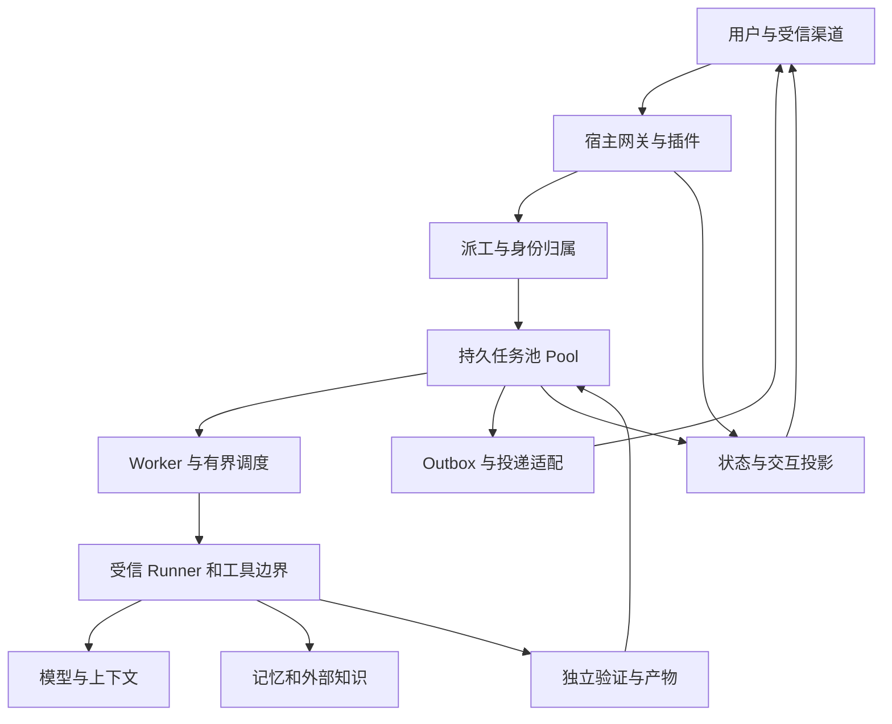
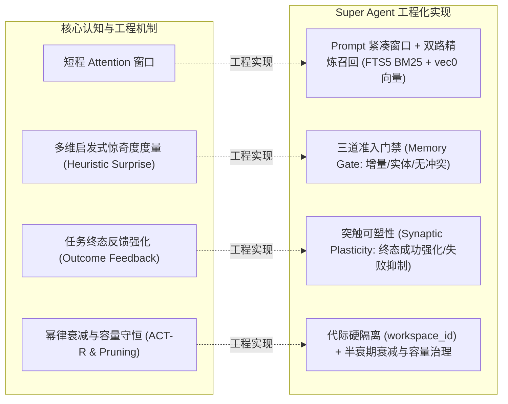
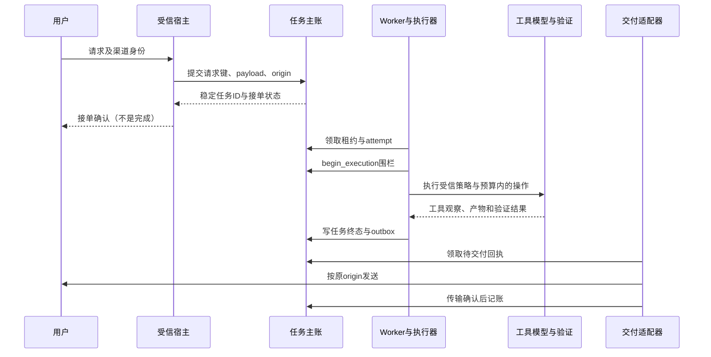

# Super Agent 技术手册：架构、原理与生产实践

**基线**：`super-agent` 仓库 v2.0 单根架构收敛版本（含 `98354f0` 及其关联演进）；核对日期：2026-11-08（Asia/Shanghai）。**适用读者**：架构、研发、测试、安全与运维人员。本文阐明核心机制、16 款插件与 `localvec` 记忆提供方、AI Agent 通用原理、v2.0 单根拓扑架构（`~/super_agent/<profile>`）、身份暂存与业务叠加层挂载工作流、召回诊断观测器（`doctor` 观测字段 `recall_diagnostics_observation` 及配套 CLI `tools/inspect_recall_diagnostics.py`）、宿主解释器自动推断及布局感知运维对账。

Super Agent 是一个以持久任务、受控执行、记忆与结果回投为核心的生产级 Agent 工程底座。它与宿主系统解耦，通过声明式业务规格（`BusinessProfileSpec`）与业务叠加层挂载实现全仓中立性；在实践中把模型视为概率推理组件，把权限、状态机跳转、文件写入与证据交付牢固锚定在确定性工程系统之中。

## 1 文档约定与能力状态

本文用以下标记区分证据，避免把目标架构或测试替身误认为线上能力：

| 标记 | 含义 | 适用判断 |
| --- | --- | --- |
| **源码** | 当前基线存在相应实现或接口 | 不证明实例启用，也不证明全部调用路径接通 |
| **隔离验证** | 在临时状态、测试数据或替身边界中验证过指定行为 | 不证明生产进程、真实模型或全部故障条件通过 |
| **渠道实测** | 指定账号在真实消息渠道发出并回读了测试消息 | 只证明被测试的传输及其测试场景，不证明完整生产业务链 |
| **建议** | 基于系统设计、研究或行业实践提出的目标能力 | 需设计、实现并验收，不能作为当前承诺 |

业务地址、凭据、模型、profile、插件、队列根和宿主版本由部署方维护。运行状态以目标进程、配置、服务和实际探测为准。仓库中的历史发布记录与本文引用的测试数字均有时间及提交范围；版本变化后需要重验。项目模块边界、最小验收和可选能力可进一步参考仓库 `docs/ARCHITECTURE.md`、`docs/DEPLOY.md` 和 `docs/OPERATIONS.md`。

### 1.1 术语与责任

| 术语 | 含义 | 权威位置 |
| --- | --- | --- |
| profile | 一组实例配置、身份和依赖的部署单元 | 宿主配置与实际运行环境 |
| origin | 接单时保存的 profile、session 及可选 route、channel、chat、thread、turn | 持久任务记录；不能事后猜当前会话 |
| job / task | 可持久查询的任务标识和状态 | `Pool` 主账 |
| attempt | 某个任务的一次执行代次 | 主账中的 attempt 与执行证明 |
| lease | 一段有限的占有或交付租约 | 对应状态存储；到期不等于进程已停止 |
| receipt / outbox | 待交付结果及其交付记录 | 主账与传输账本各自负责各自事实 |
| worker | 从持久队列领取任务并调用受信执行器的进程 | `agentcore/worker.py` |
| 工具 | 对模型暴露的可调用操作 | 宿主工具注册、授权及具体执行器 |
| 证据 | 可由独立检查者核对的状态、日志、产物或平台回执 | 产生事实的一侧，而非模型自述 |

## 2 系统目标与边界

### 2.1 功能目标

1. 接收用户任务并把会话归属、请求标识和任务约束绑定到持久记录。
2. 根据可信配置选择可用的角色、模型、记忆和工具，在资源预算内调度执行。
3. 执行过程可查询、可取消、可审计；未知和等待状态可见，不凭心跳推断最终结果。
4. 基于可核验证据形成结果，按原会话投递，并区分执行完成与消息送达。
5. 支持升级、回退与故障恢复，保留业务配置、凭据和状态数据的边界。

### 2.2 非目标与前置条件

模型不保证事实正确、指令遵循或幂等；多 Agent 数量增加不自动提升质量。工具输入、检索文档、网页、模型输出和工作区文件均需视为不可信数据。当前本地持久池依赖 POSIX 锁和 SQLite 等本机语义，不是跨主机共识系统；任务工作目录、角色提示和文件锁也不是恶意代码沙箱。部署任何真实执行器前，必须另行确认主机权限、凭据、网络出口和安全边界。

## 3 逻辑架构与依赖方向

下面是**逻辑分层**，不声称每个 profile 已完整接线。箭头表示常见调用或数据流，不表示网络部署位置。



### 3.1 宿主生态基石：Hermes Agent 平台与协同契约

Super Agent 深度依托并服务于 **Hermes Agent** 宿主生态。Hermes 提供了业界领先的轻量化交互网关、工具抽象与多平台消息适配；Super Agent 则作为企业级“认知增强与持久大脑”，二者构成正交互补的共生架构：

| 领域 | Hermes Agent 宿主层 | Super Agent 认知增强层 |
| :--- | :--- | :--- |
| **系统定位** | 感官与通信中枢（Sensory & Interaction Backbone） | 认知皮层与持久化执行底座（Enterprise Cognitive Cortex） |
| **连接与会话** | 多端接入网关（IM/Web/终端）、Session 状态机 | 持久任务池（SQLite WAL）、Attempt 栅栏、任务租约治理 |
| **工具与插件** | `PluginManager`、标准工具 schema 暴露与调用 | 8 大研发同事契约（`DEV_ROLES`）、独立 Git Worktree 物理隔离 |
| **记忆与认知** | 基础上下文装配、短程提示词拼接 | 多维启发式惊奇度打分门禁（Heuristic Surprise Gate）、ACT-R 幂律衰减、赫布扩散激活、双路 RRF 召回 |
| **流程控制** | 单轮 ReAct 基础循环、即时流式输出 | 确定性状态图（`StateGraph`）、停滞检测熔断、端到端物理证据链验收 |

#### 集成与接缝契约
1. **非侵入式插件挂载**：Super Agent 所有通用能力通过标准 Hermes 插件机制（`plugins/<plugin_name>`）接入，严格遵守 Hermes 的 `plugin.yaml` 规范；
2. **生命周期钩子（Lifecycle Hooks）**：通过 `pre_llm_call` 注入记忆召回切片，通过 `post_llm_call` 与 `on_session_end` 捕获回合事件并异步评估多维启发式惊奇度；
3. **单根受管 Profile 拓扑**：所有运行时状态收敛于 `~/super_agent/<profile>`，通过符号链接与隔离环境变量无缝驱动底层 Hermes 实例。

### 3.2 逻辑分层与核心模块

| 层 | 项目中的主要入口 | 职责与边界 |
| --- | --- | --- |
| 宿主与入口 | `plugins/`、`runtime/`、`patches/` | 将真实身份、会话及配置交给内核；插件安装与实际工具注册需分别核验 |
| 任务内核 | `agentcore/pool.py`、`worker.py`、`scheduler.py` | 状态、依赖、租约、attempt、结果 outbox 与本机有界执行 |
| 同事与工作流 | `colleague_*.py`、`pipeline_dag.py`、`plan_gate.py` | 角色描述、编排、工作流和验收；角色文本本身不提供授权 |
| 模型与上下文 | `model_routing.py`、`model_context.py`、`ccp_config.py` | 路由策略、窗口发现与配置；最终实际模型取决于接线和运行配置 |
| 记忆与突触 | `agentcore/memory/`、`plugins/localvec/`、`plugins/memory_bridge/` | 启发式惊奇度门禁、ACT-R 衰减、赫布扩散、双路召回与身份路由 |
| 交付与卡片 | `completion_delivery.py`、`direct_completion.py`、`feishu_transport.py`、卡片相关模块 | 会话归属、发送、回执和展示；传输与客户端渲染须分别验收 |
| 治理 | `verification_gate.py`、`liveness.py`、`ops_alerts.py`、`preflight.py` | 验收、状态、诊断和告警；有事件不等于有告警发送器 |

**源码**：持久账本（`agentcore.pool`）作为任务身份、依赖、租约、重放和结果 outbox 的权威；`AgentScheduler` 管理本进程执行；`Worker` 连接两者。不要把内存 Future 当作可恢复任务，也不要让展示层写入任务终态。

## 4 大模型和 Agent 的工作原理

### 4.1 模型能做什么，不能保证什么

多数自回归语言模型把输入转换为 token 序列，并在给定上下文下逐步预测后续 token；Transformer 通过注意力机制处理序列关系。实际系统可能使用不同架构、解码策略与工具协议，不能由模型家族推断某次输出是事实或已经执行。[Transformer 原论文](https://arxiv.org/abs/1706.03762)

模型生成的计划、工具调用参数、摘要和“已完成”声明都只是候选输出：调用者应对结构做解析与校验，授权层检查身份和操作，执行器返回实际结果，验证器检查对应证据。JSON schema 可以约束形式，但语法正确不保证事实正确、权限合法或副作用完成。

### 4.2 Agent 循环

典型循环为：接收目标与可用上下文 → 生成下一步或工具调用 → 校验策略与预算 → 执行 → 获取观察结果 → 更新状态 → 继续或结束。ReAct 研究探索了推理和外部行动的交替，但不意味着任何提示词都能保证正确计划或允许暴露内部推理文本。[ReAct 论文](https://arxiv.org/abs/2210.03629)

对本项目，循环的可靠性由模型之外的边界决定：工具参数不能直接变成任意 shell；任务归属不可由模型填写冒充；每次 attempt 必须通过相应执行围栏；交付只使用可核对的路由和回执；达到预算或不能证明副作用状态时应显式停止或进入待核对状态。

### 4.3 上下文窗口与压缩

上下文预算可按 `可用输入 = 模型窗口 - 输出预留 - 协议开销 - 安全余量` 估计，实际 tokenizer、系统提示和工具 schema 均会占用窗口。长窗口不保证均匀利用信息：一项多文档问答与键值检索研究发现，关键信息位置会影响结果；不能据此推导所有模型在某个固定 token 数之后必然失效。[Lost in the Middle](https://arxiv.org/abs/2307.03172)

**建议**：将稳定规则、当前目标、已核验事实、待处理问题和外部资料分区；保留原始证据引用与版本，压缩摘要不替代原始记录；对长上下文位置、矛盾事实、摘要遗漏和提示注入进行固定样本评测。`agentcore/model_context.py` 负责项目的窗口发现相关逻辑，具体端点及实际请求需按实例验证。

### 4.4 模型路由与降级

**源码**：`agentcore/model_routing.py` 定义 `pro`、`main`、`flash` 档位，以及角色白名单、压缩角色保护和每任务高成本调用的默认预算；这些是策略实现与架构不变量，不等于所有外部模型服务、所有宿主入口或降级回执都已完成端到端验证。

**建议**：用任务复杂度、上下文长度、延迟、成本、保密级别和失败代价选择模型。降级应记录请求模型、实际模型、触发原因、输入输出 token、延迟、结果状态；不能为了省成本让尚未满足质量门槛的结果冒充通过。失败重试应受总截止时间、次数及费用上限共同约束。

### 4.5 注意力、推理阶段与成本

Transformer 的一个常见缩放点积注意力形式是 `Attention(Q,K,V) = softmax(QKᵀ/√dₖ)V`：查询 Q 与键 K 的相似度形成权重，再对值 V 加权。不同注意力头、位置编码与训练目标会影响表现；注意力权重不是天然可验证的事实来源，也不是授权规则。这是解释常见模型机制的简化公式，不假设 Super Agent 固定使用某一种模型架构。[Transformer 原论文](https://arxiv.org/abs/1706.03762)

推理通常可区分处理输入上下文的预填充和逐步生成输出的解码；实现、并行方式、缓存和硬件会影响两者性能。长输入可能增加首 token 延迟和缓存压力，长输出会增加持续解码时间。实际费用与延迟还受模型、供应商、token 计量方式、并发、网络和工具等待影响，必须以目标部署实测；不能简单把上下文翻倍等同于端到端时延或成本翻倍。

采样参数控制从概率分布选择输出的方式：温度、截断策略及服务端实现会影响多样性，但温度低不保证绝对可复现或正确。应记录模型与版本、提示模板、输入快照或安全摘要、解码参数、随机种子（若服务支持）和工具结果版本；重放时仍应报告提供方实现变化与非确定性。

### 4.6 工具调用与证据链

模型的工具调用通常是带名称和参数的结构化请求；宿主解析后执行，再把观察结果回传模型继续生成。调用结构即使符合 schema，也需要按可信主体检查权限、参数范围和副作用；工具返回的网页或文本仍是外部数据，不能因为进入模型上下文就升级为系统指令。模型可能在未调用工具时声称已调用，或误读工具返回，所以验收应关联调用记录、退出状态、实际产物及独立断言。

针对一次分析任务，可以要求最终结论分别指向：输入文档的版本和位置、实际运行的检查与退出码、生成产物的摘要，以及无法验证的假设。对于必须改变外部状态的任务，还需提供目标、授权依据、执行回执与可查询状态；不存在回执时，结论应保留未知，而非由模型补全。

### 4.7 长程记忆架构：多维启发式惊奇度打分门禁与双轨记忆治理

传统 Transformer 依靠固定权重与注意力窗口处理序列。随着长任务的展开，标准注意力不仅面临算力与 KV Cache 内存的二次方/线性暴涨，更在长程跨度中深陷“注意力稀释”与“中间迷失”（Lost in the Middle）困境。更本质的是：静态权重的预训练大模型在推理测试期（Test-Time）是天然“无状态”的，会话一旦重置，上下文即刻归零。

#### 4.7.1 核心设计原理

Super Agent 采用短程注意力窗口与外部结构化长程记忆解耦的双轨设计：
1. **短程工作窗口与持久长程记忆双轨解耦**：
   - **工作记忆（Short-Term Context）**：高精细度处理当前的局部上下文；
   - **持久化长程记忆（Structured Synaptic Memory）**：将高价值经验沉淀于外部 SQLite FTS5 + `vec0` 向量库与突触拓扑图谱中，并在任务终态执行可塑性权重更新。
2. **多维启发式惊奇度打分门禁（Heuristic Surprise Gate）**：
   系统不机械盲目地把所有对话写入记忆，而是结合向量余弦新颖度（或 Bigram Jaccard 距离）与启发式规则信号（指令铁律、信念翻转、因果修复、代码书签）计算惊奇度分值。只有遇到高信息增量或关键工程事实时，才准许落盘。
3. **自适应衰减与容量治理**：
   引入基于 ACT-R 幂律衰减与置信度调节的遗忘机制，平衡新知识的吸收与陈旧知识的淘汰，避免长程运行时的记忆饱和与噪音堆积。

#### 4.7.2 Super Agent 双轨记忆工程架构



1. **惊奇度门禁（`memory_gate.py`）**：
   在事实入库前执行严格的准入门禁校验：只有经判定具备“全新信息增量（Novelty）、高置信度实体绑定与逻辑一致性”的内容，才会被提炼落盘。杜绝闲聊噪音与平庸流水账污染记忆库。
2. **突触可塑性反馈（`memory_plasticity.py`）**：
   在任务终态闭环（`Pool._terminal`）时，依据任务真实执行成败（成功/失败/撤回）自动对该轮次所引用的记忆事实发射突触强化或惩罚信号，动态调整可信权重分值。
3. **分层代际隔离与按需召回**：
   Prompt 上下文始终维持轻量与敏捷，长程跨代际事实严格以 `workspace_id` 分桶存储于持久化账本中，借助倒数排名融合（RRF）按需召回，从工程层面完美复现了“局部精细注意力 + 超长稳健记忆”的双轨优势。

## 5 请求生命周期与时序

以下为具备相应接线的**参考路径**，不是对所有现网 profile 的保证。



1. **受理**：宿主从受信传输上下文绑定身份；对重复请求使用稳定键。同键不同内容应拒绝而非悄悄覆盖。
2. **执行**：成功领取不自动授予副作用权限；`begin_execution` 还要检查当前 attempt、运行状态和取消标志。
3. **验证**：模型输出、退出码、产物和业务断言分别检查。测试通过只能覆盖所测试的条件，不能自动推广到生产。
4. **终态**：主账记录完成、失败或取消等事实，并按实现产生待交付回执。若无法证明受控执行树停止，保留不确定状态而不是伪造终态。
5. **回投**：outbox 消费者按提交时记录的 origin 寻址；缺少可证明的路由或发送结果未知应停放或核对，而不是转发给当前活动会话。

## 6 持久任务、并发和恢复语义

### 6.1 状态与幂等

**源码**：`Pool.submit` 在事务内以请求键去重，并比较 payload、依赖、重放设置、来源和卡片意图；同键不同契约抛出错误。该能力是**提交去重**，不自动保证外部写入或消息发送恰好一次。

| 情况 | 正确语义 | 禁止推断 |
| --- | --- | --- |
| 接单提交超时 | 客户端不知道事务是否提交；沿原键查询或重试 | 换新键盲目再提交 |
| 相同键、相同契约 | 返回原任务标识 | 再创建副作用 |
| 相同键、不同契约 | 冲突，拒绝覆盖 | 悄悄复用旧任务或改写任务 |
| attempt 已更新 | 旧 attempt 不能完成新代次 | 旧 worker 的迟到结果可以覆盖新结果 |
| lease 过期 | 需要核对锁、进程和停止证明 | 旧执行必然停止，马上重放安全 |
| 外发已成功、本地确认前崩溃 | 结果不确定或可能重复，取决于具体传输 | 数据库事务能覆盖外部平台发送 |

主状态、展示阶段和投递状态应分开。`pool.py` 的 `display_stage` 可把运行中的无 PID 情况投影为 `starting`，取消标志投影为 `canceling`，无法证明停止的执行投影为 `stop_unconfirmed`；展示投影不是独立的终态权威。`waiting_user`、`awaiting_plan_approval` 等是业务等待语义，恢复时仍要检查先前 attempt 的停止情况。

### 6.2 防重入、取消与重放

**源码**：本机路径使用任务锁与 attempt 栅栏；本地受监控子进程由 attempt 绑定的监管器停止回执参与判断。取消请求和停止事实分离，协作式线程取消也不能强杀忽略取消的函数。重放默认不视为安全，必须满足显式策略、预算、停止证明及外部副作用的幂等条件。详情见 `docs/ARCHITECTURE.md` 和 `docs/OPERATIONS.md`。

**建议**：对远程 API、浏览器、邮件或外部作业记录下游请求 ID、幂等键、授权范围及查询接口；让外部执行器也能证明指定代次已停止。不能观察外部效果时，保留 `unknown` 并人工核对。升级涉及在途任务时应先协调旧、新 worker，不能仅因新代码有栅栏就假定旧进程遵守它。

### 6.3 存储与容量

本地池使用 SQLite WAL 和 POSIX 文件锁；WAL 的共享内存和锁语义要求参与进程处于适当的本机文件系统环境，不应把文件复制到网络盘就宣称具备跨主机队列一致性。[SQLite WAL 官方文档](https://www.sqlite.org/wal.html)

**建议**：以到达率 λ、平均服务时间 W 和在途量 L ≈ λW 做初步容量估计，并以实测分布校准；接近饱和时队列延迟会恶化，不能仅依靠平均值。分别限制队列长度、活跃 worker、模型并发、token、出站请求和磁盘；设定拒绝、排队、降级与超时策略。`stdlib` 和可选 FlowCoro 使用相同调度契约，项目文档不承诺后者一定更快，应测真实负载、P95/P99、错误率和资源开销。

## 7 角色、编排与工具

### 7.1 角色不是权限

**源码与隔离验证**：`agentcore/colleague_dev.py` 定义 8 大岗位职责与 Raven 式路径所有权矩阵（`RolePathOwnership`：`owns`/`appends`/`never`/`artifacts`）；通过 `validate_role_path_access` 与 `assert_role_path_access` 实施确定性路径读写与追加控制（如审查角色只读源码、测试角色严禁改生产代码、架构角色独占规格与架构文档）。同时，`agentcore/skill_forge.py` 引入 EverOS 双轨智能体记忆模型（`AgentCase` 与 `ProceduralSkill`），实现工程案例的 Markdown 规范持久化与程序化技能沉淀。

**建议**：建立机器可验证的身份—资源—动作—条件策略；策略由受信管理员配置，默认拒绝，不能由模型或任务 payload 自行扩大。执行前和资源使用时均校验；插件、内联工具、委派、代码执行和连接器要覆盖同一授权边界。高风险能力使用专用身份、独立工作区、凭据最小化、受控网络出口及资源限制；必要时引入受信容器或更强隔离，进行逃逸与停止验证。

`runtime/hermes_frontdesk_policy.py` 与 `docs/ARCHITECTURE.md` 记录了宿主前台权限边界：它在若干真实派发接缝做执行前检查，属于受信宿主边界，不是针对同进程恶意插件或任意 Python 的沙箱。

### 7.2 多角色协作的控制面

多角色适合把需求澄清、实现、测试、审查及运维责任拆开；每个角色的输入、产物、证据和接收者必须明确。拆分会增加上下文复制、排队和协调成本，也可能让多个角色重复放大同一错误，因此应比较单角色与多角色的端到端质量及成本，避免只按调用次数衡量收益。

**建议交接契约**：`task_id`、`attempt`、目标、输入版本、允许的工具与资源、截止时间、预算、必需交付物、验证规则、阻塞原因、证据引用和下一接收者。并行角色修改同一对象时必须有合并策略或明确单一写者；冲突需显式解决，不让最后一条模型文本覆盖主账。

### 7.3 工具调用边界

1. 注册：只暴露受信管理员批准的工具及必要参数；隐藏 schema 不是执行授权。
2. 校验：参数按类型、长度、路径、目标及业务范围校验；模型提供的命令或 URL 不直接获得宿主权限。
3. 授权：绑定真实主体、profile、任务和 attempt；在执行点检查而非仅依赖提示或前置钩子。
4. 执行：隔离进程、文件、网络和凭据；限制时间、输出及资源；不可逆动作按业务策略设置人工确认。
5. 观察：区分拒绝、确定未执行、已确认执行和执行结果未知；日志最小化并保留可关联证据。

### 7.4 插件体系与同事工作区级联装配

**源码**：系统包含 16 款受管插件（13 款通用内建插件 + 3 款受管外部插件）与 1 款独立向量记忆提供方（`localvec`），详见 `docs/PLUGINS.md`。

受管安装器（`tools/superagent.py`）针对配置了网关同事（`colleague-team` 的 `gateway_dispatch.tool_backend.members`）的主 Profile，在部署时自动执行级联装配：
1. **工作区自愈**：自动创建 `<colleague_home>/workspace` 隔离目录。
2. **插件对齐**：根据同事各自 `config.yaml` 的 `plugins.enabled`，将当前 Release 的对应插件软链进 `<colleague_home>/plugins/`。
3. **记忆后端绑定**：将 `localvec` 记忆提供方挂载至同事的 `plugins/localvec`，并将其 `engine_root` 锚定到当前 Release 的 `current` 软链。
4. **磁盘对账**：通过 `_recall_diagnostics_observation` 检验各同事目录与插件的匹配状态（`matched` / `drifted`）。

## 8 记忆、检索与知识治理（突触记忆神经工程）

Super Agent 的记忆系统摒弃了简单粗暴的“把对话历史一股脑塞给模型”或“机械文本向量检索”，而是融合了认知科学（ACT-R 认知激活模型、赫布突触共激活理论）与多维启发式惊奇度打分门禁（Heuristic Surprise Gate），构建了具备**自主筛选、突触强化/抑制、关联扩散与代际隔离**的企业级确定性长期记忆底座。

### 8.1 记忆分层体系

| 记忆层次 | 承载媒介 | 生命周期与机制 | 数学与工程保障 |
| :--- | :--- | :--- | :--- |
| **工作记忆 (Working Memory)** | Prompt 紧凑上下文 | 当前回合交互、工具观察、临时摘要 | 预算硬约束：$L_{\text{avail}} = L_{\text{ctx}} - L_{\text{out}} - L_{\text{proto}} - L_{\text{safe}}$ |
| **临时海马体 (Spool & Staging)** | SQLite 事务账本 / WAL | 回合状态、任务 attempt 证据、四格错题卡 | 幂等哈希去重，原子提交 |
| **突触长程记忆 (Synaptic Memory)** | `synapse.json` + `memory_store` | 个人偏好、架构铁律、因果根因闭环 | ACT-R 幂律衰减 + 赫布共激活图谱 + 突触可塑性 |
| **领域实体拓扑 (Entity Graph)** | `entity_store.py` | 业务配置、服务依赖、环境拓扑 | 强类型模式定义，代际版本追踪 |

---

### 8.2 多维启发式惊奇度门禁（Heuristic Surprise Gate）

系统不机械记录平庸流水账，唯有经多维启发式惊奇度评估达到阈值的高价值信息方可落盘。

#### 8.2.1 向量语义新颖度（Embedding Semantic Novelty）
首先计算候选陈述 $s_{\text{new}}$ 与既有记忆集合 $\{s_i\}_{i=1}^M$ 在语义向量空间中的最大余弦相似度：
$$\text{Novelty}(s_{\text{new}}) = 1.0 - \max_{1 \le i \le M} \cos\left(\mathbf{v}(s_{\text{new}}), \mathbf{v}(s_i)\right) = 1.0 - \max_{1 \le i \le M} \frac{\mathbf{v}(s_{\text{new}}) \cdot \mathbf{v}(s_i)}{\|\mathbf{v}(s_{\text{new}})\|_2 \|\mathbf{v}(s_i)\|_2}$$
若未配置嵌入后端，降级使用字符二元组（Bigram）Jaccard 距离。

#### 8.2.2 惊奇度综合评分函数（`memory_surprise.py`）
综合向量新颖度、语义大模型裁判（或离线启发式特征）输出的信念翻转、铁律指令与因果报错信号：
$$S = \text{clip}\left(w_{\text{nov}} \cdot \text{Novelty} + \beta_{\text{mandate}} + \beta_{\text{flip}} + \beta_{\text{causal}} + \beta_{\text{bookmark}}, 0.0, 1.0\right)$$

- **基础权重**：$w_{\text{nov}} = 0.35$；
- **长期铁律增益**（如用户显式纠错“以后一律...”）：$\beta_{\text{mandate}} = 0.42$；
- **认知信念翻转**（推翻既有假设，如“改用...替代...”）：$\beta_{\text{flip}} = 0.25$；
- **因果修复闭环**（“报错/超时是因为...修复为...”）：$\beta_{\text{causal}} = 0.22$；
- **代码书签增益**（捕获关联源码路径或异常错误码）：$\beta_{\text{bookmark}} = 0.08$。

**双门禁决策阈值**：
- **闪存准入门禁**：$S \ge 0.65$ 且 $\beta_{\text{mandate}} > 0$，触发毫秒级前台同步闪存（Flash-Write）；
- **常规落盘门禁**：$S \ge 0.35$，允许进入异步后台记忆入库流水线；$S < 0.35$ 判定为闲聊或平庸流水账，直接丢弃。

---

### 8.3 认知动力学：ACT-R 幂律激活模型与 Sigmoid 增益调节

人类大脑对记忆的调用频率与时间间隔遵循认知心理学规律。Super Agent 在 `agentcore/memory/synapse.py` 中完整实现了 **ACT-R (Adaptive Control of Thought—Rational)** 认知激活模型。

#### 8.3.1 ACT-R 基础激活度（Base-Level Activation）
对于事实 $i$，记录其历史 $n$ 次被激活或调用的绝对时间戳序列 $\{t_k\}_{k=1}^n$。当前时刻 $t$ 的幂律基础激活度 $B_i$ 为：
$$B_i = \ln\left(\sum_{k=1}^n \max(0.1, \Delta t_k)^{-d}\right)$$
其中 $\Delta t_k = \frac{t - t_k}{3600.0}$（以小时为时间跨度单位），$d = 0.5$ 为记忆衰减特征常数。高频且近期调用的事实 $B_i \gg 0$；长期未被调用的事实其激活度随时间对数平滑衰减。

#### 8.3.2 突触权重非线性映射（Sigmoid Modulation）
将离散的置信度、状态基准与连续的 ACT-R 激活度 $B_i$ 经由 Sigmoid 函数平滑映射为最终排序调节乘子：
$$\text{Factor}(B_i) = 0.82 + \frac{0.36}{1.0 + e^{-0.5 \cdot B_i}} \quad \in [0.82, 1.18]$$
$$\text{Weight}_i = W_{\text{status}} \times \left(\frac{\text{Conf}_i}{\text{Conf}_0}\right) \times \text{Factor}(B_i)$$
其中 $W_{\text{status}}$ 为事实状态基准（`active: 1.0`, `suspect: 0.35`, `archived: 0.0`），$\text{Conf}_0 = 0.8$ 为默认基准置信度。

---

### 8.4 赫布突触学习律与扩散激活（Hebbian Co-activation & Spreading Activation）

借鉴经典神经科学法则 **“Cells that fire together, wire together”**（共同激发的神经元连接紧密）：

#### 8.4.1 共激活双向拓扑学习（Co-activation Graph）
当一组事实 $\{f_1, f_2, \dots, f_m\}$ 在同一任务中被联合召回并促成任务终态成功时，系统自动更新它们之间的无向共激活拓扑边：
$$w_{ij}^{(t+1)} = \text{clip}\left(w_{ij}^{(t)} + \Delta_{\text{synapse}}, 0.0, 1.0\right)$$
- **任务成功强化**：$\Delta_{\text{synapse}} = +\eta_{\text{hebbian}} = +0.08$；
- **任务失败抑制**：$\Delta_{\text{synapse}} = -0.5 \cdot \eta_{\text{hebbian}} = -0.04$；
- **弱边修剪**：当权重 $w_{ij} \le 0.02$ 时，连接自动脱落以防图膨胀，单节点保留 Top-$K_{\text{edges}}=16$ 条高权重连接。

#### 8.4.2 1-Hop 突触扩散激活（Spreading Activation）
在检索阶段，设首轮匹配命中的高相关事实集合为“种子节点” $\mathcal{S}$，算法沿赫布共激活图谱向外进行 1 跳发散，激活伴生记忆：
$$\text{Activation}_j = \sum_{i \in \mathcal{S}} w_{ij} \cdot \text{Score}_i \quad (\forall j \notin \mathcal{S})$$
此机制能主动捞出虽然表面词法/向量并未直接命中 Query、但在历史上总与种子事实共同解决难题的“隐式协同规则”（如命中“修改网络配置”时，主动伴生唤醒“记得前置备份 iptables”）。

---

### 8.5 任务终态突触可塑性（Plasticity Feedback / LTP & LTD）

在任务生命周期终结（`Pool._terminal`）时，`memory_plasticity.py` 将任务实际结果（成功/失败）作为环境反馈信号反哺记忆：

```mermaid
flowchart TD
    TaskEnd[任务执行结束 / 终态产生] --> Judgement{任务是否成功?}
    Judgement -->|PASS / 验收通过| LTP["LTP 长时程增强 (Long-Term Potentiation)<br/>• 置信度递增: Conf = min(1.0, Conf + 0.05)<br/>• 记录 ACT-R 使用时间戳<br/>• 失败计数清零<br/>• 触发赫布共激活正向加权 (+0.08)"]
    Judgement -->|FAIL / 生产报错| CheckEnv{是否为环境故障<br/>如端口占用/磁盘满?}
    CheckEnv -->|是 (环境噪声)| Ignore[免责忽略: 不扣罚记忆突触]
    CheckEnv -->|否 (逻辑/代码缺陷)| LTD["LTD 长时程抑制 (Long-Term Depression)<br/>• 置信度扣罚: Conf = max(0.2, Conf - 0.15)<br/>• 连续失败计数 +1<br/>• 触发赫布负向抑制 (-0.04)<br/>• 连续失败 >= 3 时标记为 SUSPECT (降权至 0.35)"]
```

---

### 8.6 四路倒数秩融合召回算法（RRF with Safety & Bookmark Boost）

在多源异构召回场景中（实体拓扑、核心长程事实、1-Hop 赫布伴生事实、参考书），各通道的原始相关度分数尺度迥异。Super Agent 统一采用 **倒数排名融合（Reciprocal Rank Fusion, RRF）** 并在算法层叠加安全极性与书签偏置（`hybrid_recall.py`）：

$$\text{RRF\_Score}(d) = \sum_{m \in \mathcal{M}} \frac{w_m}{k + \text{Rank}_m(d)} + \Delta_{\text{polarity}} + \Delta_{\text{bookmark}}$$

| 参数 / 偏置项 | 默认取值 | 工程设计意图 |
| :--- | :--- | :--- |
| **平滑常数 $k$** | $60$ | 标准 Cormack & Clarke 倒数平滑基准，避免头部排名压倒一切 |
| **实体权重 $w_{\text{entity}}$** | $1.00$ | 领域专有实体与参数定义通道 |
| **核心记忆权重 $w_{\text{memory}}$** | $1.00$ | BM25 词法倒排与 `localvec` 语义向量混合通道 |
| **扩散激活权重 $w_{\text{spread}}$** | $0.85$ | 赫布拓扑 1-Hop 伴生唤醒通道 |
| **参考书权重 $w_{\text{reference}}$** | $0.45$ | 静态基线与外部手册扩展通道 |
| **安全禁令偏置 $\Delta_{\text{polarity}}$** | $+0.002$ | 凡标记为 `polarity == "prohibition"` 的严禁类铁律赋予防灾优先权 |
| **书签匹配偏置 $\Delta_{\text{bookmark}}$** | $+0.008$ | 命中当前 Query 中精准源码文件路径或报错异常码的事实施加置顶提升 |

---

### 8.7 代际硬隔离（`workspace_id`）与容量守恒治理

1. **`workspace_id` 代际物理隔离**：
   记忆库通过 `workspace_id` 对不同工程分支、测试沙箱及环境版本实施物理切分。跨项目调试严禁串扰，切断历史污染源。
2. **守恒法则与退役生命周期（Conservation & Pruning）**：
   遵循单库最大条目配额限制。当容量突破软阈值时，结合 ACT-R 激活度 $B_i$ 与突触置信度 $\text{Conf}_i$ 执行自适应遗忘，优先归档或修剪长期未被唤醒、低置信度的过时沉淀，确保记忆库规模有界、检索耗时稳定在毫秒级。

---

### 8.8 召回诊断观测器与 Doctor 对账（Recall Diagnostics & Observation）

`tools/superagent.py doctor` 与 `tools/recall_entity.py` 原生内置召回质量遥测链：
- **时延与分布画像**：每次检索捕获总耗时（P50/P99）、向量通道与 BM25 通道打分分布、Top-K 相似度中位数；
- **健康度与漂移对账**：通过 `_recall_diagnostics_observation` 自动审计各 Profile 的 `disk_bindings` 一致性，防范配置漂移导致的静默降级。

## 9 交付、卡片与外部副作用

### 9.1 三种彼此独立的事实

| 事实 | 需要的证据 | 不代表 |
| --- | --- | --- |
| 任务已完成 | 受信执行器的终态、产物及验证结果 | 用户已经收到结果 |
| 平台已接受消息 | 明确的传输回执及可用时的平台回读 | 客户端已经正确展示或用户已读 |
| 用户可用 | 在目标客户端打开内容或附件并核对 | 下游业务已执行或业务结果正确 |

**源码**：`completion_delivery.py`、`direct_completion.py` 等提供按 origin 的投递和不确定发送处理；具体保障取决于所选 transport 和链路。outbox 与外部平台不共享事务，普通 claim/ack 不能单独给出跨系统恰好一次保证。发送成功但确认前崩溃时，需要下游幂等键、可查询回执或人工对账。不能删除 `unknown` 后直接重发，也不能从当前会话推测历史任务收件人。

### 9.2 卡片与附件

卡片只属于展示路径，不能成为任务状态的事实来源。同一交互应配置唯一生产者；进度更新与终态投递的并发关系应通过顺序约束、排空或序号控制验证。部分桥接和宿主补丁是可选能力；要分别验证安装、启用、真实注册、同一卡片更新、终态与客户端呈现。

附件应绑定任务与 attempt、限制可导出的目录、处理符号链接和路径替换风险、采用安全快照并验证文件大小、类型与摘要；实际发送还需要检查消息目标及传输回执。成功生成本地文件不等于消息平台用户能打开它。对于外部动作，记录动作键、目标、内容摘要、调用状态和可回查凭据的安全引用；不要在日志中记录密钥或完整敏感正文。

## 10 安全威胁模型与控制

| 威胁 | 典型入口 | 建议控制与验收 |
| --- | --- | --- |
| 直接或间接提示注入 | 用户内容、网页、日志、仓库文件、检索片段 | 数据与指令分区；工具授权独立于模型；用真实工具边界做对抗测试 |
| 越权工具调用 | 模型构造参数、插件间接执行、委派 | 受信主体绑定；默认拒绝的执行点策略；跨 profile/会话拒绝测试 |
| 凭据或隐私泄漏 | 上下文、日志、工具输出、附件、错误消息 | 密钥隔离与最小权限；输出脱敏；目的地限制；泄漏演练与撤销 |
| 路径逃逸和恶意代码 | 临时目录、符号链接、并发替换、子进程 | 受信沙箱、文件描述符级安全操作与资源隔离；对抗性验证 |
| 记忆污染与跨主体召回 | 自动写入、身份路由、向量检索 | 准入审核、可信路由、版本及撤销；双用户与群聊反例 |
| 重放或重复外发 | 超时、崩溃、重试、旧 attempt | 稳定业务键、围栏、可查询回执、未知态停放 |
| 资源滥用 | 无限循环、长上下文、工具风暴 | 任务级 token、时间、调用次数、并发、输出及成本上限 |
| 供应链或配置漂移 | 包、插件、宿主补丁、依赖、模型端点 | 固定版本与摘要、依赖清单、隔离构建、变更审查与回退 |

OWASP 的生成式 AI 风险清单可作为威胁清单的输入，NIST AI RMF 及生成式 AI Profile 可用于组织级治理、测量和持续风险管理；它们不替代具体部署的威胁建模，也不自动证明合规。[OWASP 2026 指南](https://genai.owasp.org/resource/owasp-genai-llm-top-10-2026/)；[NIST AI RMF 与生成式 AI Profile](https://www.nist.gov/itl/ai-risk-management-framework)

## 11 可观测性与服务目标

### 11.1 关联与最小日志

**建议**：为请求、任务、attempt、工具调用、模型请求、交付尝试和平台回执建立可关联标识；跨进程显式传递 trace 上下文。记录时间、版本、状态、耗时、错误类型、目标类别和证据摘要；避免默认采集提示词、记忆正文、凭据或完整用户文件。访问日志、保留期和删除流程应按数据分类设计。

OpenTelemetry 已提供生成式 AI 语义约定入口，规范在演进，接入前应固定并核对具体版本；采用该命名不代表本项目已经完成端到端追踪。[OpenTelemetry 生成式 AI 约定](https://opentelemetry.io/docs/specs/semconv/gen-ai/)

### 11.2 指标定义

| 指标 | 分子或测量 | 分母或边界 | 用途 |
| --- | --- | --- | --- |
| 接单成功率 | 在目标时间内获得持久任务 ID 的请求数 | 符合准入条件的请求数 | 识别入口/数据库故障 |
| 端到端交付率 | 在约定窗口内有可核实回执的任务数 | 需要交付且已终态的任务数 | 区分执行成功与用户收到 |
| 任务时延 | 接单提交至可信终态的时间分布 | 按任务类别、模型、结果分组 | 衡量 P50/P95/P99，区分排队与执行 |
| 未知投递占比 | 发送状态未知的交付尝试 | 全部交付尝试 | 触发对账，不自动重放 |
| 排队年龄 | 最老可运行任务的等待时间 | 按队列及优先级 | 避免平均值掩盖饥饿 |
| 取消确认时间 | 取消请求至停止证据出现 | 已请求取消的在途任务 | 衡量真正停止而非只记请求 |
| 质量与安全 | 固定样本的正确、引用、越权和注入表现 | 标明样本量、版本与类别 | 防止以存活率替代质量 |
| 成本 | 模型 token、调用、计算和人工处理成本 | 任务及可比样本 | 评估优化是否转移了成本 |

这些是指标定义，具体目标、窗口、排除项、告警阈值、责任人和错误预算由业务确定。采样、重试和重复请求应在口径中说明；空分母显示无数据而非 100%。健康检查通过只证明该检查覆盖的依赖，不能证明模型质量、权限和交付链路全部正常。

## 12 部署、配置与版本管理

### 12.1 环境与配置来源

| 对象 | 推荐归属 | 变更原则 |
| --- | --- | --- |
| 代码与依赖 | 固定提交构建的不可变版本目录、锁定依赖和摘要 | 新版本独立安装，可追踪回退；不覆盖状态目录 |
| 宿主与插件 | 与目标宿主版本匹配的受管安装 | 检查实际加载路径、注册工具、补丁兼容性和显式开关 |
| profile 与业务叠加 | 实例私有配置和身份目录 | 明确读写者；保留显式关闭和本地改动，禁止把凭据提交进仓 |
| 队列、记忆、投递账本 | 私有状态目录，本地锁语义明确 | 独立备份、保留来源与代次；代码回滚不等于数据回滚 |
| 密钥和访问令牌 | 受限凭据存储或本地受控文件 | 最小权限、轮换、撤销；文档、命令行和日志不包含明文 |
| 模型及外部服务 | 显式端点、模型与超时配置 | 保留实际配置来源和降级策略；不要只检查配置文件是否存在 |

当前 Python 包声明最低版本 3.11；真实部署还取决于宿主、可选依赖、操作系统和受信执行器。`docs/DEPLOY.md` 提供安装路径、插件发现、worker 和记忆接线说明。安装可能生成配置或启动服务，必须先阅读目标版本安装器的具体行为，不应把演示命令直接复制到生产。

### 12.2 发布流程

1. 固定源码提交、依赖、宿主版本、插件开关、模型与配置摘要；冻结或处理未完成任务，定义可接受的维护窗口。
2. 在隔离环境运行适用测试、构建干净产物、验证摘要与安装幂等；保留测试的跳过原因和执行环境。
3. 在候选实例校验工具实际注册、身份与授权、模型调用、记忆读写范围、队列、完成回执、卡片及附件。
4. 对真实渠道做低风险样本和回读，覆盖异常、重启与重复请求；定义停止灰度的阈值和负责人。
5. 切换前备份配置及一致性状态快照，记录源、目标、版本、任务积压和回退条件；确保旧新 worker 不混用不兼容的执行契约。
6. 按变更流程逐步切换，观察错误预算、积压和用户可见结果。必要时先停止准入与外部副作用，再按事先演练的步骤回退。
7. 回退后核对队列、在途 attempt、迁移版本、记忆和已发送消息；版本指针回退不能撤销外部动作，也不等于数据库自动兼容。

**建议**：为每个发布物生成版本、源码提交、构建环境、依赖、文件摘要、数据库迁移、兼容矩阵和验证记录。若格式或数据迁移不可逆，必须事先证明恢复方法与 RPO/RTO，而不能承诺“切回旧代码就恢复”。

### 12.3 v2.0 单根拓扑与布局感知运维（Converged Topology & Layout-Aware Ops）

**源码与工程实践**：v2.0 统一收敛为单根部署架构（`~/super_agent/<profile>`），由 `install/superagent.sh` 与 `tools/superagent.py` 严格实施受管声明：
1. **单根目录规范**：
   - `<managed_root>/current`：原子软链，指向当前激活的不可变版本目录（`releases/<v>/`）。
   - `<managed_root>/releases/<v>/`：不可变发布树，封装 `agentcore/`、16 款插件与 `localvec`、`identity/` 骨架、`patches/`、`tools/` 等全部机制代码。
   - `<managed_root>/identity/`：受管身份暂存目录。在打包部署时预置 `identity/SOUL.generic.md`（含 `{{BUSINESS_OVERLAY}}` 占位符），业务侧通过 `--compose-soul` 挂载业务叠加层生成最终生效的 `SOUL.md`。
   - `<managed_root>/workspaces/`：主智能体及各同事成员的严格隔离工作区目录。
   - `<managed_root>/state/`：各队列持久任务池数据库（`<queue_root>/pool.db`，如 `analysis-queue/pool.db` 与 `dev-queue/pool.db`）、心跳账本（`liveness.db`）与召回诊断目录（`recall-diagnostics/`）。
2. **宿主解释器自动推断（hermes_root Inference）**：
   受管安装器在解析目标宿主解释器与源码树时，遵循明确优先级：显式命令行参数 > 活跃软链 `<managed_root>/hermes-current` > 历史 `install-manifest.json` 记录 > 默认回退路径。确保在升级与环境迁移过程中，宿主运行时无缝接续。
3. **布局感知运维对账（Layout-Aware Ops）**：
   官方运维脚本库（`scripts/ops/_layout.sh`、`uninstall-legacy.sh`、`purge_and_rebuild_host.sh`）具备多布局感知能力，支持 `managed`（单根受管）、`install.sh`（单一写者）与 `explicit`（显式指定）三种拓扑。脚本自动核对并纠偏模板单元中的 `PYTHONPATH` 漂移，在执行变更前将旧单元备份至 `drift-backups/`，提供确定性的对账与自愈能力。

## 13 故障处置手册

处置前先固定时间、profile、版本和关联任务；必要时停止新准入，保全日志、数据库及相关回执。只读诊断优先，任何补发、重放、重绑和删除都必须有可核验依据。

| 症状 | 先核对 | 可采取的安全动作 | 避免 |
| --- | --- | --- | --- |
| 接单无响应 | 请求键、主账是否已有任务、提交事务和入口日志 | 用同一请求键查询或受控重试 | 换键重复提交 |
| 长时间 starting | 任务主账、attempt、PID/监管器证据、启动窗口和锁 | 保留证据，确认执行器及其受控后代状态 | 仅凭时间到期判定未执行 |
| 取消后仍运行 | cancel 标志、停止回执、后代进程及外部作业 | 按受信执行器停止协议处置，未证实时保持未知 | 把取消请求或超时当停止成功 |
| 任务完成但用户未收到 | origin、outbox、transport 回执、park/unknown | 有权限时查证原始路由和平台结果；无法证明就停放 | 改投当前会话或删除记录重发 |
| 重复消息 | 稳定键、传输日志、平台回执与 ACK 时间 | 先对账，修正幂等与确认策略 | 假设 outbox 足以覆盖外部事务 |
| 卡片显示与主账不一致 | 唯一生产者、消息 ID、序号、更新失败与终态 | 以主账为任务事实，检查显示链路 | 用卡片文本改写任务终态 |
| 记忆召回为空 | 身份路由、开关、后端可用性、权限、索引、查询 | 区分无匹配、授权拒绝和服务故障 | 退回其他主体库或把故障当“无记忆” |
| 恢复检查点不匹配 | 原库、检查点身份、备份、独立高水位与日志 | 只读诊断及一致性备份，记录不确定性 | 重建、重绑或消费积压来“修绿” |
| 模型输出或质量下降 | 实际模型、配置、token 使用、提示版本、工具结果 | 保留脱敏样本，回放固定评测并比较变更 | 只看状态码或一次成功 |
| 队列增长和超时 | 入队速率、执行分布、并发、数据库锁、外部限流 | 先施加背压，定位瓶颈后按容量计划扩容 | 无限加 worker 或无上限重试 |

数据恢复判据：数据库一致性、来源身份、最后可靠业务水位、恢复目标、回退和责任人均需明确；任何缺项都应保留“未证实”，不把备份文件存在当作可恢复证明。

## 14 测试、评测与验收

### 14.1 分层证据

| 层次 | 必测内容 | 证明范围 |
| --- | --- | --- |
| 单元与属性 | 状态转移、参数校验、冲突拒绝、身份与边界 | 局部契约；可用替身 |
| 组件集成 | 真实 SQLite、锁、子进程、插件与宿主接口 | 当前组合的接线；仍可能替换模型或网络 |
| 故障注入 | 提交前后、领取后、执行中、外发后 ACK 前、进程树停止 | 明确崩溃窗口及证据丢失情形 |
| 对抗与安全 | 注入、路径竞争、跨主体、会话混淆、回执伪造、配额耗尽 | 指定威胁模型下的抵抗能力 |
| 渠道端到端 | 真实身份、群/私聊、接单、工作、结果、平台回读、客户端展示 | 被测实例、版本、渠道和样本 |
| 负载与稳定性 | 并发阶梯、长时运行、限流、队列积压与恢复 | 指定工作负载、时长与环境下的表现 |
| 业务/模型评测 | 固定样本、人工复核、引用、事实、工具选择和拒答 | 目标数据集上的质量，不保证任意输入 |

### 14.2 验收样本与通过条件模板

上线前填写实际值，不把下面模板中的占位字段当作已达标：

| 验收项 | 输入及反例 | 通过证据 | 阈值与责任人 |
| --- | --- | --- | --- |
| 提交与去重 | 同键同内容、同键异内容、提交后连接中断 | 同任务 ID、冲突拒绝、重试不生成第二份任务 | `待业务约定` |
| 身份与授权 | 双用户、双 profile、群聊、委派、撤销 | 未授权读取/执行被拒，审计可追溯 | `待安全负责人约定` |
| 停止与恢复 | 杀 worker、超时、取消、子进程与外部作业 | 对应代次停止证明；未知时不重放 | `待运维约定` |
| 投递 | 成功、确定未发、未知、平台回读、客户端打开 | 原会话正确，回执可查，重复受控 | `待渠道负责人约定` |
| 记忆 | 正确召回、过期冲突、跨主体、提示注入 | 标注主体、来源及测量误差 | `待数据负责人约定` |
| 性能 | 峰值、稳态、退化和恢复样本 | P95/P99、吞吐、错误、资源与成本报告 | `待 SLO 约定` |
| 业务质量 | 代表性与高风险任务，人工标注 | 正确率、引用覆盖、误执行、拒答等 | `待业务负责人约定` |

回归集应在模型、提示、工具、宿主、索引、权限、插件或版本变化时重跑。报告记录样本集和标注方法、执行日期、代码与配置版本、真实/替身边界、失败和跳过原因；重复调用或同一数据泄漏到训练/标注会使指标失真。

### 14.3 本次可复核结果

2026-11-08 对基线 `5ae2c85`，两个账号各自在隔离队列执行了同键去重、不同内容冲突、origin 绑定、旧 attempt 拒绝、终态 outbox、角色工具集合及一般目录穿越检查；随后向指定群各发一条消息并通过平台回读。两条消息均取得平台回执并回读；环境专属回执标识保留在现场测试记录中。远端测试使用该提交的隔离源码副本；测试未修改生产服务，也未覆盖模型生成、入站网关、进程强杀、恶意并发文件系统或全部渠道功能。

同一基线在本机运行 `tests/test_pool.py`、`tests/test_colleague_pool.py`、`tests/test_direct_completion.py` 和 `tests/test_memory_identity_routes.py`，结果为 111 通过、2 跳过；两项跳过均因默认环境未加载可选 FlowCoro 绑定。单独加载本机 FlowCoro 绑定运行同事池测试为 36 通过。两组测试有重叠，不能相加为独立测试数量，且均不是生产链路验收。

2026-11-07 的另一工作区快照曾有全仓 `3039 passed, 46 skipped`，但它不是上述 `5ae2c85` 的本次全量回归数字，不能外推；每次升级应在对应提交和环境重新记录。在 2026-11-08 v2.0 单根架构收敛基线上，全仓自检入口 `bash verify.sh` 实测回归结果为 `3103 passed, 46 skipped in 570.53s`（46 项跳过均为可选原生 C 绑定或真实外网凭据依赖项，0 失败），仓级中立性门禁 `pytest tests/test_repo_neutrality.py` 17 项全过。本文中的历史测试只用于解释证据层级，不作为现网健康声明。

## 15 操作接口与数据契约

### 15.1 核心接口

| 接口或配置 | 当前边界 | 使用注意 |
| --- | --- | --- |
| `Pool.submit(key, payload, dependencies, replay_safe, max_tries, origin, request_card)` | 提交或复用匹配契约的持久任务 | `origin` 中 `profile`、`session` 必需；是否可投递还需要路由及相应渠道信息 |
| `Pool.claim()` / `begin_execution(job, attempt)` | 领取及执行前代次校验 | 必须使用当前 attempt；claim 自身不是副作用授权 |
| `Pool.finish(job, attempt, ok, result)` | 依据 attempt 写结果或保留未知 | 停止证明和执行模式影响是否能够终结 |
| `Pool.cancel(job)` | 请求取消 | 不等于执行树或远端工作已停止 |
| `Pool.claim_receipt()` / `ack` | 领取并确认结果回执 | 传输发送与本地确认分属不同事务 |
| `AgentScheduler(backend, workers, capacity)` | 进程内有界执行 | 不替代持久主账、token 配额或外部限流 |
| `ToolRegistry.get_tools_for_role` | 给角色绑定工具 | 当前不按自然语言职责实施授权 |

上述是代码层接口摘要，不等同于稳定公开网络 API。字段、状态和错误以基线源码及测试为准，版本升级前核对兼容性。

### 15.2 隔离环境的最小操作示例

在 Linux 环境、仓库根目录下，可先查看命令帮助，再使用临时私有目录提交**合成数据**；不对已有生产队列操作：

```bash
python3 -m agentcore.pool --help
python3 -m agentcore.pool --root /absolute/private/test-queue submit --help
python3 -m agentcore.pool --root /absolute/private/test-queue worker --help
```

示例只展示接口发现；实际执行器必须由管理员配置受信 argv、资源预算及验收规则。不要从任务正文接收 shell 命令。完整隔离操作及配置示例以该版本 `docs/OPERATIONS.md` 为准。`status`、`cancel` 和诊断也必须绑定目标实例及授权主体；查看命令帮助不证明实例已安装或运行。

### 15.3 建议的任务交接记录

下面是**建议格式，不是现有 API schema**：

```json
{
  "schema_version": "handoff/v1",
  "task_id": "example-task",
  "attempt_id": "example-attempt",
  "objective": "验证受控样例",
  "input_revision": "immutable-source-revision",
  "allowed_capabilities": ["read_example", "run_approved_check"],
  "deadline_utc": "2026-11-08T09:00:00Z",
  "limits": {"tool_calls": 20, "output_bytes": 1048576},
  "expected_evidence": ["test-result", "artifact-digest"],
  "status": "waiting_for_execution"
}
```

这里的能力清单只能作为受信策略的引用或请求，不能由模型自行授予；到期时间及预算为示例，提交前须按实际任务生成并验证。业务要求执行不可逆动作时，应明确审批主体、对象、范围、有效期与撤销语义。

## 16 工程决策与演进路线

### 16.1 关键取舍

| 决策 | 获益 | 代价与适用边界 |
| --- | --- | --- |
| 持久主账而非内存队列 | 重启后可查询、可审计 | SQLite 写入竞争和本机文件系统边界；跨机协调需另设架构 |
| attempt 栅栏与停止证明 | 降低旧执行器覆盖和并发重放风险 | 证明缺失时会停在未知，需要运维对账 |
| 模型与确定性策略分离 | 易于控制授权、副作用和验收 | 需要维护工具策略、宿主接缝及测试矩阵 |
| outbox 与传输适配器分离 | 不绑定单一消息平台，可恢复待交付任务 | 不消除外部发送与本地确认之间的崩溃窗口 |
| 词法与向量混合召回 | 同时覆盖精确标识与语义相似 | 多索引维护、权限过滤和评测复杂度增加 |
| 多角色与专用模型 | 可分离工作职责与模型预算 | 协调、上下文复制、冲突和尾延迟增加 |

### 16.2 按风险排序的建议

1. **P0 可信执行与身份**：明确真实主体映射；实施默认拒绝的工具策略和可信执行隔离；覆盖直接、间接、委派及异常路径。
2. **P0 停止与投递证据**：覆盖真实宿主进程树、远程任务和外发崩溃窗口；为未知发送建立可操作的对账流程。
3. **P1 记忆治理**：按身份分区、准入、撤销和恢复；建立真实业务固定样本及人工评估集。
4. **P1 运行验收**：在目标实例证明插件注册、模型及工具链、双账号真实渠道、重启与回退；为每个可选能力维护启用矩阵。
5. **P2 可观测与性能**：建立版本化 trace、SLI/SLO、成本与负载基线，根据瓶颈逐项调优；对不同工作负载比较调度后端。

路线是工程建议，不隐含具体人员、日期或生产变更已获批准。完成定义应由验收证据逐项支撑。

### 16.3 未来技术展望与前沿架构探索（Future Technological Horizons）

面向下一代高阶自主智能体演进，本项目在巩固确定性工程底座的同时，确立了三大核心前沿演进方向：

#### 16.3.1 端侧参数化记忆与测试期自适应微调探索
- **演进方向**：探索在本地紧凑模型（SLM / 8B 级边缘模型）前置轻量级关联记忆模块或受控的动态 LoRA-on-the-fly，在结构化 SQLite + 向量记忆库之外进一步降低高频领域知识的调用延迟。

#### 16.3.2 海马体-大脑皮层双轨认知巩固（Sleep-Time Memory Consolidation）
- **生物认知机制借鉴**：模拟哺乳动物在睡眠期由海马体快速暂存经验向大脑皮层长期稳定知识转移的生物学认知过程。
- **架构设计**：
  - **白昼/会话期（Working State）**：利用轻量持久池（Pool）、突触账本与快速分桶写入机制暂存高频交互碎片；
  - **夜间/闲时（Sleep-Cycle Engine）**：后台自适应触发常驻「认知蒸馏循环」，对跨会话碎片事实执行消歧、去冗余融合、图谱对齐与概念层级提炼，将高置信度知识固化为全局认知基线，实现免人工干预的经验自愈与知识库进化。

#### 16.3.3 反事实因果推演与红队对抗沙箱（Counterfactual Simulation & Red-Teaming Sandbox）
- **因果推演突破**：超越传统的“事后对账”与简单的测试断言，构建基于 DAG 状态图的因果反事实推演能力（Counterfactual Reasoning）。
- **实战形态**：当智能体面临高风险、高代价或破坏性外部操作时，调度引擎自动在隔离的 Git Worktree 虚拟沙箱中拉起预演环境，并由内置红队审查员（Role 4）注入反向扰动与故障突变，进行攻击性挑刺与推演证伪；仅当推演证实满足全局因果安全约束后，才获准签发生产执行许可。

## 17 源码、文档与外部参考

### 17.1 仓库索引

以下路径相对于仓库根，固定到本文基线；新的提交可能改变实现。

| 主题 | 源码或文档 | 核对重点 |
| --- | --- | --- |
| 权威技术总览 | `docs/README.md`、`docs/TECH_MANUAL.md` | 技术文档权威主导航与全局索引 |
| 系统全景架构 | `docs/ARCHITECTURE.md` | 十二层架构、单根拓扑与状态机确定性保证 |
| 生产部署指南 | `docs/DEPLOY.md` | 单根安装器、身份暂存叠加、hermes-current 自动推断与秒级回滚 |
| 插件与工具面 | `docs/PLUGINS.md` | 16 款插件 + localvec 记忆提供方、两道启用门禁 |
| 布局感知运维 | `docs/OPERATIONS.md`、`scripts/ops/_layout.sh` | 运维脚本多布局感知、模板单元对账纠偏与自愈 |
| 任务账本与执行 | `agentcore/pool.py`、`worker.py`、`scheduler.py`、`attempt_supervisor.py` | 去重、锁、attempt、停止、outbox |
| 角色和工具 | `agentcore/colleague_dev.py`、`colleague_pool.py` | 角色职责与工具授权的区别 |
| 模型和上下文 | `agentcore/model_routing.py`、`model_context.py` | 策略不变量、模型目录与实际路由 |
| 记忆与突触治理 | `agentcore/memory/` | 准入门禁、突触可塑性、混合召回、召回诊断观测器 |
| 交付与卡片状态机 | `agentcore/direct_completion.py`、`completion_delivery.py`、`task_card_bridge.py` | 归属、幂等、未知态及消息回读 |
| 宿主策略 | `runtime/hermes_frontdesk_policy.py` | 前台策略及非沙箱边界 |
| 测试与门禁 | `tests/test_repo_neutrality.py`、`test_ops_scripts.py` | 仓级业务中立性、安装器幂等、运维脚本对账 |

### 17.2 外部一手资料

- [Attention Is All You Need](https://arxiv.org/abs/1706.03762)：Transformer 注意力架构。
- [ReAct](https://arxiv.org/abs/2210.03629)：推理与行动交替的研究方法。
- [Retrieval-Augmented Generation](https://arxiv.org/abs/2005.11401)：参数与外部检索记忆结合。
- [Lost in the Middle](https://arxiv.org/abs/2307.03172)：指定长上下文任务中的位置敏感性。
- [NIST AI Risk Management Framework](https://www.nist.gov/itl/ai-risk-management-framework)：风险治理框架及生成式 AI Profile。
- [OWASP GenAI LLM Top 10 2026](https://genai.owasp.org/resource/owasp-genai-llm-top-10-2026/) 和 [提示注入](https://genai.owasp.org/llmrisk/llm01-prompt-injection/)：生成式 AI 风险与控制思路。
- [OpenTelemetry 生成式 AI 语义约定入口](https://opentelemetry.io/docs/specs/semconv/gen-ai/)：追踪与指标约定，应固定实际使用版本。
- [SQLite WAL](https://www.sqlite.org/wal.html)：WAL 一致性、并发与文件系统限制。

## 18 状态图引擎与架构级状态机规范

### 18.1 确定性状态图引擎（`agentcore.state_graph`）
针对多智能体长程研发中黑盒 ReAct 循环容易陷入的停滞打转缺陷，`agentcore.state_graph` 吸收 LangGraph 核心架构优势，提供零外部依赖、强类型纯 Python 状态图执行器：
1. **类型化状态规约（Typed Reducers）**：通过 Reducer 机制（覆盖/列表追加/自增计数）保证多节点状态合并的纯函数确定性。
2. **确定性门禁路由（Conditional Edges）**：支持 `add_conditional_edges(source, router, path_map)`，在 `research -> implement -> verify -> [harvest / retry]` 流水线中严格按测试门禁执行跳变与有界回退。
3. **分层持久化检查点（Checkpointers）**：
   - `SqliteCheckpointer`：WAL 模式多版本快照存储，支持长任务断点续跑与外部崩溃恢复。
   - `JsonCheckpointer`：轻量级单文件持久化快照。
   - `MemoryCheckpointer`：无副作用内存快照测试替身。
4. **工具循环停滞守卫（Stagnation Guard）**：
   跟踪相邻状态指纹与内容摘要。连续 `stagnation_limit`（默认 5）步零增量时抛出 `StagnationDetectedError`，根除“无脑执行数百次搜索而不产出代码”的死循环。
5. **工作区分支收获保护（Worktree Harvest Gate）**：
   在图执行到达 `END` 终态时，若工作区内有未合并/未提取的已验证 Git Commit，强制校验并拦截，杜绝研发成果孤立沉没。

### 18.2 任务卡片桥接状态机（`TaskCardBridge`）
1. **过程心跳与终态回执解耦**：
   - `progress_patch_state`：跟踪运行中心跳卡片补丁，偶发网络抖动（`unknown`）绝不污染主账。
   - `patch_state`：专职管理终态卡片补丁（`idle`/`sending`/`unsent`/`degraded`）。
2. **终态非阻塞与有界退避降级**：
   - 终态卡片补丁超时或失败时保持 `finalized=0` 并允许重试。
   - 重试超限（3 次）后自动转入 `degraded` 终态，并由直接文本投递兜底通知用户。

### 18.3 进程收敛监管状态机（`AttemptSupervisor`）
1. **收敛超时与跨权限子进程管理**：
   - 监管状态机严格按 `RUNNING -> STOPPING -> EVIDENCE_EMITTED` 演进。
   - 停止信号下达后启动 5 秒有界收敛 Deadline；捕获不同 UID/`sudo` 子进程的 `PermissionError` 并记录 `unquiesced_pids`。
   - 超时未退出时确定性写入带有 `quiescent=False` 的 `stop.json` 与 `evidence_fd`，驱动任务池状态机安全流转至终态，永不挂死主循环。
2. **文件体积配额**：
   - 默认 `--max-file`（`RLIMIT_FSIZE`）由 64MB 升级至 512MB，防范构建与日志写满引发的 `SIGXFSZ`。

---

## 19 维护规则

每次修改任务状态机、权限、模型路由、记忆身份、投递、数据格式或部署方式时，同时更新对应章节、源码基线与验收证据。保留历史实测的日期和范围；不要把新版本的规划、旧版本的结果或隔离环境的通过写成当前生产能力。版本发布由实现负责人、测试负责人和运维负责人共同核对，安全相关边界由安全负责人复核。

