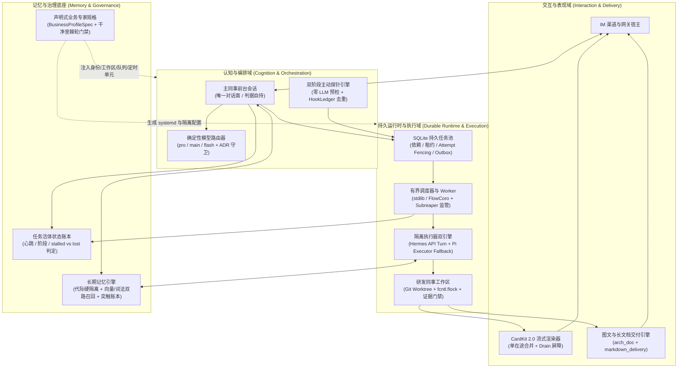
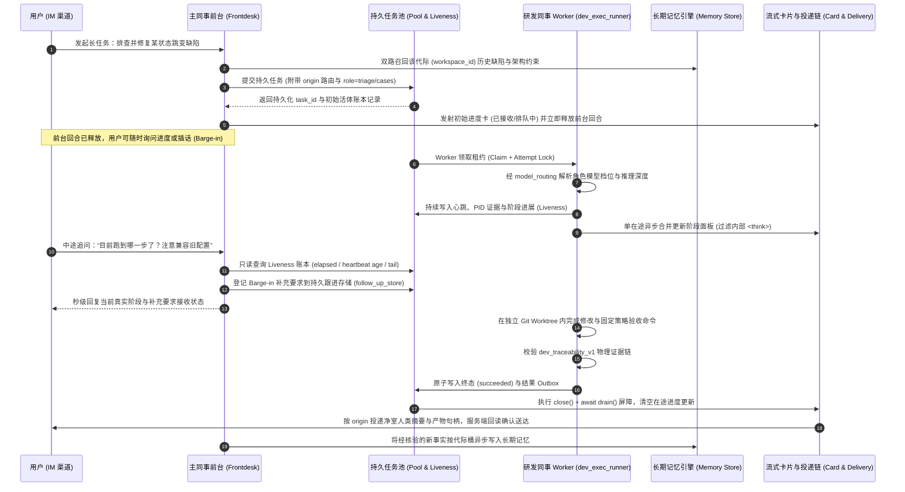

# 第 0 篇：全景导览 —— 从玩具 Agent 到生产级常驻智能体

> 摘要：本文剖析演示级 Agent 与生产级常驻智能体之间的工程鸿沟，给出 `super-agent` 的系统分层全景、端到端交互与执行生命周期，以及“通用本体 + 声明式业务叠加层”的核心解耦范式。

---

## 1. 为什么演示级 Agent 上不了生产？

在构建智能体的初期，开发者通常使用“一套 System Prompt + 一个 ReAct 工具循环 + 一个向量数据库”搭建原型。这种原型在单次演示中表现惊艳，但在真实团队的常驻生产环境中会迅速暴露出六大结构性死穴：

| 生产死穴 | 玩具 Agent 的典型症状 | `super-agent` 的工程解法 |
| :--- | :--- | :--- |
| **1. 前台阻塞与交互失联** | 在主对话回合里同步跑耗时 15 分钟的编译或代码分析；期间用户无法追问进度、无法补充要求，网关重启则任务灰飞烟灭。 | **薄前台 + 持久池解耦**：前台只做交互、分诊与派单，长任务入 SQLite 持久池（`agentcore/pool.py`），配合活体账本（`liveness.py`）与中途插话控制（`barge_in_control.py`）。 |
| **2. 多智能体群聊失控** | 多个平权 Agent 互相对话协商，上下文指数级膨胀，Token 账单失控，且出现错误时没有唯一责任主体。 | **同事制（Colleague Model）**：主同事独占对话面并自持验收判据；8 大专业研发同事在独立 Git Worktree 与文件锁保护下按契约施工（`colleague_dev.py`）。 |
| **3. 模型路由与上下文劣化** | 所有子任务盲目调用高价推理模型导致额度透支，或一刀切降级到廉价模型，导致长对话压缩（Compaction）时丢失关键架构状态。 | **确定性三级路由与底线保护**：纯函数路由引擎（`model_routing.py`）严格隔离 `pro`/`main`/`flash`，配额限流 `pro`，且强制锁定压缩与记忆合成不低于 `main`（`ADR-S3`）。 |
| **4. 定时巡检唤醒风暴** | 每隔 5 分钟用 cron 唤醒一次完整 LLM 会话去检查“有没有新任务/构建有没有挂”，99% 的空转轮次白白消耗大量 Token。 | **双阶段主动探针（Proactive Hooks）**：先跑零 LLM 的轻量脚本探针（Fast Path），返回 `[SKIP]` 直接静默退出；仅当探出真实增量且通过冷却去重后，才投递持久任务（`proactive_hooks.py`）。 |
| **5. 记忆跨代污染与幻觉回执** | LLM 记忆抽取器把“G2 代际阈值 5%”当成对“G1 代际阈值 3%”的修正，静默覆盖旧代际事实；子 Agent 嘴上报告“测试通过”但实际未执行。 | **代际桶硬隔离 + 物理证据门禁**：记忆按 `workspace_id` 硬分桶（`memory_store.py`）；交付回执强制校验结构化引用或测试进程退出码（`colleague_evidence.py`）。 |
| **6. 业务耦合与不可迁移** | 身份设定、领域词表、服务器地址散落在代码与宿主机盘上，换一台机器完全无法复现同等能力的智能体。 | **通用本体 + 声明式业务规格**：核心仓通过棘轮门禁禁止任何业务字面量（`test_repo_neutrality.py`），领域专家通过声明式 `BusinessProfileSpec`（`profile_spec.py`）一键打包与装配。 |

---

## 2. 系统架构全景图

`super-agent` 将一个生产级智能体拆解为职责正交的四个纵向域与十二个横向技术层：

---

## 3. 一条复杂请求的端到端生命周期

为了让读者直观理解上述模块如何协同工作，以下追踪一条典型的生产级研发任务——**“分析某模块的状态跳变缺陷，编写修复代码并通过回归验证”**——在 `super-agent` 内部的完整流转过程：

### 关键工程细节拆解

1. **前台回合秒级释放**：主同事在收到用户长任务后，绝不在当前对话回合里直接调用耗时工具。它通过 `durable_dispatch` 插件将任务写入 `agentcore/pool.py` 的 SQLite 队列，绑定原始会话路由（`origin`），发出受理回执后立即结束当前回合。这样主对话永远处于可响应状态。
2. **查进度不调大模型**：当用户在任务执行途中询问“进展如何”时，`task_status` 插件直接读取 `agentcore/liveness.py` 的 SQLite 活体账本（获取已运行时间、最后心跳距今秒数、进程存活证据及有界日志尾部），无需为查状态再启动昂贵的推理回合。
3. **单一卡片生产者互斥（`ADR-S6`）**：同一个交互任务只允许一个组件驱动卡片生命周期。终态交付前必须先调用 `close()` 停止新进度入队，再通过 `await drain()` 等待在途请求排空，彻底杜绝“最终报告已经发出，迟到的中间进度又把卡片刷回处理中”的经典异步竞态。

---

## 4. 核心解耦范式：通用本体 vs 声明式业务叠加层

很多团队在开发垂直领域的专家 Agent 时，习惯把领域知识、内部主机名、专用工具脚本直接硬编码进 Agent 框架源码里。结果是框架与单一业务锁死，既无法开源复用，也无法在团队内部横向复制出第二个领域的专家。

`super-agent` 严格执行**“本体与业务正交剥离”**的设计准则：

### 4.1 仓级业务无关性棘轮（Repo Neutrality Ratchet）

在 [`tests/test_repo_neutrality.py`](../../tests/test_repo_neutrality.py) 中，系统定义了扫描全仓所有可提交文件（`.py`、`.md`、`.sh`、`.yaml`、`.service`）的静态门禁：
- **禁止业务字面量**：任何特定企业内部项目代号、业务缩写、特定 IM 品牌中文名均被拦截。
- **禁止环境指纹**：任何内部服务器主机名、RFC1918 内网 IP 段（`192.168.x.x`、`10.x.x.x`、`172.16-31.x.x`）及实验网段均被拦截。
- **棘轮原则**：允许清单（Allowlist）被硬编码锁定为仅 3 项（测试文件自身、上游字节级镜像补丁 `patches/*.patch`、第三方压缩前端库 `mermaid.min.js`），严禁任何新增豁免。

### 4.2 声明式业务专家规格（`BusinessProfileSpec`）

既然本体仓不存任何业务字面量，真实的领域专家如何落地？答案是 [`agentcore/profile_spec.py`](../../agentcore/profile_spec.py) 与 [`install/setup_profile.py`](../../install/setup_profile.py) 提供的声明式装配机制：

1. **身份合成**：通用纪律骨架 [`identity/SOUL.generic.md`](../../identity/SOUL.generic.md) 预留唯一注入锚点 `{{BUSINESS_OVERLAY}}`。部署时通过 `--compose-soul` 将业务仓的专家叠加层合成进去，并通过字节体积等式验证无残留。
2. **声明式拓扑定义（`BusinessProfileSpec`）**：领域团队只需编写一份 JSON/YAML 规格文件，声明该领域专家的：
   - `workers`：各岗位 Worker 的角色名（`role`）、模型档位（`model_tier`: `pro` / `main` / `flash`）、工作目录、职责描述（`duty`）、远端执行宿主机（`target_host`）、并发度与超时预算；
   - `proactive_hooks`：定时主动巡检探针的配置文件与 `systemd` 日历调度周期；
   - `memory`：领域知识库的灌入源路径与默认身份标识；
   - `gateway`：网关端口与服务名。
3. **确定性渲染与可移植打包**：`setup_profile.py` 读取该规格后，纯确定性地生成经过安全转义（`quote_systemd`）的 `systemd` 服务与定时器单元、初始化各岗位的持久队列目录结构，并支持将领域配置打包为带 SHA256 清单的可移植 `.tar.gz` 发行包。

通过这一设计，**同一个 `super-agent` 引擎可以在 1 分钟内被实例化为自动驾驶仿真测试专家、持续集成值班专家或个人研发助理**，而核心代码无需修改一行。

