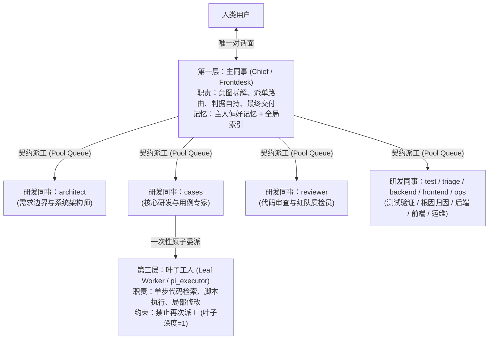
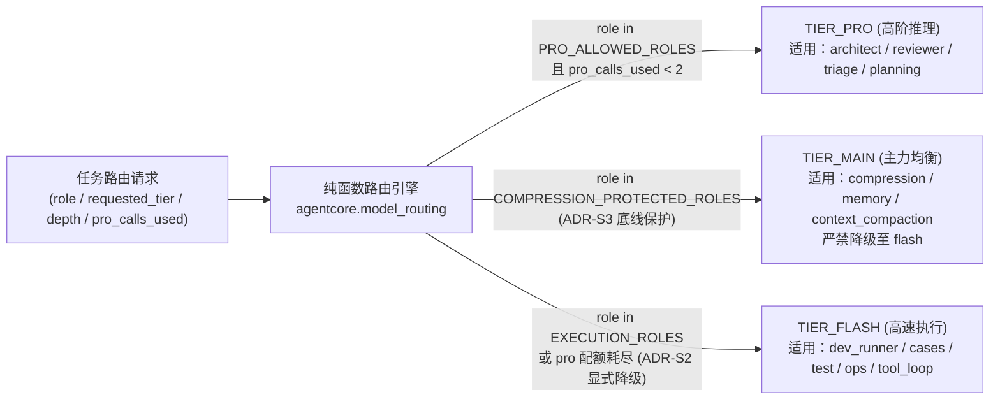

# 第 1 篇：多智能体组织学 —— 同事制、模型路由与工作区隔离

> 摘要：本文深入探讨多智能体协作的组织形态取舍，详解 `super-agent` 的“同事制（Colleague Model）”三层架构、8 大标准研发岗位契约、双引擎隔离执行器，以及保障成本与质量可控的确定性模型路由引擎与六大架构不变量（`ADR-S1` ~ `ADR-S6`）。

---

## 1. 多智能体协作的三流派取舍

当单体 Agent 的上下文窗口被长链路任务撑爆时，引入多 Agent 是必然演进。但业界常见的多 Agent 编排往往陷入两类极端：要么每次临时拼凑匿名子 Agent，跑完即散、毫无经验沉淀；要么让多个 Agent 在群里自由辩论，导致注意力稀释与 Token 灾难。

[`identity/COLLEAGUE_MODEL.md`](../../identity/COLLEAGUE_MODEL.md) 总结了三种流派的工程取舍：

| 组织流派 | 运行形态 | 核心优势 | 致命短板 | `super-agent` 的取舍 |
| :--- | :--- | :--- | :--- | :--- |
| **同事制（Colleague Model）** | 常驻**命名**同事，各有明确岗位契约、独立配置与长期记忆；人类只跟**主同事**对接 | 职责归属持久、岗位记忆可积累、对外交互面单一，**最节省人类注意力** | 需要严格的岗位边界与记忆分区治理，否则易退化为同名分身 | **主链路核心采用**：主同事控场 + 常驻/任务级专业研发同事 |
| **编排制（Orchestrated Leaf）** | 一次性临时子进程（Ephemeral），按指令跑完单个原子任务即销毁 | 上下文隔离彻底、无历史包袱、适合高并发批处理 | 无长期归属、无经验积累，跨阶段复杂链路需上层强行串联 | **作为底层补充**：用于批处理与叶子任务（`pi_executor`） |
| **对等制（Peer-to-Peer）** | 多个平权智能体在同一会话中互相协商、自由接话 | 适合开放式头脑风暴或多人同台演示 | 缺乏唯一最终责任人，上下文交叉污染严重，Token 消耗成倍放大 | **生产主链路弃用**：群聊默认仅主同事回话，严禁自由抢话 |

---

## 2. 三层角色体系与主同事五条铁律

在 `super-agent` 中，智能体团队按权限、生命周期与工具面被严格划分为三层：

### 主同事（对接口人）的五条核心契约

1. **唯一对话面**：用户只需向主同事交代目标；拆分任务、选择专业同事、跟踪进度、汇总产物均由主同事完成。
2. **判据自持与真实验证（最关键原则）**：**永远不要把“理解与验收判据”外包给下级子 Agent。** 下级同事返回的回执与历史记忆都只是“待验假说（Hypothesis）”，不是“已验证事实（Verified Fact）”。主同事在对外给出定性结论前，必须核验物理证据或回读真实产物。
3. **对外只交付已完成事实**：交付内容必须包含“结论 + 可核验句柄（文件绝对路径 / 任务 ID / 报告链接）+ 未覆盖项与降级声明”。
4. **同事面能进能出**：某类专项任务重复出现满 3 次即固化为常驻同事；长期闲置的岗位及时裁撤，防止组织腐化。
5. **归属可转移**：产物与结论沉淀在岗位工作区与共享清单下，不随单次会话或特定底层模型的更换而丢失。

---

## 3. 八大官方研发同事与工作区隔离

为了避免多智能体协作时出现“职责不清”或“两个 Agent 同时修改同一个文件导致代码踩踏”，[`agentcore/colleague_dev.py`](../../agentcore/colleague_dev.py) 定义了 8 个开箱即用的标准研发岗位契约（`DEV_ROLES`），每个岗位均明确规定了 `duty`（核心职责）、`can_do`（授权动作）与 `boundaries`（红线禁令）：

| 角色标识 (`role`) | 岗位名称 | 核心职责与严守边界 |
| :--- | :--- | :--- |
| `architect` | 需求边界与系统架构师 | **纯黑盒拆解自然语言需求**，提取因果契约与架构蓝图；**红线**：严禁先读内部实现源码来倒推需求，防止既有实现缺陷污染规格契约。 |
| `cases` | 核心研发与用例开发专家 | 按架构契约在隔离分支实现功能逻辑与完备测试用例；**红线**：严禁在主分支直接施工，短时序高敏链路前严禁乱插硬延时，必须包含反向断言。 |
| `reviewer` | 代码审查与红队质检员 | 执行语法与架构反模式守卫、并发时序竞争分析与覆盖率核验；**红线**：存在反模式或证据不足时一律驳回，严禁盲目放行。 |
| `test` | 自动化测试与仿真验证专家 | 在隔离环境中驱动全量/增量测试管线，采集轨迹并归档报告；**红线**：以真实进程退出码与 SHA256 制品校验为准，严禁伪造结果或静默回退。 |
| `triage` | 缺陷定性与根因诊断专家 | 比对状态跳变轨迹、调用栈与历史故障库，构建最小复现；**红线**：严禁将未经验证的猜测包装为确定性结论，证据不足须列明缺失链路。 |
| `backend` | 服务端与底层系统工程师 | 维护调度框架、API 接口、数据库事务与文件锁控制；**红线**：严禁绕开锁机制拉起失控子进程或直接裸改底层任务库。 |
| `frontend` | 表现层与交互排版工程师 | 负责原生交互卡片排版、图表可视化与流式体验；**红线**：严格遵守单卡生命周期唯一性，禁止二次触发退役组件。 |
| `ops` | 持续集成与运维巡检专家 | 管理干净室构建、服务健康巡检与版本回滚；**红线**：环境缺失绝不允许伪装成测试通过，生产变更必须先出计划（Plan）再执行。 |

### 物理级并发隔离：Git Worktree + `fcntl.flock` + 双引擎执行器

光有 Prompt 里的口头契约不够，[`agentcore/dev_runner.py`](../../agentcore/dev_runner.py) 与 [`install/worker/dev_exec_runner.py`](../../install/worker/dev_exec_runner.py) 在操作系统层面提供了三道硬隔离：

1. **跨进程排他锁（`fcntl.flock`）**：每个研发工作区绑定一把内核级文件锁。同一时刻只允许一个写者进程执行代码修改与验收命令；若进程意外崩溃，操作系统内核自动释放文件描述符锁，不会留下死锁文件。
2. **管理员固定验收策略（Verification Authority）**：任务 Payload 只能传递业务目标，**绝不允许由任务自身指定要执行的宿主机验收 Shell 命令**。验收命令由管理员配置固定，防止模型通过修改测试脚本来自我放行。
3. **双引擎主备容灾（Dual-Engine Runner）**：在 `dev_exec_runner.py` 中，任务优先由 **Engine 1（Hermes API Server Turn）** 执行以使用完整后台工具链；当主引擎超时、异常或无输出时，自动切换至 **Engine 2（`toolsets/pi_executor` 独立编码执行器）** 兜底，并在回执中如实标记引擎切换，确保主引擎波动不会导致长任务静默丢失。同时支持通过 `DEV_TARGET_HOST` 将执行上下文装饰路由至指定的远端 SSH 宿主机。

---

## 4. 确定性模型路由与六大架构不变量（`ADR-S1` ~ `ADR-S6`）

在多角色协作系统中，如果所有角色都无节制地调用最昂贵的顶级推理模型（`pro`），单次复杂任务的成本会高得无法承受；反之，如果把所有后台角色一刀切降级到最廉价的轻量模型（`flash`），又会导致复杂规划失败或长上下文压缩失真。

[`agentcore/model_routing.py`](../../agentcore/model_routing.py) 实现了一个**纯函数、零 I/O、零时钟依赖**的确定性模型路由引擎（给定相同输入，产生逐字节一致的路由决策），并在代码中直接固化了 6 条可由单元测试机械验证的**架构决策记录（Architectural Decision Records）**：

### 六条机器可验的架构不变量

| 编号 | 架构决策名称 | 核心工程约束与设计原因 |
| :--- | :--- | :--- |
| **ADR-S1** | **模型身份与路由单一事实源（SSoT）** | 所有执行器（`dev_exec_runner`、`dev_runner`、`durable_dispatch`、`ccp_config`）必须统一通过 `agentcore.model_routing` 解析模型档位，严禁在任何执行器内部硬编码 `model='flash'` 或私自改写路由。 |
| **ADR-S2** | **模型与引擎降级显式可见（Visible Degradation）** | 任何因为配额耗尽导致的档位降级（如 `pro -> main/flash`）或执行引擎回退（`hermes -> pi`），必须在回执中显式输出 `degraded=True` 与 `degradation_reason`，严禁掩盖质量降级。 |
| **ADR-S3** | **长上下文压缩底线保护（Compaction Floor Protection）** | **极其重要的生产经验**：`compression`、`memory`、`context_compaction` 三类角色被锁定在 `>= main` 档位（中等以上推理深度），并与 `EXECUTION_ROLES` 严格互斥。因为一旦把长对话压缩交给最低档的 `flash` 模型，会不可逆地损坏会话记忆与架构状态。 |
| **ADR-S4** | **核心包与外部工具集无环依赖（Acyclic Boundary）** | `agentcore/*` 严禁在 AST 层面导入 `toolsets.pi_executor` 或宿主桥接层；依赖方向严格单向流动（`toolsets -> agentcore`），通过 `tests/` 中的 AST 静态扫描门禁强制执行。 |
| **ADR-S5** | **Pro 档位白名单与单任务配额护栏** | 只有认知密集型角色（`PRO_ALLOWED_ROLES`：`architect`、`brain`、`planning`、`plan_gate`、`deep_diagnosis`、`reviewer`、`triage`）允许请求 `pro` 档位，且单任务默认上限为 2 次（`DEFAULT_MAX_PRO_CALLS_PER_TASK = 2`），超额自动降级并留痕。 |
| **ADR-S6** | **完成态卡片单一生产者互斥** | 当 `durable-dispatch` 启用完成态卡片投递时，`task-progress` 插件自动让出完成卡发射权，确保每个 Profile 下最多只有一个生产者向 IM 渠道发送终态卡片。 |

通过这套“角色契约 + 物理工作区隔离 + 纯函数模型路由 + 静态 ADR 门禁”的组合拳，`super-agent` 实现了多智能体团队既能像人类研发组织一样专业分工，又能在算力预算与代码安全上保持绝对可控。

