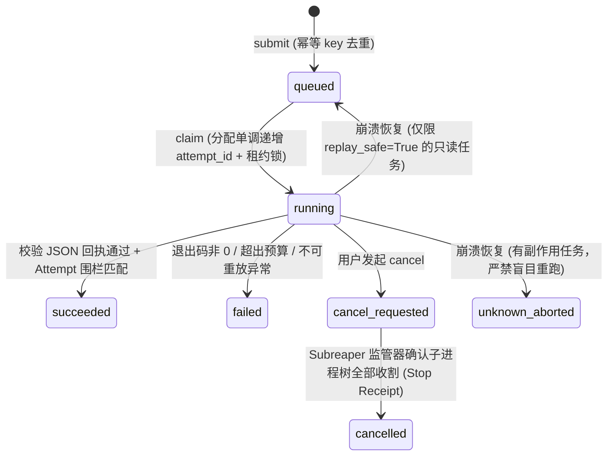
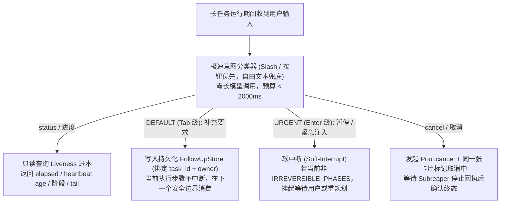
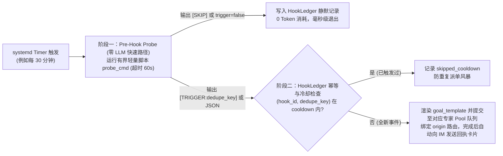

# 第 2 篇：长任务运行时 —— 持久队列、插话抢占与主动探针

> 摘要：本文深入解析 `super-agent` 如何解决异步长任务的四大生产难题：进程崩溃后的状态恢复、取消操作留下的孤儿进程与旧任务诈尸、任务运行期间的用户中途插话（Barge-in），以及定时巡检作业的 Token 唤醒风暴。

---

## 1. 为什么内存里的 `asyncio.Future` 不是生产级任务？

在许多轻量级 Agent 框架中，所谓的“后台任务”只是在网关进程内调用 `asyncio.create_task()` 或把函数扔进内存线程池。这种做法在生产环境中有三个致命缺陷：

1. **网关重启即失忆**：只要更新配置或重启网关服务，所有在途任务全部丢失，用户永远收不到结果，也不知道任务停在了哪一步。
2. **协作式取消管不住子进程**：Python 协程或线程的取消是协作式的（Cooperative Cancellation）。当子 Agent 正在通过 `subprocess` 执行一段耗时的编译或仿真命令时，取消外层 Future 根本杀不死已经脱离环境的孙进程（Orphan Process），它们会继续在后台偷偷改文件。
3. **旧 Attempt 晚到覆盖新状态（Zombie Write）**：一个被判定为超时或取消的旧任务尝试（Attempt 1），如果在网络恢复后迟到了几秒交回结果，会直接把重试中的 Attempt 2 或已取消状态覆盖成“成功”。

`super-agent` 通过 [`agentcore/pool.py`](../../agentcore/pool.py)、[`agentcore/worker.py`](../../agentcore/worker.py) 与 [`agentcore/scheduler.py`](../../agentcore/scheduler.py) 构建了**基于 SQLite 持久化与操作系统进程围栏**的长任务运行时。

---

## 2. 持久任务池（Durable Pool）与 Attempt Fencing 围栏

### 2.1 状态流转与所有权边界

- **持久层（`agentcore.pool.Pool`）**：拥有任务身份、DAG 依赖关系、租约（Lease）、重放安全策略（`replay_safe`）、Attempt 围栏号以及结果发件箱（Outbox）。
- **执行层（`agentcore.scheduler.AgentScheduler`）**：负责进程内有界并发槽位控制，支持标准库线程池（`stdlib`）或原生协程池（`flowcoro_py`）双后端。
- **桥接层（`agentcore.worker.Worker`）**：只有当本地调度器有空闲槽位时，才去 `Pool` 领取（Claim）持久任务，绝不把未执行的任务囤积在进程内存里。

### 2.2 四道确定性运行时围栏

1. **Attempt Fencing（防旧任务诈尸）**：每次 `claim` 任务时生成唯一的 `attempt_id` 与独立工作目录。任何心跳续租、日志写入或终态提交都必须携带当前有效的 `attempt_id`；一旦租约被收回或取消，旧 Attempt 的迟到写入会被数据库层直接拒绝。
2. **Linux Subreaper 进程树收割与停止契约（[`docs/ATTEMPT_STOP_CONTRACT.md`](../ATTEMPT_STOP_CONTRACT.md)）**：
   - 取消一个任务（`Pool.cancel`）**绝不能立刻把状态改成 `cancelled`**，而必须先进入非终态的取消窗口。
   - 本地执行器运行在启用了 `PR_SET_CHILD_SUBREAPER` 的监管进程下。即使任务内部派生的子进程脱离了原会话或清空了环境变量，也会被 Subreaper 强制收养并逐一击杀收割（Reap）。
   - 只有当监管器出具绑定该 Attempt 的停止回执（Stop Receipt），证明没有任何残余进程存活后，任务才能正式落入 `cancelled` 终态。
3. **重放安全分级（`replay_safe`）**：只读分析任务标记为 `replay_safe=True`，Worker 意外断电重启后可安全重新入队；而涉及代码写入或外部调用的任务默认 `replay_safe=False`，中断后保持待核实状态，严禁自动重放造成二次副作用。
4. **内核级资源硬预算（`RLIMIT_FSIZE`）**：每个 Attempt 拥有独立的墙钟截止时间（Deadline）、合并的 `stdout/stderr` 字节上限以及单文件大小上限（默认 64 MiB，在 `exec` 前通过 `RLIMIT_FSIZE` 施加），防止失控脚本写满磁盘。

---

## 3. 活体状态账本（Liveness Ledger）：区分 `stalled` 与 `lost`

传统的队列只有 `running` 和 `done` 两个粗糙状态，当任务卡死 20 分钟没有动静时，用户完全不知道它是“正在深思”还是“进程已经崩了”。

[`agentcore/liveness.py`](../../agentcore/liveness.py) 为所有长任务（无论来自持久队列、终端后台作业还是外部执行器）维护一张独立的单行活体账本（`task_liveness`）：

| 活体状态 | 物理含义 | 判定依据与防伪机制 |
| :--- | :--- | :--- |
| `running` | 正常活跃执行中 | 心跳时钟（`heartbeat_at`）在阈值窗口内持续推进，且更新了真实 `phase` 与 `tail` 日志尾部。 |
| `stalled` | **静默停滞（可恢复观察）** | 进程仍在，但超过 `DEFAULT_STALL_SECONDS`（默认 120 秒）未收到新心跳。后续若恢复心跳可自动解除 `stalled`。 |
| `lost` | **进程蒸发（确凿丢失）** | 账本记录的本地子进程已消失。为防止操作系统 PID 复用导致误判（新起的无关进程恰好分到同一个 PID），账本同时绑定 **`boot_id + /proc/<pid>/stat starttime`**（`pid_start_time`）作为不可伪造的物理进程指纹。 |
| `unverified` | **声称完成但证据未齐** | 执行器声称任务已结束，但启动时登记的预期产物（`expects`）尚未通过核验；对读取方而言绝不视为已完成。 |
| `done` / `failed` / `cancelled` | **不可逆终态（Write-Once）** | 终态具备单次写入保护（Write-Once），任何网络延迟导致的晚到心跳都无法把已结束的任务改回 `running`。 |

---

## 4. 中途插话与抢占控制（Barge-in Control）

当一个耗时 10 分钟的研发任务正在后台执行时，用户在对话框里输入了一句话，系统该怎么响应？如果把这句话当成普通聊天塞进正在跑工具循环的主模型上下文里，要么排队等 10 分钟才回，要么再拉起第二个耗时模型回合造成双倍并发冲突。

[`agentcore/barge_in_control.py`](../../agentcore/barge_in_control.py) 借鉴了现代交互式编码终端的 **Tab（排队追加） / Enter（紧急软中断）** 双模态控制设计，提供了一条不触发长模型回合的**极速控制短路径（Control Short-Path，SLO 预算 < 2000ms）**：

- **不可逆阶段保护（`IRREVERSIBLE_PHASES`）**：当后台任务正处于最终提交或不可逆外部写入阶段时，普通的补充要求（`Urgency.TAB`）绝不会强行抢占，系统会如实告知用户“已登记到跟进队列，将在当前不可逆步骤完成后应用”。
- **持久化跟进队列（`FollowUpStore`）**：用户的中途补充要求按 `(task_id, owner)` 落盘到 SQLite，即使网关重启也不会丢失用户的补充指令。

---

## 5. 双阶段主动探针引擎（Proactive Hooks）：灭绝定时唤醒风暴

生产级常驻智能体不仅要被动响应用户提问，还需要主动盯盘（例如：每 30 分钟检查一次远端代码仓是否有新提交、夜间回归构建是否失败、线上告警队列是否有新增）。

如果直接用 `cron` 每 30 分钟唤醒一次大模型去跑工具检查，一天 48 次唤醒中可能有 47 次是“无事发生”，却白白消耗了数十万 Token 的系统提示词预填充（Prefill）成本。

[`agentcore/proactive_hooks.py`](../../agentcore/proactive_hooks.py) 用**“零 LLM 预检探针 + 幂等持久派单”**的双阶段架构彻底解决了这个问题：

1. **阶段一（Pre-Hook Probe，零 Token 消耗）**：由轻量级 Shell 或 Python 脚本充当哨兵。当没有检测到新提交或异常时，脚本打印 `[SKIP]` 或 `{"trigger": false}`，引擎在 SQLite `HookLedger`（`proactive_hooks.db`）记下一笔静默巡检即刻退出，**全程不调用任何大模型接口**。
2. **阶段二（Idempotent Durable Dispatch，有事才唤醒专家）**：当探针捕获到真实变化并输出 `{"trigger": true, "dedupe_key": "commit-abc123", "summary": "..."}` 时，引擎首先核对 `(hook_id, dedupe_key)` 的主键记录与冷却窗口（`cooldown_seconds`）。确认是首次触发后，将上下文填入 `goal_template`，直接投入目标研发同事的持久 `Pool` 队列。任务完成后，复用统一的完成态投递链路将人类可读的报告卡片推送到指定群聊或个人会话。

