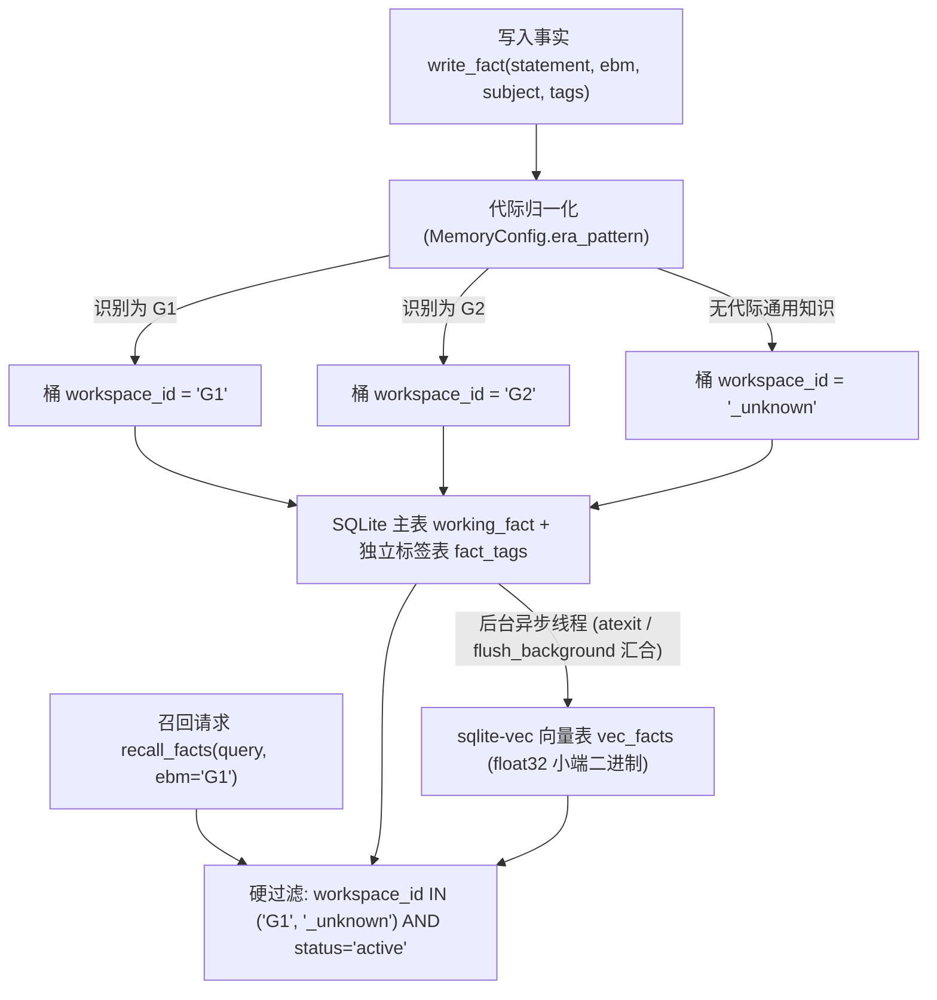

# 第 3 篇：生产级长期记忆 —— 双路召回、代际硬隔离与容量治理

> 摘要：本文深入剖析 `agentcore/memory/` 长期记忆引擎的工程架构，揭示为什么盲目使用 LLM 自动记忆抽取会破坏多版本工程知识，并详解代际分桶硬隔离、独立标签表设计、向量与词法双路召回、置信度衰减以及常驻内存预算治理。

---

## 1. 为什么常规的“LLM 自动记忆抽取 + 向量库”在工程领域会失效？

市面上绝大多数 Agent 记忆组件采用如下流水线：每轮对话结束后，让一个后台 LLM 抽取器判断“新事实是否与旧事实冲突”，若语义相似但数值不同，则将旧事实标记为 `superseded`（已淘汰）。

在研发与复杂工程领域，这种黑盒自动覆写会导致灾难性的**跨代际知识污染**：
- **真实故障复盘（见 [`agentcore/memory/memory_store.py`](../../agentcore/memory/memory_store.py) 顶部注释）**：
  先向记忆库写入 `G1` 代际规范：“某控制门限超过 3.0% 时退出自动模式”；随后写入 `G2` 代际规范：“某控制门限超过 5.0% 时退出自动模式”。通用 LLM 抽取器只看自然语言语义，不理解 `G1` 与 `G2` 是并行维护的两套产品代际，误以为 5.0% 是对 3.0% 的最新修正，直接把 `G1` 的核心事实静默淘汰。

因此，`super-agent` 的记忆工程确立了三条核心准则：
1. **确定性写入与代际硬隔离**：记忆的分桶、冲突判定与淘汰状态必须由确定性规则控制，绝不交给不理解业务代际的黑盒抽取器。
2. **结构演进与上游解耦**：扩展元数据（如多维业务标签）存储在独立的关联表中，不篡改基础事实表列结构。
3. **存储与常驻内存可度量、可治理**：向量索引不能无限膨胀，退役事实不能持续侵占常驻只读视图内存。

---

## 2. 存储架构：`workspace_id` 代际硬隔离与独立 `fact_tags` 表

### 2.1 代际分桶硬隔离（Era Isolation）

在 [`agentcore/memory/config.py`](../../agentcore/memory/config.py) 与 [`agentcore/memory/memory_store.py`](../../agentcore/memory/memory_store.py) 中，宿主通过 `MemoryConfig` 注入代际识别正则（如 `era_pattern=r"\bG(\d+)(?:\.\d+)?\b"`）：
- **写入即分桶**：调用 `write_fact(..., ebm="G1")` 时，代际标识被归一化并写入 `working_fact.workspace_id`。未指明代际的通用经验统一归入 `_unknown` 桶（`UNKNOWN_BUCKET`），严禁模型凭空臆造代际。
- **召回硬过滤**：当在 `G1` 上下文中调用 `recall_facts(..., ebm="G1")` 时，SQL 层强制限定只检索 `workspace_id IN ('G1', '_unknown')`。`G2` 的事实在物理查询层面被彻底屏蔽，从根源上杜绝跨代串味。



### 2.2 为什么 `fact_tags` 必须独立成表？

很多开发者喜欢直接给事实表执行 `ALTER TABLE working_fact ADD COLUMN tags TEXT` 塞入 JSON 字符串。`super-agent` 明确拒绝这种做法：
- **防上游重建丢失**：当底层表结构随版本迁移重建时，私自追加的列会静默丢失。
- **精确索引与无歧义约束**：`fact_tags` 采用独立的 `(fact_id, key)` 复合主键与 `(key, value)` 索引。同一条事实的任意标签维度（如 `topic`、`signal`、`module`）只允许存在唯一值，且按任意标签过滤都是一次高效的索引等值查找。

### 2.3 异步向量化与批量灌入（Bulk Ingest）性能优化

1. **交互式写入不阻塞主线程**：`write_fact` 将文本与标签原子提交到 SQLite 后立即返回，耗时的向量嵌入计算交由后台线程异步写入 `vec_facts`；同时注册 `atexit` 钩子与 `flush_background(timeout)` 接口，保证短生命周期 CLI 或测试断言前不会丢失向量索引。
2. **54 倍批量灌入加速**：在远端磁盘实测中，SQLite 默认的 `synchronous=FULL` 每次事务提交都触发约 73ms 的磁盘 `fsync`，导致知识库初始化灌入速度被卡在 1.4~8.7 条/秒。通过 `MemoryConfig(bulk_ingest=True)` 或 `MEMORY_BULK_INGEST=1`，在可重跑的批处理灌入阶段自动切换为 `WAL + synchronous=NORMAL + wal_autocheckpoint=20000`，实测写入吞吐提升至 **474 条/秒（提升 54 倍）**，而日常交互式记忆写入仍保持最高持久性级别。

---

## 3. 双路混合召回与诊断透明性

单纯依赖向量余弦相似度（KNN）在检索精确代码符号、配置宏名或错误码时表现极差；而单纯依赖 SQL `LIKE` 或全文检索又无法处理自然语言的同义转述。

[`agentcore/memory/memory_store.py`](../../agentcore/memory/memory_store.py)、[`agentcore/memory/hybrid_recall.py`](../../agentcore/memory/hybrid_recall.py)、[`agentcore/memory/vec_index.py`](../../agentcore/memory/vec_index.py) 与 [`tools/recall_combined.py`](../../tools/recall_combined.py) 构建了**向量 + 词法 + 实体规则 + 标签**的多路混合召回管线：

1. **单进程 RRF（Reciprocal Rank Fusion）混合召回（`recall_hybrid`）**：
   - [`agentcore/memory/hybrid_recall.py`](../../agentcore/memory/hybrid_recall.py) 在同一进程内联合调用 [`EntityStore`](../../agentcore/memory/entity_store.py)（FTS5 BM25 + 精确别名匹配）与 [`memory_store.recall_facts`](../../agentcore/memory/memory_store.py)（向量 KNN + 词法 + 标签过滤），消除了双子进程冷启动开销。
   - 采用倒数秩融合公式 $\text{score}(d) = \sum_{s} \frac{w_s}{k + \text{rank}_s(d)}$（默认 $k=60$）统一异构分数量纲，使同时被规则库与长期事实库印证的条目自动置顶，并保持 `prohibition`（安全禁令）极性优先。
   - [`EntityStore`](../../agentcore/memory/entity_store.py) 支持外部 JSON 种子包注入（`seed_file` / `SUPER_AGENT_ENTITY_SEED_FILE` / `export_seed_pack` / `import_seed_pack`）与基于数据库已存实体名的动态锚点关键词发现，使引擎保持 100% 业务中立的同时支持任意领域规则热装载。
2. **连接级 `sqlite-vec` 自动装载与平滑降级**：
   - `sqlite-vec`（随包分发 `agentcore/memory/vendor/vec0.so`）是连接级扩展。连接工厂 `_connect()` 在每次新建连接时自动装载扩展并确保 `vec_facts` 虚拟表就绪。
   - 若运行环境缺失原生扩展，引擎自动平滑降级为 Python 内存内精确余弦计算，保证功能在任何干净室容器中 100% 可用。
3. **非法向量入库拦截（`valid_embedding`）**：在向量写入缓存或数据库前（[`agentcore/memory/vector_codec.py`](../../agentcore/memory/vector_codec.py)），强制校验维度一致性（`len(vec) == embed_dim`）、浮点数有界性（拒绝 `NaN` / `Inf`）及 `float32` 打包字节长度，防止脏向量污染 KNN 索引。
4. **空结果根因透明化（`empty_reason`）**：当召回返回 0 条结果时，引擎绝不只返回一个空列表让调用方盲猜，而是精确标注 `empty_reason`（如 `no_match`、`no_match_for_tags`、`below_score_floor`），配合 [`tools/inspect_recall_diagnostics.py`](../../tools/inspect_recall_diagnostics.py) 实现毫秒级召回链路排障。

---

## 4. 记忆新陈代谢、突触可塑性闭环与常驻内存治理

如果一个常驻 Agent 运行半年，只往记忆库里追加而不做清理，会出现两个严重后果：一是过期经验反复干扰当前决策；二是退役事实的向量仍然占据磁盘与常驻内存副本，甚至稀释 `sqlite-vec` 的全局 Top-K 召回池。

### 4.1 入库门禁、使用留痕与突触可塑性闭环（Synaptic Plasticity Loop）

- **三道入库门禁（`memory_gate.py`）**：`write_fact(..., enforce_gate=True)` 在写入前校验可行动性（拦截模糊空话）、作用域完整性（含数字门限却无代际/主体时拦截）与主体关联度。
- **端到端突触可塑性反馈闭环（`memory_trace` -> `memory_plasticity` -> `synapse`）**：
  1. **召回留痕**：`recall_facts(..., task_id=...)` 或 `recall_hybrid(..., task_id=...)` 自动将本轮命中的 `fact_id` 记入 `memory_usage.db`（[`agentcore/memory/memory_trace.py`](../../agentcore/memory/memory_trace.py)）。
  2. **终态归因与强化/降级**：任务在 [`Pool._terminal`](../../agentcore/pool.py) 进入终态（或显式调用 `apply_task_outcome(task_id, passed, failure_text)`）时，[`agentcore/memory/memory_plasticity.py`](../../agentcore/memory/memory_plasticity.py) 自动复盘该任务用过的记忆：任务通过则置 `active` 并清零连败计数；非环境噪声导致的失败则累加 `consecutive_failures`，满 5 次连败自动降级为 `suspect`（在下次召回排序中权重乘 `0.5`，天然跌出 Top-1 但保留审计痕迹）。
- **跨库增量同步（`memory_sync.py`）**：[`sync_databases(src_db, dst_db)`](../../agentcore/memory/memory_sync.py) 按 `(归一化正文哈希, workspace_id)` 增量挑出源库独有的活跃事实与标签并幂等导入目标库，避免直接拷贝 `.db` 覆盖对端独有经验。

### 4.2 休眠向量垃圾回收（Dormant Vector GC）与常驻视图裁剪

1. **退役即清向量**：当事实通过 `drop_fact`、`supersede`、`write_fact(resolve_conflict=True)` 或 `activate_candidate_fact` 转为 `deprecated` / `superseded` 时，[`vector_codec.delete_vectors_for_facts`](../../agentcore/memory/vector_codec.py) 在同一事务内立即清除其在 `fact_embeddings` 与 `vec_facts` 中的向量，保留 `working_fact` 审计行但释放 100% 向量空间。
2. **存量休眠向量批量回收（`prune_dormant_vectors`）**：对历史遗留的休眠向量，调用 `prune_dormant_vectors(dry_run=False, vacuum=True)` 可一键回收所有非 `active`/`candidate` 事实的嵌入与 `vec0` 索引，消除全局 KNN 的「桶稀释」与僵尸空间占用。
3. **常驻内存视图按需裁剪（`MemoryReadView`）**：[`agentcore/memory/read_view.py`](../../agentcore/memory/read_view.py) 在同步 `vec_facts` 时严格只装载 `status='active'` 的向量，并提供 `compact_dormant=True` 与 `evict_dormant_vectors()` 在内存快照中剔除休眠嵌入。

### 4.3 存储与常驻视图体检（`agentcore.memory_footprint`）

为了防止记忆库在不知不觉中撑爆宿主机内存，[`agentcore/memory_footprint.py`](../../agentcore/memory_footprint.py) 提供了只读、零隐私泄露（不输出任何事实正文或原始向量值）的容量体检器：

```bash
python3 -m agentcore.memory_footprint --database <path/to/memory.db> --view-budget-mib 128
```

该工具专门审计三项最容易被忽视的隐性资源泄漏：
1. **向量双份存储审计**：检查是否同时在 `fact_embeddings` BLOB 列与 `vec_facts` 虚拟表里重复存储了两份浮点向量。
2. **僵尸向量占比（Retired Fact Vectors）**：审计已退役（`deprecated` / `superseded`）事实的残余向量字节数，配合 `prune_dormant_vectors()` 保持休眠向量零堆积。
3. **常驻内存水位门禁**：计算当前活跃与全量索引相对 `--view-budget-mib` 的占用百分比，并由定时巡检作业 `runtime/autotask/jobs/memory-footprint-guard.json` 持续监控告警。

