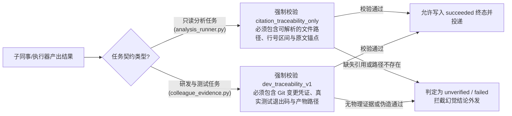
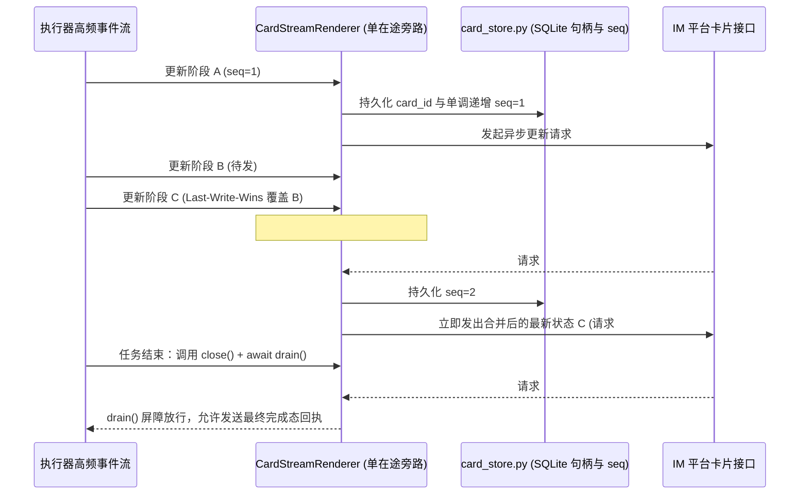

# 第 4 篇：防幻觉与确定性工程 —— 证据门禁、流式屏障与干净室验证

> 摘要：本文阐述 `super-agent` 的最高工程哲学——“不相信模型的口头承诺，只相信可机械核验的物理证据”。深入拆解分析与研发交付的证据门禁、CardKit 2.0 流式卡片的单在途合并与 `drain()` 屏障、完成态服务端回读核对，以及对智能体自身进行机械取证的干净室验证体系。

---

## 1. 核心工程准则：回执不等于事实，配置不等于生效

在把大语言模型接入生产系统的过程中，最危险的反模式就是**“听信模型的自我汇报”**：
- 子 Agent 在 JSON 回执里返回 `{"ok": true, "summary": "所有测试均已通过"}`，但实际上它可能因为环境报错根本没跑测试，或者只跑了一个空命令；
- 消息发送函数返回了 HTTP 200，但内容因为格式非法被平台静默截断，或者卡片因为并发更新乱序停在了半截状态；
- 开发者在配置文件里加了一段身份纪律，以为模型已经在遵守，实际上宿主加载路径根本没读到那个文件。

`super-agent` 在系统的每一个关键出口都设置了**不可绕过的确定性物理门禁（Deterministic Gates）**。

---

## 2. 双轨交付证据门禁：只读分析 vs 研发修改

系统拒绝任何“无出处、无句柄”的裸文本结论，根据任务性质实施两套严格的证据校验协议：

1. **只读分析证据链（`citation_traceability_only`，见 [`agentcore/analysis_runner.py`](../../agentcore/analysis_runner.py)）**：
   负责代码调研、架构梳理或日志排查的只读分析运行器，其输出必须附带结构化引用条目（文件路径、行号、关键符号或日志时间戳），不允许输出无法溯源的主观综述。
2. **研发追溯证据链（`dev_traceability_v1`，见 [`agentcore/colleague_evidence.py`](../../agentcore/colleague_evidence.py)）**：
   研发同事在独立工作区完成编码或测试后，交付结构必须通过 `colleague_evidence.py` 的模式核验：修改了哪些文件、运行了什么管理员授权的验证命令、进程的真实退出码是多少、生成的报告文件落在哪个路径。

---

## 3. 流式交互卡片与完成态投递的确定性工程

在 IM 平台上向用户实时展示长任务进度，是分布式异步编程的重灾区。常见缺陷包括：高频更新触发平台接口限流、内部推理过程（`<think>`）泄露到公开卡片、最终结果发出后被迟到的中间进度覆盖、以及网关崩溃重启后卡片永远卡死在“运行中”。

`super-agent` 通过 [`agentcore/cardkit2_renderer.py`](../../agentcore/cardkit2_renderer.py)、[`agentcore/card_store.py`](../../agentcore/card_store.py)、[`agentcore/stalled_card_bridge.py`](../../agentcore/stalled_card_bridge.py) 与 [`agentcore/completion_delivery.py`](../../agentcore/completion_delivery.py) 构建了工业级交付链路：

### 3.1 单在途异步合并（Single-In-Flight Coalescing）与 `<think>` 剥离

- **思维链净室过滤**：渲染器在语法层自动剥离 `<think>...</think>` 内部推理块与原始 JSON/Markdown 调试噪音（见 `completion_delivery.py` 的人类摘要提取逻辑），公开卡片只展示结构化的阶段面板。
- **单在途合并（Last-Write-Wins）**：无论后台每秒产生多少次工具进度事件，同一张卡片在网络上永远**最多只有 1 个在途 HTTP 请求**。请求在途期间新产生的多次进度更新会在内存槽位中自动合并，前一个请求返回后只发送最新的一帧，既消除了网络乱序翻转，又降低了 90% 以上的平台 API 调用量。
- **`close() + await drain()` 终态屏障**：在投递最终完成报告前，必须先调用 `close()` 拒绝任何后续进度写入，再 `await drain()` 阻塞等待当前在途的最后一次卡片更新彻底返回，从而在时序上保证**终态卡片绝对不会被迟到的中间进度覆盖**。

### 3.2 崩溃恢复与服务端回读核对（Read-Back Verification）

1. **句柄持久化与未知状态保留**：`card_store.py` 将卡片 ID 与严格递增的 `sequence` 落盘到 SQLite。若宿主中途崩溃重启，`stalled_card_bridge.py` 不会盲目重发第二张新卡造成刷屏，也不会假装任务成功，而是原地更新原卡片提示未知/中断状态。
2. **投递三态分离与服务端回读**：在 [`agentcore/feishu_transport.py`](../../agentcore/feishu_transport.py) 中，系统严格区分 **`已接受（Accepted）` / `已渲染（Rendered）` / `已送达（Delivered）`**。完成态投递按 `delivery_key` 保证至多一次（At-Most-Once），并在发送后向服务端回读消息实体进行内容比对；凭据全程不落盘、不进日志。

---

## 4. 如何用机械手段验证智能体自身？

普通的软件项目只测业务逻辑，而 `super-agent` 最独特的地方在于：**它用一套极其严苛的机械断言，去验证“智能体框架自身有没有说谎”**。

### 4.1 死端口请求转储法：零凭据证明“身份真的进了 Prompt”

怎么证明 [`identity/SOUL.generic.md`](../../identity/SOUL.generic.md) 里的纪律条款和业务叠加层真的被宿主拼进了发给大模型的最终 System Prompt，而不是停留在磁盘上的死文件？

如果去调真实大模型问“你的系统提示词是什么”，模型既可能产生幻觉，又需要消耗真实 API 凭据（在 CI 干净室里没有凭据）。

[`checks/identity_injection_check.sh`](../../checks/identity_injection_check.sh) 设计了一个极为精妙的**死端口取证法（Dead-Port Request Dump Verification）**：
1. 在临时隔离 Profile 中，将模型 API 端点故意指向本机一个**必然拒绝连接的死端口**；
2. 触发一次真实的宿主对话调用；
3. 宿主在向模型端点发起 HTTP 请求失败时，会**无条件将构造完毕的完整请求 Payload 转储（Dump）到本地诊断文件**；
4. 检验脚本直接解析该转储文件，逐字节断言骨架独有句与业务叠加层内容确实出现在 `messages[0].content` 中，且 `{{BUSINESS_OVERLAY}}` 占位符零残留；
5. 最后比对生产 Profile 的 `config.yaml` 哈希值，证明整个探测过程对生产环境零污染。

### 4.2 干净室 20 项断言（Clean-Room Verification）

为了消灭“在我本机能跑，换台机器全挂”（例如本机恰巧导出了某个环境变量掩盖了脚本未初始化变量缺陷），[`docker/verify.sh`](../../docker/verify.sh) 在一个全新的空 `HOME` 容器内执行从零构建与 20 项端到端断言：
- **离开源码目录 import 测试**：切换到 `/tmp` 目录执行 `import agentcore`，防止因为当前工作目录（cwd）在源码根下而产生“假绿”，确保随包分发的二进制扩展 `.so` 真正打进了 wheel/pip 包；
- **`--dry-run` 零副作用证明**：执行干跑安装后扫描文件系统，断言没有创建任何一个文件；
- **幂等安装证明**：连续执行两次真实安装，断言第二次精确识别出所有资产“已一致”，文件集合与哈希分毫不差；
- **离线确定性嵌入闭环**：使用基于字符 n-gram SHA256 哈希投影的确定性嵌入函数（`docker/engine_smoke.py`），在无网络、无 GPU 的容器内跑通“写入 -> 后台向量汇合 -> 代际隔离召回”全链路。

---

## 5. 总结：先进 Agent 工程的六大支柱

纵观 `super-agent` 的设计，我们可以将生产级常驻智能体的核心工程方法论浓缩为六句话：

1. **组织同事化**：用“主同事控场（判据自持）+ 8 大契约化研发同事（Worktree 与文件锁隔离）+ 一次性叶子工人”替代无序的多 Agent 群聊。
2. **调度持久化**：用 SQLite 持久队列、Attempt Fencing 围栏与 Linux Subreaper 进程树收割替代脆弱的内存 `Future`。
3. **巡检两段化**：用“零 LLM 预检探针 + `HookLedger` 冷却去重”过滤 99% 的静默轮次，只在捕获真实增量时唤醒专家。
4. **路由确定化**：用纯函数模型路由器与 `ADR-S1 ~ ADR-S6` 静态不变量严控 `pro` 档位配额，同时死守长上下文压缩的质量底线（`>= main`）。
5. **记忆分桶化**：用 `workspace_id` 代际硬隔离、独立 `fact_tags` 表与内存水位体检器取代盲目覆写的黑盒 RAG。
6. **验证物理化**：回执必须带证据链，流式卡片必须走单在途合并与 `drain()` 屏障，本体必须过零业务词棘轮与干净室 20 项断言。

