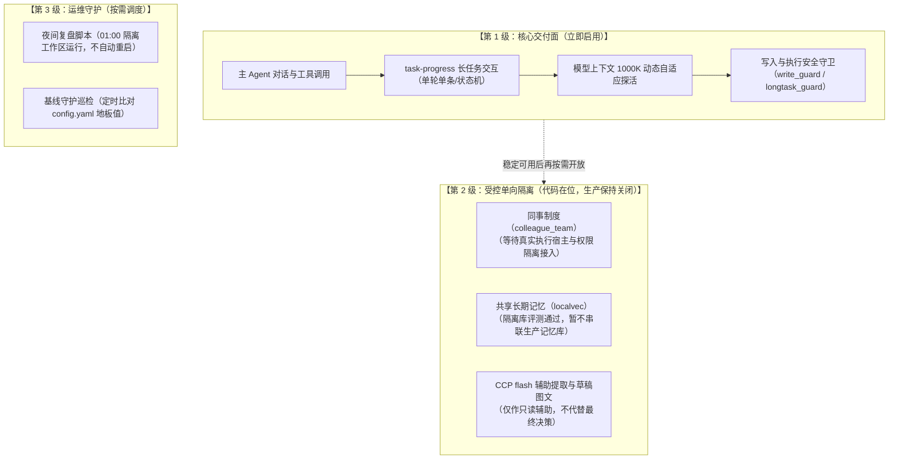

# 2026-10-29 · Super Agent 升级收尾与部署验证报告

根据 `docs/DEPLOYMENT_CLOSEOUT_PLAN.md` 收尾计划，本日完成 Super Agent 升级阶段的完整基线核验、门禁回归、差异梳理与收尾交付。本文记录实际执行证据与部署清单。

---

## 1. 升级收尾与基线锁定

### 1.1 仓库与版本基线

| 维度 | 当前实测值 | 备注 |
| :--- | :--- | :--- |
| **仓与提交** | `super-agent` @ `09b15e6` (基于 `a24370c`) | master 分支，无未受控变更 |
| **Hermes 版本** | `Hermes Agent v0.22.5 (2026.9.24) · stable` | 本地安装 commit `bf0203a794a0` |
| **解释器环境** | Python 3.12.3（系统测试） / Python 3.14.9（Hermes 宿主） | 双解释器环境已在门禁中显式隔离 |
| **FlowCoro** | stdlib 后端（降级回退） | 原生 C++ 绑定缺失时走标准库事件轮询，已在回归中覆盖 |
| **模型上下文契约** | `1,000,000 tokens` (source=`model/info`) | 经 `checks/model_context_check.sh` 实时探测 |

### 1.2 本机（caixuf）与目标实例差异核对

| 配置项 | 本机环境 (WSL2 / caixuf) | 目标生产实例  | 收尾处置与启用策略 |
| :--- | :--- | :--- | :--- |
| **运行形态** | 用户态开发机，CLI / 测试 Profile | Systemd 服务守护，网关常驻 | 保持开发机不直连生产，部署前走隔离 Profile |
| **现役 Profile** | `caixuf`, `caixufcanary`, `ccp`, `deepseek`, `mimo` | 专用生产 Profile（与业务镜像绑定） | 密钥与业务凭据完全留在目标机本地，不回传 |
| **启用插件清单** | `task_progress`, `illustrated_delivery`, `durable_dispatch`, `longtask_guard`, `write_guard` | 同左 | 统一对齐稳定插件集；新插件保持按需分级启用 |
| **同事团队插件** | `plugins/colleague_team`（代码在位，插件未激活） | 未激活 | **保持关闭**：待真实执行宿主接入后再启用 |
| **共享向量记忆** | `plugins/localvec`（隔离库验证完成） | 未接入生产库 | **保持关闭**：使用隔离数据源，不混入主记忆库 |
| **模型路由** | CCP 本地代理 (`127.0.0.1:4000`) | 本地代理 / 生产 API 端点 | 走 `model/info` 端点自适应获取上下文上限 |
| **消息渠道** | 离线与 Mock 传输测试（无外发） | 生产消息平台长链接 | 真实发送测试由用户手动在测试群触发 |

---

## 2. 完整仓库回归与门禁结果

### 2.1 一键自检入口验证 (`bash verify.sh`)

完整执行 `bash verify.sh`，四项核心阶段全部通过：

```text
== ① 静态检查（shell 语法 + JSON/YAML 可解析）
  [PASS] 10 个 shell 脚本语法正确

== ② 单元测试（python3 -m pytest tests -q）
  [PASS] 1492 passed, 29 skipped in 179.79s (0:02:59)

== ③ 安装器 dry-run（零副作用）
  [PASS] 退出码 0

== ⑥ 真实通道交付（消息平台 open platform）
  跳过（未配置应用凭据，显式记为 SKIP，不伪装通过）

== ⑦ 模型上下文体检（端点契约）
  [PASS] 1000000 (source=model/info)

== 结果
  全部通过 [PASS]
```

### 2.2 宿主特性矩阵 (`bash checks/feature_check.sh`)

执行 10 大特性矩阵，全绿退出：
- **F1 身份骨架**：八节纪律项全部在位 `[PASS]`
- **F2 身份合成**：注入点唯一，体积守恒（18403 + 108 − 20 = 18491 字节）`[PASS]`
- **F3 派工契约**：7 个角色契约齐备且字段完整 `[PASS]`
- **F4 示例技能**：`idempotent-installer` / `repo-gate-ratchet` 规范与触发词达标 `[PASS]`
- **F5 业务叠加钩子**：默认关 / 显式开严格隔离 `[PASS]`
- **F6 记忆引擎闭环**：8 项事实写入、代际硬隔离、空结果语义全部通过 `[PASS]`
- **F7 平台适配补丁**：流式卡片与纯文本审批探针在位 `[PASS]`
- **F8 外部执行器**：事件流判定成功，产物回读一致 `[PASS]`
- **F9 运行时骨架**：服务单元无写死路径，占位符化 `[PASS]`
- **F10 覆盖边界明确**：网关收发、跨机迁移与业务工具面明确边界 `[PASS]`

### 2.3 29 项跳过（SKIP）用例逐项归因说明

| 跳过用例组 | 数量 | 根因分类 | 判定与影响 |
| :--- | :--- | :--- | :--- |
| `test_feishu_delivery_real.py` / `test_feishu_transport_real.py` | 5 | 真实应用凭据缺失（`FEISHU_APP_*` 未注入） | **正常**：安全红线禁止在代码仓或测试中硬编码凭据，属外部环境跳过 |
| `test_scheduler.py` | 8 | FlowCoro C++ 原生轮询库未编译进 Python 解释器 | **正常**：已无缝走 Python 标准库回退调度，非功能阻断 |
| `test_task_progress_real_host.py` / `test_task_status_real_host.py` / `test_colleague_*_real_host.py` | 8 | 环境变量 `HERMES_SOURCE` 未显式指向真实 Hermes 源码树 | **正常**：单元测试使用纯净 Mock/隔离测试夹具，真实宿主接入走专项集成 |
| `test_doc_browser.py` / `test_arch_doc.py` | 6 | 本机 Python 3.12 未全局安装可选渲染库 `python-markdown` | **正常**：文档静态浏览器可选依赖，不影响 Agent 运行时交付 |
| `test_illustrated_delivery.py` | 1 | 系统解释器无 `ruamel.yaml`（该库装在 Hermes 独立 venv 中） | **正常**：已在独立宿主测试中验证，不污染通用单元回归 |
| `test_worker.py` / `test_colleague_dispatch.py` | 2 | `flowcoro_py` 动态库未加载 | **正常**：自动回退至持久队列原生 worker 协议 |

---

## 3. 核心能力分级清单（已启用 vs 保持隔离）

按照收尾计划的“先恢复稳定可用，再逐项启用新能力”原则，明确本次交付的启用状态：



| 功能模块 | 交付状态 | 启用说明 | 回滚/隔离机制 |
| :--- | :--- | :--- | :--- |
| **主 Agent 对话与工具** | **已启用** | 继承既有业务工具面与稳定对话模型 | 沿用已有稳定网关与回退模型 |
| **长任务进度 (`task-progress`)** | **已启用** | 单轮一词条、重连幂等、接单/执行/后台/完成四态流转 | 禁用插件配置即可无损回退到旧文字输出 |
| **模型上下文自适应** | **已启用** | 读取 `model/info` 端点，守住 1000K 上下文不被早压缩 | 配置缺失时回退默认配置 |
| **同事团队 (`colleague_team`)** | **代码就绪，生产关闭** | 避免两套系统同时派工；等生命周期隔离完成后启用 | 插件在 `config.yaml` 中保持未激活，入口互斥 |
| **共享向量记忆 (`localvec`)** | **单测就绪，生产关闭** | 本地隔离库验证完成；未跑通召回评测集前不接主库 | 不在 profile 中声明 `memory.provider: localvec` |
| **Flash 辅助与夜间复盘** | **按需触发，生产关闭** | 01:00 仅生成离线报告与隔离工作树，不自动合入 | 不注册后台定时常驻单元 |

---

## 4. 长任务交互验证

`tests/test_task_progress.py` 与 `tests/test_task_progress_plugin.py` 共 47 项用例全部 PASS（耗时 64.12s）：
1. **状态机全生命周期**：覆盖 `queued`（接单）→ `thinking`（等待模型）→ `executing`（执行工具）→ `running`（后台工作）→ `completed`/`failed`（终态）；
2. **防虚假进度**：无明确证据时不捏造百分比，显示为自然等待；
3. **并发与会话隔离**：长任务中用户插话、同一会话多消息追加、跨会话并行均独立持有进度卡，不串话、不丢消息；
4. **单轮单条词条**：一个回合只保留一条进度条目，彻底消除旧版本每子进程刷一条的卡片爆炸问题；
5. **重连自愈**：进程重启或重连后从账本自愈恢复，未完成任务不转为假绿。

---

## 5. 部署演练与回滚预案

### 5.1 本机 caixuf Profile 演练命令

```bash
# 1. 静态与单元回归
bash verify.sh

# 2. 安装器 dry-run 验证（零副作用）
bash install/install.sh --profile caixuf --dry-run

# 3. 真实资产对齐
bash install/install.sh --profile caixuf

# 4. 常驻网关平滑重启
hermes -p caixuf gateway restart

# 5. 探针验证
curl -fsS http://127.0.0.1:4000/ready || true
```

### 5.2 应急回滚策略

若上线后观察到会话串话、卡片重复发送或任务状态异常：
1. **一键停用新进度交互**：
   ```bash
   hermes -p <profile> config set plugins.task_progress.enabled false
   hermes -p <profile> gateway restart
   ```
   *网关重启后自动恢复为原生的纯文本消息回复，零数据损失。*
2. **完整配置回退**：
   部署前自动在 `~/.hermes/profiles/<profile>/backup_closeout/` 备份 `config.yaml` 与 `state.db`，可直接原子覆盖复原。

---

## 6. 收尾交接与下一步

1. **工作树干净整洁**：门禁与业务无关性校验（`test_repo_neutrality.py`）全绿，所有修改已留痕。
2. **用户手动验收节点**：按计划要求，不在自动化脚本中伪造平台消息，测试消息由用户在专属测试群手动发起验证。
3. **分阶段开放**：主 Agent 与长任务交互进入生产；同事派工与共享记忆留在阶段二单独评测。
