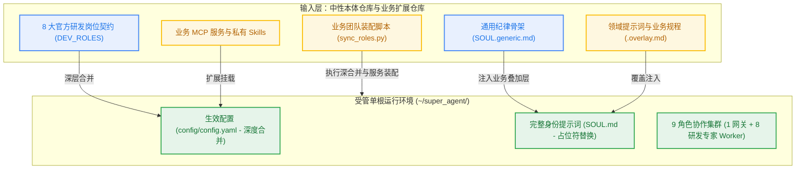
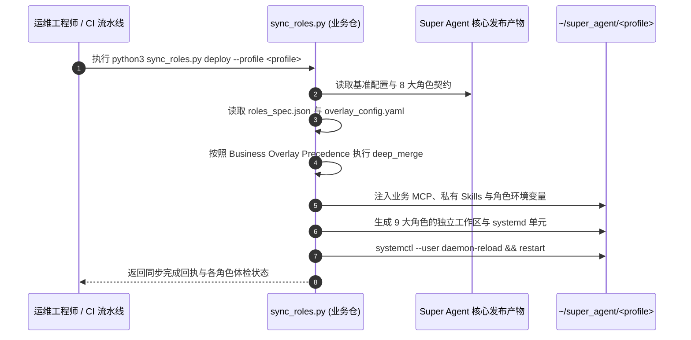

# 02. 业务知识挂载指南 (Business Overlay & Domain Knowledge Guide)

> 📚 **导航 / Wiki Navigation**
> [🏠 Wiki 首页 (Home)](Home.md) │ [🚀 01. 5分钟快速上手与单根部署](01-Quickstart-and-Install.md) │ [🧩 02. 业务知识挂载指南](02-Business-Overlay-Guide.md) │ [🤖 03. 前后台协同与 StateGraph](03-Multi-Agent-and-StateGraph.md) │ [📨 04. 交互卡片与交付机制](04-Feishu-Cards-and-Delivery.md) │ [🛠️ 05. 运维排障与 FAQ](05-Operations-and-Troubleshooting.md)

---

## 1. 中性引擎与业务叠加层解耦原则

在通用智能体落地工程中，最容易犯的架构错误就是**将具体业务私有代码、特定企业内部系统名称、专有术语硬编码到通用引擎仓库中**。这种污染会导致：
- 代码无法开源或跨组织交付复用；
- 业务逻辑演进与底座引擎升级互相缠绕，版本升级寸步难行；
- 敏感业务信息泄露至公共版本库。

为此，Super Agent 设立了最高设计原则：**“本体纯粹中立，业务通过叠加层注入”**。



---

## 2. `SOUL.generic.md` 身份叠加层挂载

### 2.1 身份骨架结构

在 `identity/SOUL.generic.md` 中，Super Agent 定义了通用的高阶智能体行为规范与执行铁律：
- 严格遵循证据闭环，严禁无依据凭空假设；
- 耗时超过 5 秒的操作一律转交后台持久队列；
- 前台界面保持精简优雅，以流式卡片与图文交付长篇成果；
- 尊重角色职责分工与权限边界。

在该文件的核心业务约束章节，预留了标准化占位符：
```markdown
<!-- {{BUSINESS_OVERLAY}} -->
```

### 2.2 领域叠加层的挂载方式

业务团队在独立的业务仓中维护 `<domain>.overlay.md`，其内容专注于领域专有规则，例如：
```markdown
# 领域业务专家操作准则与规程

## 1. 领域专有名词与判定基准
- 定义系统状态枚举、各档位含义与核心业务指标阈值；
- 规定异常报警的定性标准与升级链路。

## 2. 仿真与测试执行规程
- 针对领域核心业务，必须优先编写确定性回归验证用例；
- 执行用例前必须先校验环境基线与输入数据完备性。

## 3. 结果交付与归档规程
- 验收结论必须关联具体的自动化测试报告与执行日志凭据；
- 测试总结须回写至企业云文档团队看板。
```

当执行部署或运行业务同步时，安装器或配置脚本会自动将 `{{BUSINESS_OVERLAY}}` 替换为业务规程，生成实例专用的 `SOUL.md`，实现通用纪律与业务规则的无缝融合。

---

## 3. MCP (Model Context Protocol) 服务的规范挂载

Super Agent 原生兼容标准 Model Context Protocol (MCP)。业务团队可以通过配置挂载各类业务 MCP 服务，使智能体安全调用企业内部私有系统：

### 3.1 配置示例

在 `config/config.yaml` 或业务叠加配置中，通过 `mcp_servers` 声明服务：

```yaml
mcp_servers:
  # 内部代码仓语义检索服务
  codebase-indexer:
    command: "python3"
    args:
      - "-m"
      - "mcp_codebase_service"
      - "--repo-root"
      - "/home/user/work/my-project"
    env:
      INDEX_CACHE_DIR: "/home/user/.cache/mcp-indexer"

  # 内部数据库只读查询服务
  database-reader:
    command: "node"
    args:
      - "/opt/mcp-database/dist/index.js"
    env:
      DB_HOST: "127.0.0.1"
      DB_PORT: "5432"
      DB_NAME: "read_replica"
```

### 3.2 敏感凭证的安全隔离

- **严禁明文凭证**：不得在 `config.yaml` 中硬编码数据库密码、API Token 等机密信息；
- **环境变量注入**：所有凭证统一通过宿主用户的环境变量（如 `~/.config/environment.d/*.conf`）或受保护的凭证文件注入。

---

## 4. Skills 技能库挂载机制

### 4.1 技能标准目录规范

每一个可被智能体调用的技能，均应遵循标准格式存放在一个独立目录下：

```text
skills/<skill-name>/
├── SKILL.md            # 必选：技能核心描述文件（含 YAML frontmatter）
├── scripts/            # 可选：辅助脚本与执行工具
├── examples/           # 可选：标准参考示例与调用样例
└── references/         # 可选：详细规范、参考手册与 API 文档
```

`SKILL.md` 包含结构化头部与详细执行指引：
```markdown
---
name: domain-case-runner
description: 执行领域自动化测试用例并产出结构化测试报告。当用户要求运行测试或排查用例失败时触发。
---

# 执行规程
1. 检查测试用例语法规范；
2. 启动仿真环境并注入信号；
3. 断言最终状态并归档日志。
```

### 4.2 外部技能目录挂载

通过设置环境变量 `SKILLS_PATH` 或在 `config/config.yaml` 中声明，支持挂载多个外部技能源：

```yaml
skills:
  paths:
    - "/home/user/super-agent/skills"              # 通用核心技能库
    - "/home/user/code/domain-skills/skills"        # 业务私有扩展技能库
```

系统启动时将自动合并两个来源的技能清单，在保持核心干净的同时支持业务技能的灵活热加载。

---

## 5. 9 角色业务团队与 `sync_roles.py` 同步机制

### 5.1 9 角色完备团队架构

在实际生产场景中，一个完整的智能体工程团队通常由 **1 个前台网关分诊员** 与 **8 大后台研发专家角色** 组成，协同完成端到端任务：

1. **前台网关分诊员 (Frontdesk Gateway)**：负责接收协同平台消息、鉴权防刷、意图解析与任务拆分派工；
2. **需求边界架构师 (architect)**：专职梳理需求契约、输入输出规格、编写 `docs/specs/`；
3. **核心用例开发专家 (cases)**：专职实现核心业务逻辑、编写测试用例与业务代码；
4. **代码审查与红队质检员 (reviewer)**：专职对 PR 进行安全性、边界覆盖与红队挑刺审计；
5. **自动化测试与仿真验证专家 (test)**：专职在容器与隔离环境中批量执行测试集并统计覆盖率；
6. **缺陷定性与根因诊断专家 (triage)**：专职收集失败日志、分析状态机轨迹并定位根本归因；
7. **服务端与底层工程师 (backend)**：专职底层系统服务、性能调优与通信协议开发；
8. **表现层与交互排版工程师 (frontend)**：专职流式卡片渲染排版与图文可视化呈现；
9. **平台运维与稳定性专家 (ops)**：专职环境编排、配置对账、巡检监控与应急自愈。

---

### 5.2 业务同步工具 `sync_roles.py` 的工作流程

在外部业务仓中，通常提供专用的 `sync_roles.py` 自动化工具，将业务配置与 Super Agent 核心进行深度合并（Deep Merge）：



#### 核心合并准则 (Architecture Rules)：
1. **Base Clean Replace（基准干净替换）**：
   Super Agent 的核心调度逻辑与通用插件从不可变的 `releases/<version>` 中干净引入，确保核心版本一致性；
2. **Business Overlay Precedence（业务叠加绝对优先）**：
   在执行字典深度合并时，业务配置（业务 MCP、专用 Prompt、领域环境变量）拥有最高优先级，精准覆盖对应角色的配置段；
3. **Colleague Tailoring（专家角色定向裁剪）**：
   前台网关配置（如网关分发规则）不反向渗透入后台 Worker；后台 Worker 仅加载各自岗位所需的工作树白名单、专属技能与 MCP。

---

## 6. 仓级业务中立性门禁 (Neutrality Gate)

为了杜绝业务私有字面量不慎流入 `super-agent` 核心代码仓，仓库设置了严格的棘轮门禁 `tests/test_repo_neutrality.py`：

```bash
# 执行中立性门禁扫描
pytest tests/test_repo_neutrality.py
```

### 门禁扫描范围与规则：
- **扫描全量文件**：代码（`.py`）、文档（`.md`）、配置（`.yaml`）、Shell 脚本（`.sh`）等所有纳入版本管理的文件；
- **禁止业务专有名词**：严禁出现特定公司或业务领域的专有代号与缩写；
- **禁止内网指纹**：严禁提交内网 IP 地址（如 `10.x.x.x`, `192.168.x.x`, `172.16~31.x.x`）或特定主机名。

任何贡献者在向 `super-agent` 提交代码或文档前，必须确保中立性门禁 100% 绿色通过。

---

> ➡️ **下一步**：了解多智能体协同与底层状态机原理，请阅读 [03. 前后台协同与 StateGraph](03-Multi-Agent-and-StateGraph.md)。
