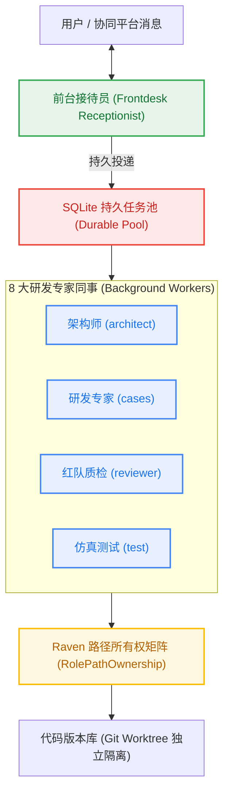
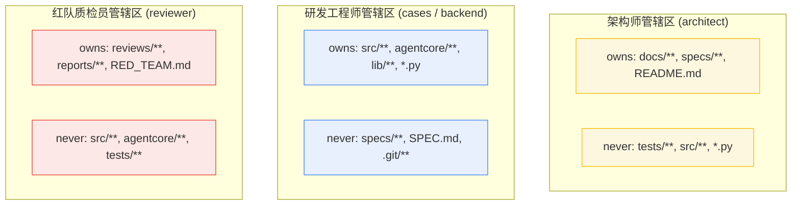
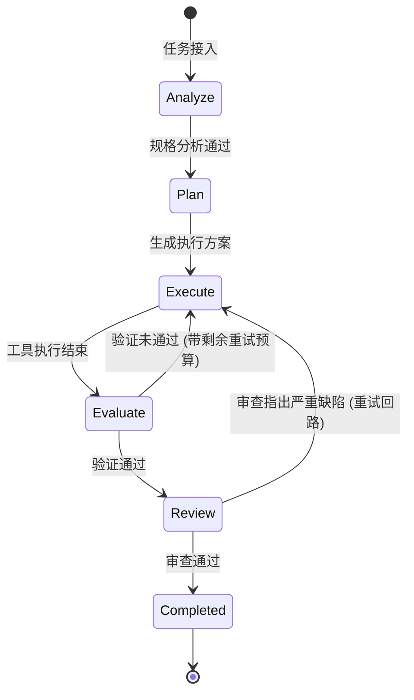
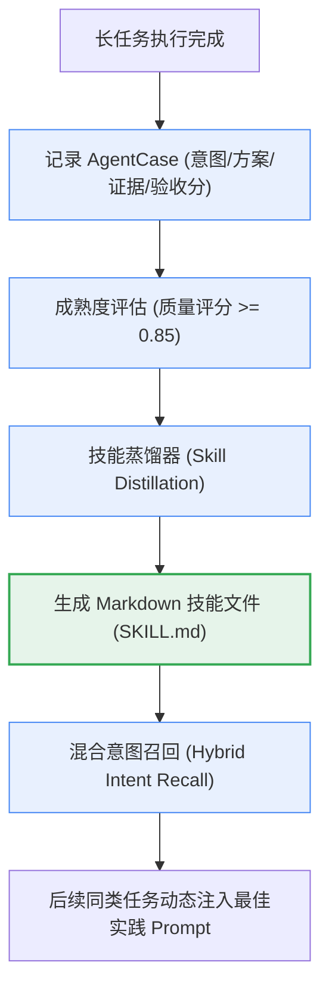

# 03. 前后台协同与 StateGraph 状态图 (Multi-Agent, StateGraph & Raven)

> 📚 **导航 / Wiki Navigation**
> [🏠 Wiki 首页 (Home)](Home.md) │ [🚀 01. 5分钟快速上手与单根部署](01-Quickstart-and-Install.md) │ [🧩 02. 业务知识挂载指南](02-Business-Overlay-Guide.md) │ [🤖 03. 前后台协同与 StateGraph](03-Multi-Agent-and-StateGraph.md) │ [📨 04. 交互卡片与交付机制](04-Feishu-Cards-and-Delivery.md) │ [🛠️ 05. 运维排障与 FAQ](05-Operations-and-Troubleshooting.md)

---

## 1. 同事制协作范式 (Colleague Paradigm)

在多智能体系统演进史上，常见的架构模式主要有两种极化形式：
- **流水线编排制 (Strict Pipeline)**：过度僵化，上游一个微小变动导致整条流水线崩溃重试，无法应对敏捷研发变化；
- **自由对等制 (Unconstrained Swarm)**：智能体之间无序通信、互相下发指令，极易产生无限递归、状态踩踏与严重幻觉。

Super Agent 提出了**“同事制多智能体（Colleague Multi-Agent Team）”**组织学模型：



### 1.1 前台接待员（Frontdesk Receptionist）
- **核心定位**：面对企业用户的唯一接待窗口，专职意图解析与快速响应；
- **防御红线 (`FRONTDESK_BOUNDARY`)**：前台严禁直接调用耗时外部命令、严禁在主进程直接执行大段代码编译或长任务排障；
- **操作原则**：任何预计执行耗时超过 5 秒的操作，必须通过 `durable_submit` 封装为持久任务投递至后台持久池，并即刻向前台用户交付交互进度卡片。

### 1.2 后台研发同事（Background Dev Workers）
- **核心定位**：由独立 Worker 进程承载的专业工程师；
- **执行环境**：每个任务由独立的 Git Worktree 提供物理目录隔离，并通过跨进程文件锁（`fcntl.flock`）保证单一写者；
- **工具授权**：具备完整的系统操作工具面（`read_file`, `write_file`, `edit_file`, `run_command`），但其文件操作受到严格的路径访问矩阵审查。

---

## 2. 8 大官方研发角色契约 (`DEV_ROLES`)

Super Agent 内核原生提供 8 个官方研发岗位契约（定义于 `agentcore.colleague_dev.DEV_ROLES`），覆盖软件工程端到端研发全流程：

| 角色标识 (`role`) | 岗位名称 (`display_name`) | 核心职责 (`duties`) | 默认推理模型层级 |
| :--- | :--- | :--- | :--- |
| `architect` | 需求边界与系统架构师 | 梳理需求契约、明确输入输出规格、拆解技术方案并编写规格文档 | `pro`（深度思考与结构化设计） |
| `cases` | 核心研发与用例开发专家 | 编写核心业务代码与对应确定性验证用例，修复已知缺陷 | `main`（高质量标准编码） |
| `reviewer` | 代码审查与红队质检员 | 以反向挑刺视角审查代码改动、核验边界保护与反向抑制断言 | `pro`（严格逻辑漏洞挑刺） |
| `test` | 自动化测试与仿真验证专家 | 批量执行测试套件、复现异常时序、统计测试通过率并生成报告 | `main`（自动化测试执行） |
| `triage` | 缺陷定性与根因诊断专家 | 抓取运行时日志、状态跳变轨迹对账、提取证据链并分析失败根因 | `pro`（时序对账与证据链推理） |
| `backend` | 服务端与底层系统工程师 | 负责底座基础设施、并发通信、协议适配与系统级性能调优 | `main`（系统级后端工程） |
| `frontend` | 表现层与交互排版工程师 | 专职设计流式交互卡片、Markdown 高清图表与终端渲染效果 | `main`（交互与数据可视化） |
| `ops` | 平台运维与稳定性专家 | 负责集群配置对账、systemd 服务编排、巡检诊断与应急恢复 | `main`（基础设施运维管理） |

### 确定性三级模型路由与 ADR-S1~S6 护栏
系统采用纯函数模型路由器 `agentcore.model_routing` 进行严格的资源分配：
- **`pro` 白名单保护 (`ADR-S1`)**：仅架构设计、红队挑刺与根因诊断等少数需要极高推理能力的岗位可占用高算力模型配额；
- **防降级底线保护 (`ADR-S2`)**：严禁将长上下文压缩（Compression）或长期记忆提炼（Memory Extraction）降级至低算力轻量模型，防止核心事实被摘要过程吞噬；
- **显式降级回执 (`ADR-S4`)**：若发生配额超限或模型故障，路由层必须在任务回执中明确标注实际执行档位，杜绝无感知静默降级。

---

## 3. Raven 路径所有权矩阵 (`RolePathOwnership`)

多智能体并发协作最大的风险是**“权限越界与状态践踏”**：例如测试角色为了让测试通过，私自篡改测试框架门禁；或者前端角色误删了底层核心通信代码。

Super Agent 吸收 Raven 权限管理思想，建立了强类型的 **`RolePathOwnership` 路径所有权契约**：

```python
@dataclass(frozen=True)
class RolePathOwnership:
    role: str
    owns: Tuple[str, ...] = ()       # 完全控制：允许创建、修改、重命名、删除
    appends: Tuple[str, ...] = ()    # 仅允许追加：严禁删除或覆写旧内容
    never: Tuple[str, ...] = ()      # 严禁触碰：任何读写均立即抛出权限异常
    artifacts: Tuple[str, ...] = ()  # 允许产出的制品模式
    enforce_write: str = "hard"      # 写权限硬强制拦截（抛出 PermissionError）
```

### 8 大角色的典型权限边界



| 角色 (`role`) | 核心拥有路径 (`owns`) | 仅追加路径 (`appends`) | 严格禁止触碰 (`never`) |
| :--- | :--- | :--- | :--- |
| `architect` | `docs/**`, `specs/**`, `README.md` | `DECISIONS.md`, `CHANGELOG.md` | `tests/**`, `src/**`, `*.py`, `.git/**` |
| `cases` | `src/**`, `agentcore/**`, `*.py` | `FIXLOG.md`, `CHANGELOG.md` | `docs/specs/**`, `SPEC.md`, `.git/**` |
| `reviewer` | `reviews/**`, `reports/**`, `RED_TEAM.md` | `review_log.txt` | `src/**`, `agentcore/**`, `tests/**`, `.git/**` |
| `test` | `tests/**`, `test_reports/**`, `evals/**` | `test_run.log` | `src/**`, `agentcore/**`, `docs/specs/**` |
| `triage` | `diagnostics/**`, `reproduce/**`, `triage/**` | `ROOT_CAUSE.md` | `docs/specs/**`, `SPEC.md`, `.git/**` |
| `backend` | `backend/**`, `api/**`, `server/**` | `FIXLOG.md` | `frontend/**`, `ui/**`, `.git/**` |
| `frontend` | `frontend/**`, `ui/**`, `cards/**` | `FIXLOG.md` | `backend/**`, `agentcore/**`, `.git/**` |
| `ops` | `deploy/**`, `install/**`, `scripts/**` | `OPS_JOURNAL.md` | `case_set/**`, `tests/evals/**`, `.git/**` |

当任何 Worker 试图调用文件编辑工具时，底层运行器将自动执行 `assert_role_path_access(role, path, action)`。一旦违规，立即阻断并记录审计日志：
```text
PermissionError: role_ownership_violation: role 'reviewer' cannot write 'src/core.py': path is under forbidden pattern 'src/**'
```

---

## 4. LangGraph 状态图引擎 (`agentcore.state_graph.StateGraph`)

针对复杂多步骤任务，Super Agent 内置了纯 Python 实现的确定性状态图引擎 `StateGraph`，具备工业级可靠性保障：



### 核心特性矩阵：
1. **类型化状态与 Reducer**：
   支持基于 `TypedDict` 或 `dataclass` 定义不可变状态结构，状态更新必须通过显式声明的 Reducer 函数合并；
2. **SQLite WAL 持久化检查点 (Durable Checkpoints)**：
   在每一个 Node 执行完毕后，工作流引擎将整树状态快照写入持久化数据库。即使服务器断电或进程遭遇 OOM，重启后也能精准从最后一个合规节点恢复，绝不从头盲目重新计算；
3. **停滞守卫 (Stagnation Guard)**：
   实时计算状态机指纹与工具调用输出。若检测到工作流连续多次循环且未产生任何有效状态跃迁，停滞守卫将主动熔断退出，避免无意义的 Token 燃烧；
4. **终态工作树收割验证 (Terminal Worktree Harvest)**：
   工作流进入终态节点前，强制比对 Git Worktree 状态，确保工作区内的所有改动均已完成暂存、提交或归档，杜绝未提交代码遗留在临时分支。

---

## 5. EverOS 技能锻造器 (`agentcore.skill_forge.SkillForge`)

为了使智能体在日常解决问题的过程中不断自我进化，Super Agent 吸收了 EverOS 双轨记忆（Dual-Track Memory）的设计精髓，构建了 `SkillForge` 程序化技能锻造系统：

- **用户轨迹 (User Track)**：聚焦用户个人偏好、上下文交互历史与会话轮次；
- **智能体经验轨迹 (Agent Track)**：专职记录任务处置案例（`AgentCase`）与提炼高质量可复用程序化技能（`ProceduralSkill`）。



### 技能成熟度管理 (`maturity_score`)
每个锻造出的技能具备 0.0 至 1.0 的成熟度评分：
- 初始提炼技能赋予初级分（如 0.6）；
- 每次在新的真实任务中被成功引用并通过终验门禁，成熟度自动增加；
- 在上下文检索时，系统综合意图关键词、领域匹配度与成熟度打分进行重排序，确保最权威、最稳定的工程经验被优先注入模型上下文。

---

> ➡️ **下一步**：了解如何将长任务进度与高质量图表交付给用户，请阅读 [04. 交互卡片与交付机制](04-Feishu-Cards-and-Delivery.md)。
>
> 🧭 [⬅️ 上一篇：02. 业务知识挂载指南](02-Business-Overlay-Guide.md) │ [🏠 返回 Wiki 首页 (Home)](Home.md) │ [➡️ 下一篇：04. 交互卡片与交付机制](04-Feishu-Cards-and-Delivery.md)
