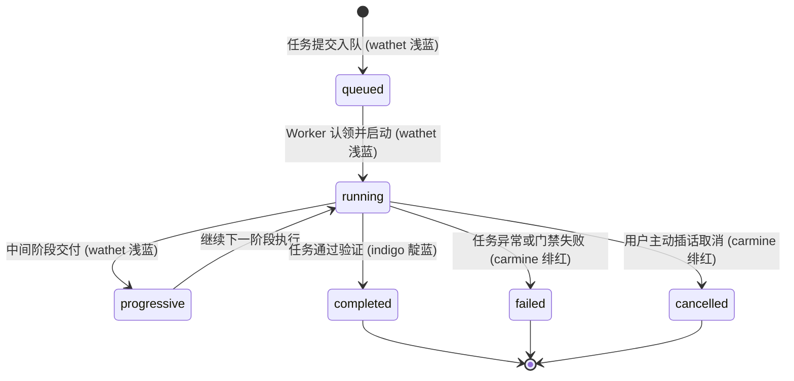

# 04. IM 平台交互卡片与交付机制 (CardKit 2.0 & Delivery Pipeline)

> **文档导航**：[Wiki 首页 (Home)](Home.md) │ [01. 单根受管部署与极速上手](01-Quickstart-and-Install.md) │ [02. 业务知识叠加与服务编排](02-Business-Overlay-Guide.md) │ [03. 研发专家协同与状态图引擎](03-Multi-Agent-and-StateGraph.md) │ [04. IM 交互卡片与交付机制](04-Feishu-Cards-and-Delivery.md) │ [05. 运维体检与排障对账](05-Operations-and-Troubleshooting.md)

---

## 1. CardKit 2.0 真实 6 态与标准色标契约

### 1.1 故障场景：高频刷屏限流与网络乱序踩踏
在长任务执行过程中（如代码编译、环境拉起、集成测试），若每产生一行日志就向协同会话发送一条新消息，会迅速触发 IM 平台的 API 频控限流（HTTP 429 Too Many Requests）；此外，在异步并发网络下，连续发送的独立请求易因网络抖动发生乱序到达，导致较早发出的“执行中”覆盖掉较晚发出的“已完成”。

### 1.2 真实代码机制：`agentcore/task_card_bridge.py` 6 态契约
Super Agent 严格采用单卡就地局部更新（In-Place Patch），在 `task_card_bridge.py`（`STATUS_LABELS` 与 `STATUS_HEADERS`）中定义了 6 种标准状态与 Feishu/Lark 官方色标：



| 卡片状态 (`status`) | 界面主题色 | 标题文本 | 业务触发时序与展示内容 |
| :--- | :--- | :--- | :--- |
| `queued` | `wathet` (浅蓝) | 排队中 | 任务入队等待 Worker 认领，展示队列名与预估等待位次 |
| `running` | `wathet` (浅蓝) | 执行中 | Worker 成功认领并启动，展示当前物理执行阶段与已耗时 |
| `progressive` | `wathet` (浅蓝) | 渐进交付中 | 执行周期较长时，流式展示中间分段成果或阶段性总结 |
| `completed` | `indigo` (靛蓝) | 处理完成 | 任务执行成功并通过终验，展示交付物摘要与归档链接 |
| `failed` | `carmine` (绯红) | 执行未通过 | 任务执行异常或门禁被阻断，展示定性归因与排障日志 |
| `cancelled` | `carmine` (绯红) | 已取消 | 任务被用户主动插话取消或抢占，展示清理工作区凭据 |

**核心调用接口与单在途去抖机制**：
```python
bridge = TaskCardBridge(managed_root, profile="dev", card_style="cardkit2")
bridge.bind_task("task-101", role="backend", display_name="后端同事", goal="重构任务", origin=origin)
bridge.create_initial("task-101", creator=send_card_fn)
bridge.update_progress("task-101", status="running", phase="编译依赖", progress=0.35, elapsed=12.4)
bridge.finalize("task-101", status="completed", summary="全部门禁通过", elapsed=28.1)
```
- **单在途合并去抖 (In-flight Debounce & Collapse)**：同一卡片在任何时刻严格保持至多 1 个在途 PATCH 网络请求。在高频产生日志时，在途请求返回前所有新状态自动在内存折叠合并，请求 ACK 后一次性推送最新折叠快照。

### 1.3 代价与边界
高频日志在网络抖动时会被合并跳帧，卡片仅作为有界视窗（展示最近 3~5 行关键输出）；全量详细日志定向落盘至 `state/logs/`，避免突破 30KB 单卡体积限制。

---

## 2. 心跳解耦与终态降级机制

### 2.1 故障场景：过程心跳阻塞终态交付
过程心跳用于刷新进度条百分比与当前动作。若过程心跳超时与终态交付混用相同重试队列，当网络出现瞬间波动时，心跳重试将锁死调度线程，导致关键终态卡片迟迟无法送达。

### 2.2 真实代码机制：双通道拆分与纯文本兜底
`agentcore/task_card_bridge.py` 在方法层面对心跳与终态进行了物理拆分：
1. **过程心跳 (`progress_patch_state`)**：
   设置极短的超时时间，若遇网络抖动或平台限流直接丢弃该次心跳，绝不阻塞主执行线程，杜绝心跳阻碍终态更新；
2. **终态保障与降级 (`patch_state`)**：
   仅对终态（`completed`, `failed`, `cancelled`）执行最多 3 次带退避的强保障重试；若 3 次均因网络或平台故障失败，自动触发 `degraded=True` 降级逻辑，回退为通过基础消息接口发送**纯文本兜底消息**，确保用户百分之百获知任务终结。

### 2.3 代价与边界
心跳丢弃保证了主链路绝对通畅，但极端网络抖动下卡片进度条可能出现跳变；终态降级为纯文本后，卡片内交互按钮将不可用。

---

## 3. 终态写一次铁律与职责边界对账

### 3.1 故障场景：迟到进程逆向篡改终态
当任务已标记完成并进入归档状态，若原 Worker 因租约过期被替代后又苏醒并尝试上报旧状态，可能将卡片从 `completed` 逆向覆写回 `running`。

### 3.2 真实代码机制：排他文件锁与 SQLite 终态账本
1. **排他文件锁**：`_serialize_task` 装饰器通过 `fcntl.flock` 对 `<root>/state/task_cards/locks/<task_id>.lock` 加排他锁，杜绝多进程并发写入踩踏；
2. **SQLite 终态写一次 (`finalized=1`)**：
   `update_progress()` 在 `BEGIN IMMEDIATE` 事务中先检查 `task_cards.finalized` 字段（若已为 `1` 直接返回 `already_finalized` 拒绝覆盖）；`finalize()` 在平台确认送达终态补丁后将 `finalized=1` 落盘，后续任何延迟到达的非终态进度写入均被底层直接拦截；
3. **架构职责澄清**：
   - `agentcore/task_card_bridge.py`：负责任务卡状态账本、排他锁控制与终态写一次拦截；
   - `agentcore/card_store.py`：仅负责客户端流式 sequence 序列在本地的持久化存储，供重连回放，并不控制 TaskCardBridge 的只读标记。

### 3.3 代价与边界
文件锁与 SQLite 事务带来微秒级开销；一旦任务置为终态，后续任何追加信息必须新建卡片或以新回复发出。

---

## 4. 排空屏障与 LLM 截断防护 (`plugins/write_guard`)

### 4.1 故障场景：未排空退出与 Token 截断覆写 0 字节
1. 智能体主进程直接退出导致传输队列中尚未 ACK 的卡片更新丢失；
2. 大模型生成长文本时触碰输出 Token 限制，JSON 被硬截断，工具执行框架降级为空字典 `{}`，导致将目标文件覆写为 0 字节。

### 4.2 真实代码机制
1. **`close()` + `await drain()` 排空屏障**：
   在任务结束前显式调用屏障，阻塞等待本地待发队列全部完成传输并收到平台 ACK。**注意**：该语义仅代表传输层已确认接收，不代表远端人类用户已读。
2. **`plugins/write_guard` 截断防护**：
   - `pre_tool_call` 门禁：检测到单次写入超过 8000 字符（`WRITE_GUARD_MAX_CHARS`）强制阻断分块；检测到 `content` 缺失（空字典 `{}` 截断签名）直接抛错阻断，提示模型“输出已被截断，严禁原样重试”；
   - `transform_tool_result` 回读验真：主动读取目标路径的文件大小与类型，确认磁盘写入字节与预期吻合后才向模型返回成功回执。

### 4.3 代价与边界
8000 字符阈值要求大文件必须分段写入；回读验真增加了文件系统 I/O 检查开销。

---

## 5. 高清图文与架构图交付管道 (`tools/arch_doc.py`)

针对系统架构图、覆盖率分析矩阵等复杂产物，纯卡片文字无法承载全部深度，系统通过 `tools/arch_doc.py` 驱动本地无头 Chromium 离线交付：
1. **本地 Chromium 驱动**：使用本地无头浏览器加载渲染，零外网数据传输；
2. **自包含 HTML**：将 CSS 样式与 Mermaid 渲染引擎全量内联，产出可直接离线打开的单文件报告；
3. **高清分页 PNG 截图**：通过 CDP 协议精准测量页面尺寸，产出多页高清 PNG，直推 IM 平台会话；
4. **云文档看板联动**：将任务验收报告链接自动同步回写至团队知识库与多维看板。

---

## 6. 延伸参考
- 架构设计原则与卡片互斥：[`docs/ARCHITECTURE.md`](../ARCHITECTURE.md)
- 插件生命周期与 write_guard 机制：[`docs/PLUGINS.md`](../PLUGINS.md)
- 运维健康体检与故障对账：[05. 运维体检与排障对账](05-Operations-and-Troubleshooting.md)
