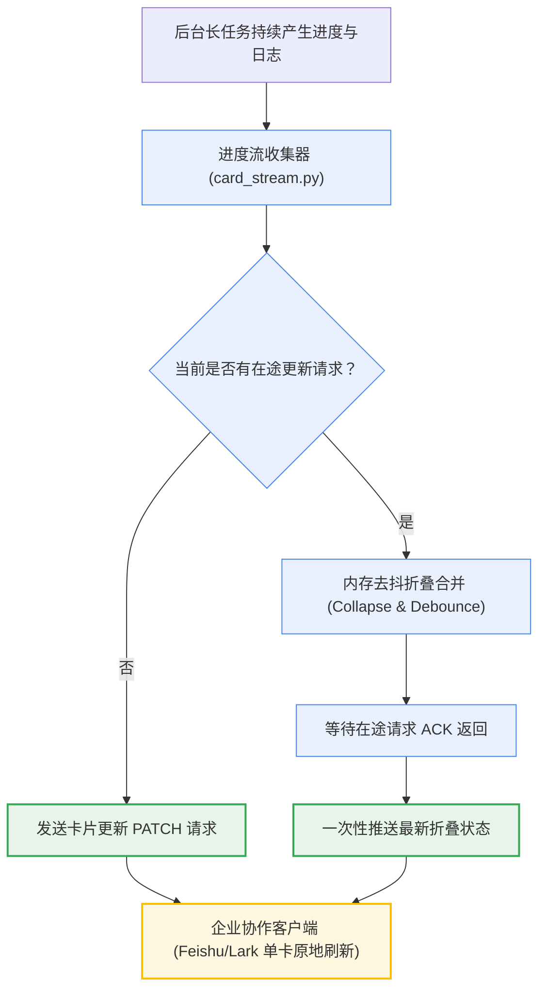
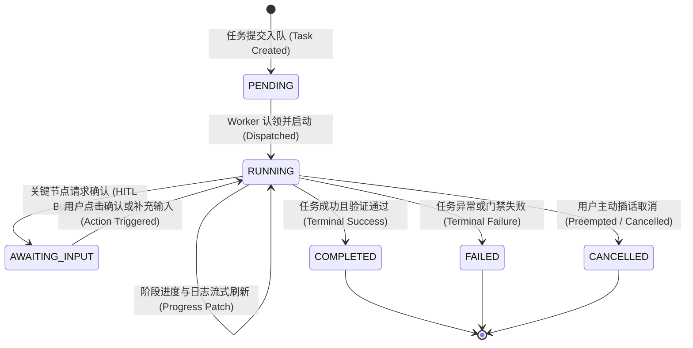
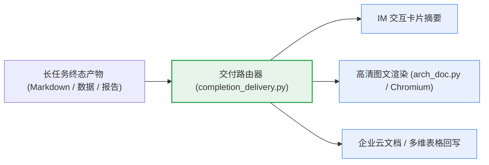

# 04. 企业协作平台卡片生命周期与交付机制 (Feishu/Lark Cards & Progressive Delivery)

> **导航 / Wiki Navigation**
> [Wiki 首页 (Home)](Home.md) │ [01. 5分钟快速上手与单根部署](01-Quickstart-and-Install.md) │ [02. 业务知识挂载指南](02-Business-Overlay-Guide.md) │ [03. 前后台协同与 StateGraph](03-Multi-Agent-and-StateGraph.md) │ [04. 交互卡片与交付机制](04-Feishu-Cards-and-Delivery.md) │ [05. 运维排障与 FAQ](05-Operations-and-Troubleshooting.md)

---

## 1. 即时协作交付的现实挑战与 CardKit 2.0 哲学

在通过 Feishu / Lark 等企业即时通讯平台与用户交互时，长任务常常面临以下严峻挑战：
- **消息风暴与频控限流 (Rate Limit)**：若任务每执行一步（如下载依赖、编译、跑测）都向会话发送一条新消息，不仅造成严重刷屏，还会迅速触发开放平台的 API 调用频控，导致后续消息丢弃；
- **网络乱序与状态踩踏**：在异步高并发网络环境下，如果连续发送多条更新请求，由于传输延迟差异，较早发出的“执行中”消息可能在“已完成”之后到达，导致卡片状态回退；
- **版式折叠与信息降级**：平台普通消息对长篇 Markdown 表格和图表支持有限，代码和复杂关系图在移动端往往被折叠或无法渲染。

为了给用户提供媲美专业 Web 应用的平滑体验，Super Agent 构建了 **CardKit 2.0 交互卡片引擎**：

### CardKit 2.0 三大设计铁律：
1. **单卡就地流式更新 (In-Place Streaming)**：全生命周期仅使用一条消息卡片，通过局部更新（Patch）就地刷新进度与阶段，绝不重复刷屏建新卡；
2. **单在途合并去抖 (In-flight Debounce & Collapse)**：同一张卡片在任何时刻严格保持**最多仅有一个在途网络请求**。在高频产生日志时，在途请求返回前所有新状态自动在客户端内存中折叠合并，避免频控限流与乱序到达；
3. **排空屏障 (`drain()` Barrier)**：任务结束或需要等待用户点击确认前，必须显式调用 `drain()` 屏障，确保所有在途的进度更新全部被对端平台确认接收后，再写入终态卡片，杜绝终态被旧进度覆盖。

---

## 2. 交互卡片全生命周期状态机

CardKit 2.0 将长任务划分为清晰受控的状态机跃迁：

### 状态定义与展示规范：

| 卡片状态 | 界面主题色 | 核心展示内容 | 交互动作 |
| :--- | :--- | :--- | :--- |
| `PENDING` | 蓝色 (Info) | 任务标题、调度队列名、当前排队位次、预计耗时 | 支持用户点击“取消排队” |
| `RUNNING` | 绿色 (Running) | 当前执行阶段进度条、已耗时、最近 3~5 行有界日志视窗 | 支持用户发送插话或中止任务 |
| `AWAITING_INPUT` | 橙色 (Warning) | 风险阻断原因、方案对比、审批选项 | 提供“批准执行”、“拒绝回滚”交互按钮 |
| `COMPLETED` | 绿青色 (Success) | 交付物结构化摘要、执行耗时、验收报告链接、生成文件统计 | 提供“查看完整报告”、“回滚本次变更”快捷按钮 |
| `FAILED` | 红色 (Danger) | 失败阶段定性、根本归因摘要、排障日志下载链接 | 提供“一键重试”、“派单给归因专家”按钮 |
| `CANCELLED` | 灰色 (Neutral) | 任务取消原因、取消操作人、已清理的工作树状态 | 静态展示 |

### 终态写一次铁律 (Terminal Write-Once)
当卡片写入终态（`COMPLETED`, `FAILED`, `CANCELLED`）后：
- 底层卡片存储器（`card_store.py`）将卡片标记为只读并持久化写入 SQLite；
- 丢弃后续所有延迟到达的非终态心跳上报；
- 交互按钮进入禁用或终态归档状态，防止用户重复提交导致二次执行。

---

## 3. 实时进度流与视窗机制 (`card_stream.py` & `task_progress`)

为了让用户在长任务执行期间保持掌控感，系统提供了细粒度的进度反馈机制：

### 3.1 多阶段动态进度计算
任务由调度器拆解为若干物理阶段（例如：① 代码拉取与工作区隔离 -> ② 方案设计与规格校验 -> ③ 代码编写与单元测试 -> ④ 仿真验证与验收审查）。进度计算引擎依据预估权重和已完成阶段动态推进进度条百分比，杜绝“进度长时间卡在 99%”的糟糕体验。

### 3.2 有界日志尾部视窗 (Bounded Log Tail)
由于移动端与桌面端卡片对内容体积有硬性限制（通常不超过 30KB），系统设计了**滑动日志视窗**：
- 实时截取终端最近 3~5 行关键执行输出（如当前正在执行的具体测试用例名）；
- 自动过滤高频无意义的 ANSI 终端转义字符与空白行；
- 全量详细日志实时定向落盘至 `state/logs/<task_id>.log`，卡片仅提供实时视窗与完整日志下载链接。

---

## 4. 图文与云文档交付机制

针对复杂工程成果（如系统架构图、详细测试覆盖矩阵、根因排查复盘），纯卡片文本无法承载全部深度信息。Super Agent 提供了立体交付矩阵：

### 4.1 高清图文与架构图渲染管道 (`arch_doc.py`)
当智能体需要向用户交付带 Mermaid 架构图或时序图的详细方案时，系统自动调用 `tools/arch_doc.py`：
1. **本地 Chromium 驱动**：利用宿主机预取的无头 Chromium，完全在本地完成渲染，无需外部依赖或将代码上传至第三方云端；
2. **自包含 HTML**：内联 CSS 样式、语法高亮与本地 Mermaid 引擎，生成开箱即用的 `.html` 文档；
3. **高清分页 PNG 截图**：通过 CDP 协议精准测量正文高度与图表就绪状态，输出多页高清 PNG。在消息会话中直接以大图形式呈现，让用户在移动设备上一目了然。

### 4.2 企业云文档与多维表格自动回写
通过受管交付接口，智能体支持：
- **云文档知识库沉淀**：自动将设计决策、红队质检报告发布到指定的企业团队知识库目录下，并生成版本追溯链接；
- **多维表格看板同步**：将本次任务对应的需求 ID、责任专家角色、测试通过率与完成耗时，增量写入团队的多维表格（Bitable）研发看板，实现敏捷研发数据的自动化流转。

---

> **下一步**：掌握系统的日常监控、诊断工具与应急故障处置，请阅读 [05. 运维排障与 FAQ](05-Operations-and-Troubleshooting.md)。
>
>  [上一篇：03. 前后台协同与 StateGraph](03-Multi-Agent-and-StateGraph.md) │ [返回 Wiki 首页 (Home)](Home.md) │ [下一篇：05. 运维排障与 FAQ](05-Operations-and-Troubleshooting.md)
