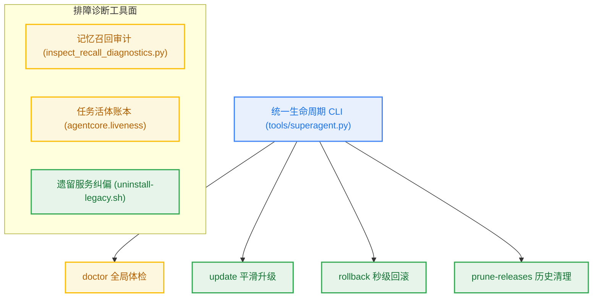

# 05. 日常运维、排障诊断与常见问题 (Operations, Diagnostics & Troubleshooting)

> **导航 / Wiki Navigation**
> [Wiki 首页 (Home)](Home.md) │ [01. 5分钟快速上手与单根部署](01-Quickstart-and-Install.md) │ [02. 业务知识挂载指南](02-Business-Overlay-Guide.md) │ [03. 前后台协同与 StateGraph](03-Multi-Agent-and-StateGraph.md) │ [04. 交互卡片与交付机制](04-Feishu-Cards-and-Delivery.md) │ [05. 运维排障与 FAQ](05-Operations-and-Troubleshooting.md)

---

## 1. 日常运维体系与多布局感知 (Layout-Aware Operations)

在生产环境中，随着版本演进，宿主机可能存在历史多目录拓扑与最新 v2.0 单根拓扑共存的情况。Super Agent 官方运维脚本集（位于 `scripts/ops/`）内置了**多布局感知推断引擎（`_layout.sh`）**：
- 自动识别当前主机是单根受管结构（`~/super_agent/<profile>`）还是历史平铺结构；
- 动态推导配置文件、任务队列数据库、systemd 用户单元及运行日志的实际绝对路径；
- 消除因路径硬编码引发的运维误操作。



---

## 2. 核心诊断排障工具箱 (Diagnostic Toolbox)

### 2.1 全局综合体检 (`doctor`)

当系统出现异常或每次重大发版后，首先运行 `doctor` 进行端到端基线对账：

```bash
python3 tools/superagent.py doctor --profile <profile>
```

#### 检查清单与输出示例：
```text
=== Super Agent Doctor Diagnostics: <profile> ===
[PASS] Single-root directory layout: ~/super_agent/<profile>
[PASS] Current symlink targets: releases/20261109_140000
[PASS] Durable pool database integrity (WAL mode, busy_timeout=5000ms)
[PASS] Managed systemd user services active:
       - super-agent@<profile>.service (running, pid 41203)
       - super-agent-worker@<profile>-backend.service (running, pid 41285)
[PASS] Managed plugins symlinks intact (13 internal, 3 external)
[PASS] Recall diagnostics ledger accessible
[PASS] No orphaned processes or lock file contention detected
>>> Result: ALL 7 DIAGNOSTIC GATES PASSED
```

---

### 2.2 长期记忆召回脱敏诊断 (`inspect_recall_diagnostics.py`)

当用户反馈智能体出现“遗忘历史设定”或“回答不准确”时，使用该工具审计长期记忆检索状态：

```bash
python3 tools/inspect_recall_diagnostics.py --profile <profile>
```

#### 脱敏与隐私安全保护：
- **零隐私泄露**：工具严禁打印用户的具体 Prompt 文本、查询 Query 字符串或事实正文内容；
- **纯量化指标输出**：
  - 最近 24 小时的召回请求总数与平均耗时（P50 / P95 / P99）；
  - 向量路（Vector）与词法路（Lexical）各自的命中比例（Hit Ratio）；
  - 各 `workspace_id` 分桶与 `fact_tags` 维度的索引分布；
  - 慢查询分布直方图。

若发现平均召回耗时超过 200ms，需重点排查本地嵌入模型进程的 CPU 调度优先级或进行数据库碎片整理（`VACUUM`）。

---

### 2.3 历史版本安全清理 (`prune-releases`)

频繁迭代升级会使 `releases/` 目录累积大量历史代码镜像。通过 `prune-releases` 安全回收磁盘空间：

```bash
# 查看清理计划（不带 --apply 仅打印计划）
python3 tools/superagent.py prune-releases --profile <profile> --keep 3

# 正式执行清理
python3 tools/superagent.py prune-releases --profile <profile> --keep 3 --apply
```

#### 安全防护原则：
- **绝对保护激活版本**：当前 `current` 软链接所指向的不可变 release 绝不被删除；
- **保护最近稳定备份**：若存在回滚锚点，该版本享受免死保护；
- **同步更新清单**：清理完毕后自动刷新 `install-manifest.json`，确保审计记录与磁盘物理状态完全一致。

---

### 2.4 遗留历史服务对账与平滑纠偏 (`uninstall-legacy.sh`)

如果宿主机曾安装过更早期的实验性服务，可能存在残存的旧版本 systemd 单元或废弃软链接。运行官方清理脚本进行一键平滑纠偏：

```bash
bash scripts/ops/uninstall-legacy.sh
```

脚本将主动检测并安全停止已废弃的服务单元，重载 systemd 守护进程，使宿主环境完全收敛至单根受管状态。

---

### 2.5 部署源锁定与防降级防护 (Deploy Source Locking & Downgrade Prevention)

为杜绝从错误仓库目录更新、历史旧提交静默降级覆盖以及脏工作区代码混入生产，安装器在 `install` / `update` 阶段默认开启部署源硬锁：

#### 核心防护与拦截项：
- **`source_dirty`**：源码工作区包含未提交改动时阻断发布；临时调试可使用 `--allow-dirty` 绕过；
- **`source_repo_mismatch`**：发布执行目录与历史 `install-manifest.json` 中记录的源路径不符时阻断；若需正式变更发布目录，使用 `--adopt-source` 显式接管；
- **`downgrade_or_divergent`** / **`previous_commit_unknown_to_source`**：待发布提交不是当前线上版本的 Git 后代时阻断；紧急强制回退可通过 `--allow-downgrade`，标准回退请使用 `rollback`；
- **`unexpected_commit`**：使用 `--expect-commit <commit-sha>` 可显式锁死预期发布的 Git 提交，防止分支误切。

#### 版本漂移与真实性检查 (`doctor drift`)：
当执行 `doctor` 体检时，`deploy_version_observation` 节点会自动对账当前线上版本与发布源状态。若检测到线上版本落后于源码源、脏版本安装或有未随发布重启的常驻进程（`stale_processes`），`doctor` 会标记为 `drift` 状态（退出码 1），提示运维人员及时处置。


---

## 3. 生产环境常见问题处置矩阵 (Troubleshooting Matrix & FAQ)

### Q1: 为什么后台任务长时间处于 RUNNING 状态且卡片无任何输出？

**可能原因**：
1. 外部工具命令陷入死锁或等待阻塞式网络 IO；
2. 进程被系统 OOM 杀掉，导致状态未能及时更新；
3. SQLite 任务池在多进程写入时遭遇长时间锁争用。

**处置步骤**：
1. **检查活体账本 (Liveness Ledger)**：
   检查 `~/super_agent/<profile>/state/liveness_ledgers/<task_id>.json`，查看最后一次心跳时间（Heartbeat Age）。系统将心跳异常严格分为两种定性：
   - `stalled`：进程 PID 仍然存在，但心跳更新已停滞（说明卡在死循环或外部阻塞 IO）；
   - `lost`：进程 PID 已不复存在（说明遭遇宿主 OOM Killer 或被硬杀）。
2. **检查 Subreaper 进程树**：
   ```bash
   pstree -p $(pgrep -f "worker.*<profile>")
   ```
   定位卡住的底层子进程并根据需要手动收割。
3. **检查文件锁状态**：
   ```bash
   lsof +D ~/super_agent/<profile>/state
   ```

---

### Q2: 为什么长期记忆未命中预期的历史知识？

**可能原因**：
1. `workspace_id` 代际隔离生效，当前任务与目标事实分属不同工作区；
2. 记忆提炼阶段事实置信度过低，未通过准入门槛；
3. 本地向量服务（`localvec`）未正常响应。

**处置步骤**：
1. 运行 `inspect_recall_diagnostics.py` 查看当前 profile 的召回命中统计；
2. 确认写入该事实时指定的 `fact_tags` 与当前检索条件的重合度；
3. 查看 `state/memory_spool/` 目录下事件流是否积压，若有积压可手动触发索引刷新。

---

### Q3: 研发角色执行代码修改时报错 `PermissionError: role_ownership_violation`？

**典型日志**：
```text
PermissionError: role_ownership_violation: role 'reviewer' cannot write 'agentcore/pool.py': path is under forbidden pattern 'agentcore/**'
```

**原因分析**：
触发了 Raven 路径所有权矩阵（`RolePathOwnership`）硬拦截。系统为防止多智能体之间代码践踏，对各岗位设立了明确的管辖区。例如：质检员角色（`reviewer`）只允许编写质检报告和审查日志，严禁直接篡改核心业务源码。

**处置建议**：
1. **符合岗位职责的正确流转**：将代码修改任务指派给拥有源码控制权的角色（如 `cases` 或 `backend`）；
2. **领域特殊覆盖**：若业务私有叠加层确实需要调整特定角色的管辖路径，应在业务叠加配置中通过 `register_role_override()` 规范声明，严禁绕过或关闭底层安全校验。

---

### Q4: 协作平台高频报错 `429 Too Many Requests` 或卡片无法刷新？

**可能原因**：
1. 长任务日志产生速度过高，突破了即时通讯平台的 API 频控上限；
2. 未启用 CardKit 2.0 的折叠去抖与排空机制。

**处置步骤**：
1. 检查调用链路中是否统一接入了 `card_stream.py`；
2. 确认在途请求合并机制处于激活状态（单张卡片仅维持一个在途网络请求）；
3. 检查是否有业务脚本在循环体中直接裸调平台 HTTP API。

---

### Q5: 升级后系统出现非预期严重异常，如何紧急止血？

**应急响应指南（30秒恢复）**：
执行秒级回滚命令：

```bash
python3 tools/superagent.py rollback --profile <profile>
```

回滚操作将：
1. 将 `current` 软链接原子切换回前一个版本的 `releases/<prev_timestamp>`；
2. 平滑重启关联的 systemd 用户服务；
3. 持久队列中已有的未完成任务将被旧版本 Worker 安全接管并继续执行。

---

## 4. 生产服务等级目标 (SLO) 巡检基准

| 指标项 | 目标阈值 | 监控与检测方式 |
| :--- | :--- | :--- |
| **前台响应延迟** | P99 < 1.5 秒 | 消息网关入口日志与第一张交互卡片上屏时间 |
| **长任务恢复时间** | < 10 秒 | Worker 重启后自动扫描并认领租约超时任务 |
| **记忆召回耗时** | P95 < 80 毫秒 | `inspect_recall_diagnostics.py` 脱敏诊断直方图 |
| **版本回滚耗时** | < 5 秒 | `superagent.py rollback` 软链接原子切换耗时 |
| **代码中立性违规数** | 严格为 0 | CI 流水线 `pytest tests/test_repo_neutrality.py` |

---

> **至此已通读 Super Agent User Wiki 全部章节！**
>
>  [上一篇：04. 交互卡片与交付机制](04-Feishu-Cards-and-Delivery.md) │ [返回 Wiki 首页 (Home)](Home.md)
