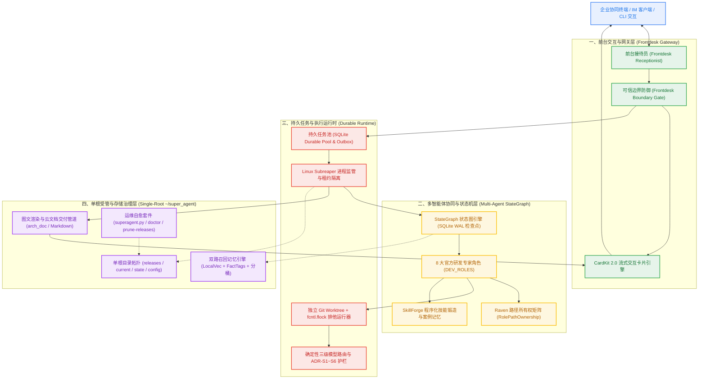

# Super Agent 用户与架构 Wiki (User & Architecture Wiki)

> 📚 **导航导航 / Wiki Navigation**
> [🏠 Wiki 首页 (Home)](Home.md) │ [🚀 01. 5分钟快速上手与单根部署](01-Quickstart-and-Install.md) │ [🧩 02. 业务知识挂载指南](02-Business-Overlay-Guide.md) │ [🤖 03. 前后台协同与 StateGraph](03-Multi-Agent-and-StateGraph.md) │ [📨 04. 交互卡片与交付机制](04-Feishu-Cards-and-Delivery.md) │ [🛠️ 05. 运维排障与 FAQ](05-Operations-and-Troubleshooting.md)

---

## 1. 欢迎来到 Super Agent Wiki

**Super Agent** 是一个专为生产环境设计的**通用常驻智能体本体（Always-on Production Agent Core）**。

在传统的智能体落地探索中，开发者往往遭遇大量“玩具级 Demo 能跑通，生产环境处处暴雷”的现实死穴：
- **进程虚假存活**：LLM 思考或工具调用耗时较长时，前台界面超时报错，后台任务被无端杀掉或成为孤儿僵尸进程；
- **状态不确定性**：依赖大模型做不可靠的上下文自由调度，状态机跳转脱窗、循环死锁、多次重试导致状态踩踏；
- **长期记忆污染**：黑盒 LLM 覆写记忆导致关键历史丢失，向量召回缺乏分桶与标签隔离，跨代任务记忆混杂；
- **交付排版劣化**：长篇 Markdown 和图表在即时消息平台被暴力截断、折叠或限流，关键产物无法送达用户；
- **业务耦合严重**：业务私有逻辑直接侵入智能体引擎，导致框架无法跨环境迁移与通用复用。

Super Agent 采用**中立引擎（Neutral Engine）**与**业务叠加层（Business Overlay）**彻底解耦的架构，通过确定性持久任务池（SQLite Durable Pool）、LangGraph 状态图引擎（StateGraph）、Raven 岗位路径所有权隔离（RolePathOwnership）、CardKit 2.0 流式卡片与单根受管部署（Single-Root Architecture），为企业级生产场景提供因果确定、安全高可用、开箱即用的常驻多智能体底座。

---

## 2. 系统全景架构导览

Super Agent 采用清晰的分层架构设计，各层间严格遵循单向依赖与状态栅栏约束：

---

## 3. Wiki 知识库章节索引

| 章节编号 | 文档主题 | 核心内容提要 |
| :--- | :--- | :--- |
| **01** | [🚀 5分钟快速上手与单根部署](01-Quickstart-and-Install.md) | 环境先决条件、单根受管拓扑（`~/super_agent/<profile>`）、`superagent.sh` 一键安装、版本原子升级与秒级回滚。 |
| **02** | [🧩 业务知识挂载指南](02-Business-Overlay-Guide.md) | 中性核心与业务解耦规范、`SOUL.generic.md` 身份注入、MCP 服务的规范挂载、外部 Skills 引入、9 角色业务团队与 `sync_roles.py` 配置深度合并。 |
| **03** | [🤖 前后台多智能体与 StateGraph](03-Multi-Agent-and-StateGraph.md) | 前台接待员与后台执行者职责边界、8 大官方研发岗位契约（`DEV_ROLES`）、Raven 路径所有权矩阵、LangGraph 纯 Python 状态图、EverOS 技能锻造器。 |
| **04** | [📨 交互卡片与交付机制](04-Feishu-Cards-and-Delivery.md) | CardKit 2.0 状态机生命周期、单在途去抖合并、`drain()` 屏障、实时动态进度流、Markdown 与 Chromium 图文/云文档高清交付规范。 |
| **05** | [🛠️ 运维排障与 FAQ](05-Operations-and-Troubleshooting.md) | 布局感知运维脚本（`_layout.sh`）、`doctor` 全局体检、脱敏长期记忆召回诊断（`inspect_recall_diagnostics.py`）、历史版本清理（`prune-releases`）与生产常见问题速查处置表。 |

---

## 4. 常用核心命令速查表

| 操作场景 | 推荐命令 | 说明 |
| :--- | :--- | :--- |
| **环境预检与单测** | `bash verify.sh` | 静态检查、全仓业务中立性门禁与核心单测（零外部依赖，约 30 秒） |
| **单根安装计划** | `./install/superagent.sh plan --profile <profile>` | 查看安装受管根目录的规划变更，不改动系统 |
| **执行正式安装** | `./install/superagent.sh install --profile <profile> --apply` | 部署新版本到 `releases/<version>` 并原子软链至 `current` |
| **全局健康体检** | `python3 tools/superagent.py doctor --profile <profile>` | 检查 systemd 服务状态、队列积压、插件链接与配置完整性 |
| **平滑版本升级** | `python3 tools/superagent.py update --profile <profile> --apply` | 构建新 release、无缝接管状态并重启关联服务 |
| **秒级紧急回滚** | `python3 tools/superagent.py rollback --profile <profile>` | 切换 `current` 软链接至上一个 release 并恢复稳定状态 |
| **历史版本清理** | `python3 tools/superagent.py prune-releases --profile <profile> --keep 3 --apply` | 保留最近 3 个历史 release，安全回收磁盘空间 |
| **记忆召回诊断** | `python3 tools/inspect_recall_diagnostics.py --profile <profile>` | 脱敏审计召回延迟、命中率与各分桶健康状况 |
| **架构文档渲染** | `python3 tools/arch_doc.py <doc.md> -o <out_dir>` | 生成内联 CSS 样式的自包含 HTML 与高清分页 PNG 预览 |

---

## 5. 延伸权威技术文档

若需深入理解特定子系统的底层源码与历史设计规范，可参考仓库中的权威活文档：

- [`docs/INDEX.md`](../INDEX.md)：全套技术文档权威导航索引（Master Index）
- [`docs/TECH_MANUAL.md`](../TECH_MANUAL.md)：Super Agent 系统技术手册（原理、边界、恢复语义与故障处置矩阵）
- [`docs/ARCHITECTURE.md`](../ARCHITECTURE.md)：v2.0 架构全景深潜与 ADR 决策记录
- [`docs/DEPLOY.md`](../DEPLOY.md)：生产部署与生命周期指南
- [`docs/PLUGINS.md`](../PLUGINS.md)：插件与工具面全景指南（16 款受管插件机制）
- [`docs/OPERATIONS.md`](../OPERATIONS.md)：布局感知运维与对账指南
- [`docs/guide/README.md`](../guide/README.md)：先进常驻 Agent 架构精读指南系列教程

---

> 💡 **小贴士**：开始使用请继续阅读：[01. 5分钟快速上手与单根部署](01-Quickstart-and-Install.md)
